API Gateway Integration serves as the critical connective tissue between your centralized API management platform \(APIwiz\) and the runtime platforms where your APIs actually execute. In a modern architectural landscape, an API gateway acts as the primary entry point for all client requests, responsible for routing traffic, enforcing security, and handling backend communication. However, manually configuring these gateways—especially when an organization utilizes multiple different gateway vendors across various environments—can be highly inefficient and error-prone.

API Gateway Integrations solve this challenge by establishing a seamless, automated bridge between the design/management workspace and the runtime gateway. These connectors enable the platform to automatically synchronize API configurations, deploy endpoints, and push policy updates directly to the gateway. By doing so, they eliminate the need for developers and operations teams to switch interfaces or manually duplicate configurations within individual, vendor-specific gateway consoles.

**The Role of API Gateway Integration in API Management**

API Gateway connectors are fundamentally vital for the "Run" phase of the API lifecycle, ensuring that APIs transition smoothly from development into secure, operational production environments. Their primary strategic roles include:

- **Centralized Traffic Management and Governance:** Connectors allow teams to manage diverse gateway tools from a single pane of glass. By centralizing the management of API traffic, organizations can significantly improve their overarching governance, ensuring that all APIs adhere to corporate standards regardless of which underlying gateway they are deployed on.
- **Robust Security Policy Enforcement:** Security cannot be an afterthought at runtime. These integrations support the strict enforcement of critical security policies directly at the gateway level. This includes pushing configurations for authentication, authorization, and rate limiting to ensure that backend services are protected from malicious traffic, abuse, or sudden traffic spikes.
- **Simplified Deployment and Lifecycle Agility:** Moving an API from a staging environment to a production gateway requires precision. Gateway integrations simplify the deployment and continuous updating of APIs across different gateway environments, reducing manual effort and accelerating time-to-market for new features.
- **Deep Observability and Analytics:** A successful API strategy requires continuous monitoring. These connectors provide deep visibility into API usage and performance by enabling the platform to pull monitoring and analytics data directly from the gateway's traffic logs. This ensures teams can track real-time performance and quickly troubleshoot operational issues.

\*\*Supported API Gateway Connectors in APIwiz \*\* To ensure maximum flexibility and avoid vendor lock-in, the APIwiz platform supports integration with 8 of the industry's leading API gateway providers. Here is a summary of each supported connector:

- [Apigee](#apigee)**:** Integrates with Google’s API gateway to securely configure and control APIs, monitor traffic, and streamline lifecycle management directly from the workspace.
- [ApigeeX](#apigeex)**:** Connects to Google Cloud’s advanced API management platform, allowing you to import and manage API configurations securely using Service Account keys and KVM proxies.
- [Kong](#kong)**:** Enables you to configure, manage, and monitor APIs through Kong’s lightweight, high-performance gateway, simplifying the setup of services, routes, and plugins.
- [Azure](#azure)**:** Integrates with Azure API Management \(APIM\) to provide centralized API publishing, monitoring, and security through Microsoft’s cloud platform.
- [NGINX](#nginx)**:** Facilitates the configuration and management of APIs through NGINX’s high-performance reverse proxy by syncing runtime configurations directly from your source control system.
- [Axway](#axway)**:** Integrates with Axway API Gateway to securely configure runtime environments, manage services, and authenticate connections across various deployment environments.
- [AWS](#aws)**:** Connects to AWS API Gateway, enabling you to seamlessly create, manage, secure, and deploy APIs at scale on the Amazon Web Services cloud.
- [KrakenD](#krakend)**:** Integrates with the open-source KrakenD API Gateway to enable centralized configuration, aggregation, transformation, and optimization of API traffic via GitOps.

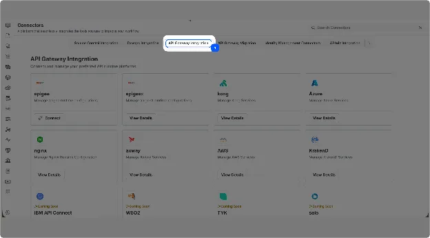

## **Apigee**

Apigee is a leading, enterprise-grade API management platform developed by Google Cloud that allows organizations to securely design, deploy, scale, and monitor their APIs. Within the APIwiz platform, the Apigee connector facilitates seamless integration with both SaaS and On-Premises Apigee environments. This connection enables teams to securely manage API runtime configurations, control API traffic, and streamline lifecycle management directly from a centralized workspace, eliminating the need to constantly switch between different gateway consoles.

### **Prerequisites**

Before configuring the Apigee connector in the APIwiz workspace, you must ensure your Google Cloud/Apigee environment is prepared and that you have gathered the necessary administrative credentials. Apigee website keeps undergoing updates often. Along with the steps below, you can refer to [this](https://cloud.google.com/apigee/docs) documentation.

**Step 1: Ensure an Active Apigee Organization**

1. **Access Google Cloud / Apigee:** Navigate to the [Apigee interface](https://cloud.google.com/apigee) and log in.
1. **Verify Organization:** Ensure that your Apigee organization is fully provisioned, actively running, and that you have administrative access to it.

**Step 2: Determine your Setup Type**

1. Identify whether your organization is using an **On-Premises** \(Apigee Private Cloud\) deployment or a **SaaS** \(Cloud-hosted\) deployment. This distinction is critical as it dictates the configuration fields required later.

**Step 3: Gather Host Details \(Required for On-Premises Only\)**

1. **Identify the Management Server:** If you are connecting to an On-Premises setup, you must locate the specific address of your Apigee Management Server.
1. **Document the Scheme, Host, and Port:** Note down the communication protocol \(e.g., http or https\), the exact Host Name \(e.g., apigee.company.com\), and the Port number \(e.g., 443 or 8080\).

**Step 4: Prepare Standard Authentication Credentials**

1. **Create or Identify an Admin User:** You will need an account with administrative privileges to manage API proxies and deployments.
1. **Document Credentials:** Securely note down the **Username** \(e.g., apigee-admin\) and the **Password** associated with this account. **Step 5: Generate OAuth Tokens \(Required only if using OAuth\)** - If your organization mandates OAuth instead of Basic Authentication, you must gather specific token details:
1. **Basic Token:** Obtain the Base64-encoded client credentials for your Apigee environment \(e.g., dXNlcjpwYXNzMTIz\).
1. **Grant Token:** Obtain the token used to request an access token \(e.g., ya29.a0AfH6SMCfExampleGrantToken\).
1. **Token URL:** Identify the OAuth token endpoint URL \(e.g., [https://login.apigee.com/oauth/token](https://login.apigee.com/oauth/token)\).

**Connecting Apigee in the APIwiz Workspace**

Once you have gathered your Setup Type, Host Details, and Authentication Credentials, follow these detailed steps to establish the connection:

**Step 1: Locate the Apigee Connector**

1. Log in to your APIwiz workspace dashboard.
1. Navigate to the **Connectors** module from the main menu.
1. Select the **API Gateway Integration** category from the top navigation tabs.
1. Locate the **Apigee** Connector card within this category.

**Step 2: Initiate the Connection**

1. Click the **Connect** button directly on the Apigee connector card.
1. A configuration panel will immediately slide open on the right-hand side of your screen.
1. Click on the **\+ New Collection** button inside this panel to start a new configuration.

**Step 3: Select Setup Type and Configure Connection Details**

At the top of the configuration window, select your **Setup Type** by clicking either the **onprem** or **saas** radio button.

- **Option A: On-Prem Configuration** If you selected *onprem*, fill out the following fields:
  1. **Name:** Enter a unique identifier for the connector \(e.g., *apigee-onprem-01*\).
  1. **Username:** Enter your Apigee account username.
  1. **Password:** Enter your Apigee account password.
  1. **Authentication Type:** Select either **Basic** or **OAuth**.
  1. **Scheme:** Enter the protocol used \(e.g., *https*\).
  1. **Host Name:** Enter the Apigee server hostname \(e.g., *apigee.company.com*\).
  1. **Port:** Enter the port number for the connection \(e.g., *443*\).
    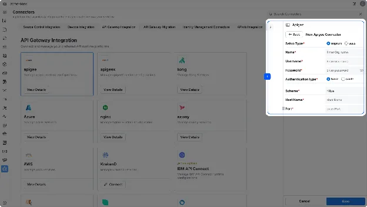
- **Option B: SaaS Configuration** If you selected *saas*, fill out the following fields:
  1. **Name:** Enter a unique identifier for the connector \(e.g., *apigee-saas-01*\).
  1. **Username:** Enter your Apigee account username.
  1. **Password:** Enter your Apigee account password.
  1. **Authentication Type:** Select either **Basic** or **OAuth**.

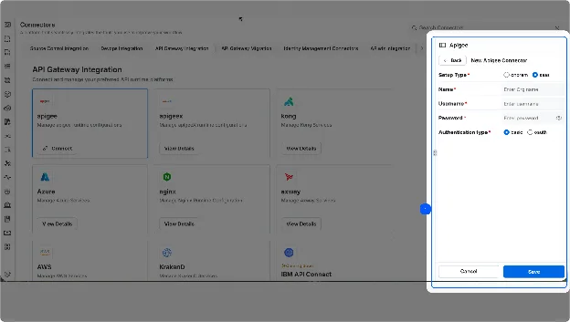

**Step 4: Configure OAuth \(If Selected\)** - If you selected **OAuth** as your Authentication Type in Step 3 \(for either Setup Type\), additional fields will appear. You must provide:

1. **Basic Token:** Paste your Base64-encoded client credentials.
1. **Grant Token:** Paste the token used to request your access token.
1. **URL:** Enter the OAuth token endpoint URL.

**Step 5: Save the Configuration and Verify**

1. After accurately entering all details, click the **Save** button located at the bottom of the panel.
1. Look for a **success message** at the bottom of the screen indicating that the connection to Apigee has been successfully established.
1. Observe the Apigee Connector card on your dashboard; the button will have automatically changed from "Connect" to **"View Details"**.

**Step 6: Manage the Connector**

1. Whenever you need to manage this integration in the future, click the **View Details** button.
1. A window will open displaying your current configuration.
1. From this window, you can use the **Edit** function to update your credentials or use the **Delete** function to completely remove the connection if it is no longer required.

## **ApigeeX**

ApigeeX is Google Cloud’s advanced, cloud-native API management platform designed to help enterprises securely build, manage, scale, and analyze their APIs. Within the APIwiz platform, the ApigeeX connector enables teams to seamlessly import and manage API runtime configurations directly from the centralized workspace. It establishes a robust connection to your Google Cloud environment by utilizing secure Service Account JSON keys and Key-Value Map \(KVM\) proxies. This ensures enterprise-grade security and streamlined lifecycle management without the need to constantly switch between external gateway consoles.

### **Prerequisites: Preparing to Connect ApigeeX**

Before configuring the ApigeeX connector in the APIwiz workspace, you must ensure your Google Cloud environment is prepared, a service account is created, and specific proxy details are configured and gathered.

**Step 1: Ensure an Active Google Cloud / ApigeeX Organization**

1. **Navigate to Google Cloud Console:** Log in to your [Google Cloud](https://cloud.google.com/apigee) environment using your administrative credentials.
1. **Verify ApigeeX Provisioning:** Ensure that your ApigeeX organization is actively provisioned, running, and that you have administrative access to manage it.
1. **Document Organization Name:** Note down your exact ApigeeX Organization Name \(e.g., *my-apigeex-org*\), as you will need this for the connector.

**Step 2: Generate a Service Account Key \(JSON\)**

APIwiz requires a Service Account Key to securely authenticate with your Google Cloud project.

1. **Navigate to IAM & Admin:** In the Google Cloud Console, search for and navigate to "Service Accounts" under the IAM & Admin section.
1. **Create a Service Account:** Click "Create Service Account", name it \(e.g., *apiwiz-apigeex-integration*\), and grant it the necessary Apigee Administrator or Developer roles.
1. **Generate Key:** Click on the newly created service account, navigate to the "Keys" tab, and click "Add Key" -\> "Create new key".
1. **Download JSON:** Select **JSON** as the key type and click "Create". The file will automatically download to your machine. Keep this file secure, as you will upload it into APIwiz.

You can refer to [this](https://cloud.google.com/iam/docs/creating-managing-service-account-keys) documentation for updated content to create and manage service account keys.

**Step 3: Configure a Key-Value Map \(KVM\) Proxy** - You must have a Key-Value Map \(KVM\) proxy configured within your ApigeeX environment to handle secure data retrieval for the integration.

1. **Navigate to Apigee Environments:** In the Apigee console, navigate to your target environment.
1. **Create KVM:** Navigate to the [Key-Value Maps](https://cloud.google.com/apigee/docs/api-platform/cache/key-value-maps) section and create an environment-scoped KVM.

**Step 4: Gather KVM Proxy Details and Environment Name**

To complete the APIwiz configuration, you must document the exact details of the KVM proxy and environment you just configured.

1. **Environment Name:** Note the exact name of the ApigeeX environment where your APIs will be deployed or managed \(e.g., *prod-environment*\).
1. **KVM Proxy Name:** Document the name you assigned to your KVM proxy \(e.g., *kvm-proxy*\).
1. **KVM Proxy Endpoint:** Locate the specific endpoint URL for the KVM proxy \(e.g., [https://apigeex-host/v1/kvm-proxy](https://apigeex-host/v1/kvm-proxy)\).
1. **KVM Proxy Key:** Note the specific key used to access the KVM proxy data \(e.g., *proxy-key-123*\).

### **Connecting ApigeeX in the APIwiz Workspace**

Once you have downloaded your JSON file and gathered your KVM details, follow these detailed steps to establish the connection:

**Step 1: Locate the ApigeeX Connector**

1. Log in to your APIwiz workspace dashboard.
1. Navigate to the **Connectors** module from the main menu.
1. Select the **API Gateway Integration** category from the top navigation tabs.
1. Locate the **ApigeeX** Connector card.

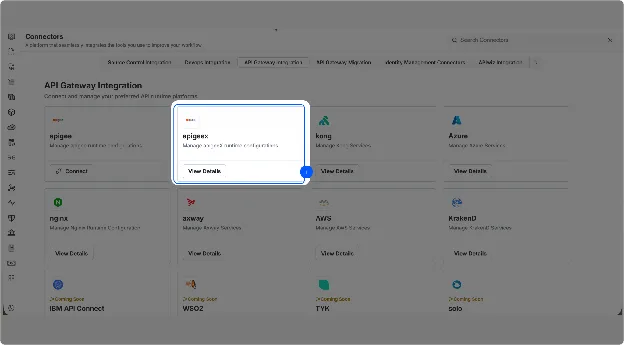

**Step 2: Initiate the Connection**

1. Click the **Connect** button directly on the ApigeeX connector card.
1. A configuration panel will immediately slide open on the right-hand side of your screen.
1. Click on the **\+ New Collection** button to start a new configuration.

**Step 3: Upload Credentials \(Initial Setup\)**

In the first screen of the side panel, provide the initial organization details:

1. **Org Name:** Enter the exact ApigeeX organization name where the APIs are managed \(e.g., *my-apigeex-org*\).
1. **File \(Upload JSON File\):** Click the upload button and select the Service Account JSON key file you downloaded during the prerequisite phase.

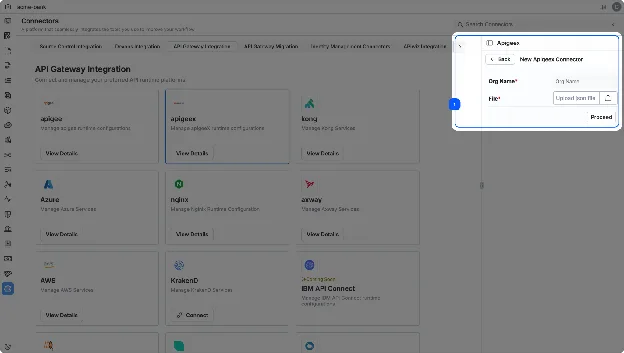

**Step 4: Proceed to Environment Setup**

1. Once the organization name is entered and the JSON file is successfully uploaded, click the **Proceed** button to move to the next step.

**Step 5: Configure Environment and KVM Details**

Fill in the specific environment and proxy details using the information gathered in Step 4 of the prerequisites:

1. **Environment Name:** Enter the ApigeeX environment where the APIs will be managed \(e.g., *prod-environment*\).
1. **KVM Proxy:** Enter the exact name of the KVM proxy configured in ApigeeX.
1. **KVM Proxy Endpoint:** Enter the endpoint URL for the KVM proxy.
1. **KVM Proxy Key:** Enter the key used to securely access the KVM proxy data.

**Step 6: Save Configuration and Verify**

1. After accurately filling in these details, click the **Save** button located at the bottom of the panel to complete the setup.
1. Look for a **success message** at the bottom of the screen indicating that the connection to ApigeeX has been successfully established.
1. Observe the ApigeeX Connector card on your dashboard; the button will have automatically changed from "Connect" to **"View Details"**.

**Step 7: Manage the Connector**

1. Whenever you need to manage this integration in the future, click the **View Details** button.
1. A window will open displaying your current configuration.
1. From this window, you can easily use the **Edit** function to update your details \(e.g., if you need to upload a newly rotated JSON key\) or use the **Delete** function to completely remove the connection if it is no longer required.

## **Kong**

Kong is a widely adopted, open-source API gateway and microservices management layer known for its high performance, scalability, and extensibility through plugins. Within the APIwiz platform, the Kong connector enables you to configure, manage, and monitor APIs seamlessly through this lightweight gateway. It simplifies the complex setup of backend services, routing logic, and security plugins. By bridging your workspace directly to Kong, it ensures secure API traffic handling and centralizes your API lifecycle management without requiring you to switch between different operational consoles.

### **Prerequisites**

Before configuring the Kong connector in the APIwiz workspace, you must ensure your Kong Gateway environment is prepared and that you have gathered the necessary host details and administrative credentials.

**Step 1: Ensure an Active Kong Gateway Instance**

1. **Navigate to the official Kong website -** Determine if you are using Kong Gateway \(On-Premise/Open Source\) or Kong Konnect \(SaaS\). You can click [here](https://konghq.com) for the website.
1. **Deploy the Gateway -** If hosting your own instance, follow the installation guides to deploy Kong via Docker, Kubernetes, or native packages on your preferred infrastructure.
1. **Verify Status -** Ensure the Kong service is actively running and successfully routing traffic.

**Step 2: Locate your Admin Host URL**

The APIwiz platform interacts with Kong through its Admin API, not the proxy port. You must locate the specific Admin API endpoint.

1. **Identify the Host/IP:** Find the public IP address or hostname of the server hosting your Kong instance.
1. **Identify the Admin Port:** By default, Kong's Admin API listens on port 8001 \(HTTP\) or 8444 \(HTTPS\).
1. **Document the URL:** Combine the scheme, host, and port to create your Admin Host URL \(e.g., [https://kong-admin.mycompany.com:8444](https://kong-admin.mycompany.com:8444)\). You can refer to [this](https://docs.konghq.com/gateway/latest/admin-api/) documentation for updated content on the steps.

**Step 3: Prepare Authentication Credentials \(Admin Token\)**

If your Kong Admin API is secured \(which is highly recommended for production\), you must gather the authentication token.

1. **For Kong Enterprise:** Log in to your Kong Manager. Navigate to the "Admins" or "RBAC" section. Generate an RBAC token for a dedicated APIwiz service account with administrative privileges.
1. **For Kong Konnect \(SaaS\):** Navigate to "Personal Access Tokens" in your Konnect profile and generate a new token specifically for the APIwiz integration.
1. **Document the Token:** Securely note down this **Kong Admin Token**, as you will need to input it into the APIwiz workspace.

**Step 4: Network Access Configuration**

1. **Obtain APIwiz IPs.** Contact your APIwiz platform administrator to get the specific IP addresses used by your workspace.
1. **Whitelist the IPs.** Update your server's local firewall \(or cloud security groups if hosted on AWS/GCP/Azure\) to allow inbound TCP traffic to your Admin port \(e.g., 8444\) exclusively from the APIwiz IP addresses.

### **Connecting Kong in the APIwiz Workspace**

Once you have gathered your Admin Host URL and Kong Admin Token, follow these detailed steps to establish the connection:

**Step 1: Locate the Kong Connector**

1. Log in to your APIwiz workspace dashboard.
1. Navigate to the **Connectors** module from the main menu on the left.
1. Select the **API Gateway Integration** category from the top navigation tabs.
1. Locate the **Kong** Connector card within this category.

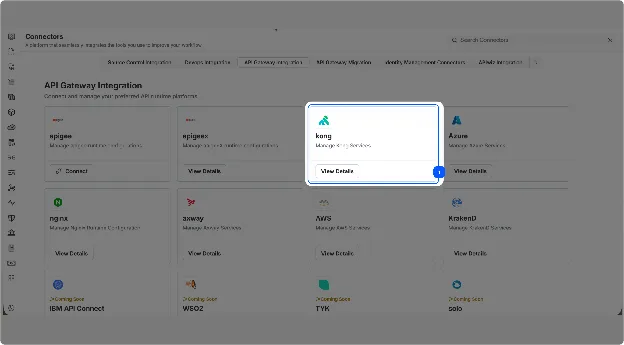

**Step 2: Initiate the Connection**

1. Click the **Connect** button directly on the Kong connector card.
1. A configuration panel will immediately slide open on the right-hand side of your screen.

**Step 3: Create a New Collection**

1. Inside the right-hand panel, click on the **\+ New Collection** button to begin defining your Kong runtime connection.

**Step 4: Configure Runtime Details**

Ensure the **Runtimes** tab is selected at the top of the panel, then fill in the following fields using your prerequisite information:

1. **Type:** Click the radio button to select your deployment type: choose **onprem** if you are hosting Kong yourself, or **saas** if you are using Kong Konnect.
1. **Admin Host:** Enter the exact Kong Admin API host URL you prepared in Step 2 of the prerequisites \(e.g., [https://kong-admin.mycompany.com:8444](https://kong-admin.mycompany.com:8444)\).
1. **Kong Admin Token:** Enter the secure authentication token required to access Kong’s Admin API that you generated in Step 3 of the prerequisites.
1. **Runtime Name:** Enter a unique identifier for this specific runtime environment so you can easily identify it later \(e.g., *kong-runtime-prod*\).
1. **Read Only \(Checkbox\):** Check this box if you want to restrict this specific runtime connection to read-only mode, preventing the platform from making configuration changes to your gateway.
  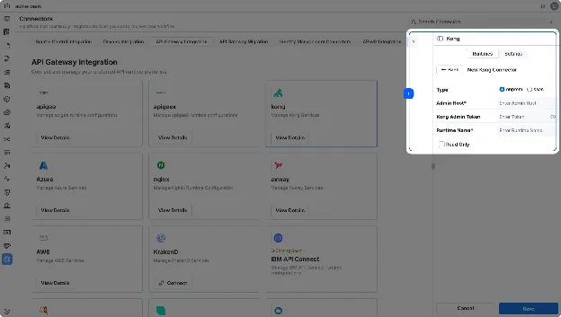

**Step 5: Save Configuration and Verify**

1. After accurately filling in all the required details, click the **Save** button located at the bottom of the panel.
1. Look for a **success message** at the bottom of the screen indicating that the connection has been successfully established.
1. Observe the Kong Connector card on your dashboard; the button will have automatically changed from "Connect" to **"View Details"**.

**Step 6: Manage the Connector**

1. Whenever you need to manage this integration in the future, click the **View Details** button.
1. A window will open displaying your current connection details.
1. **Settings Tab:** You can switch over to the **Settings** tab within this window to view a list of all existing runtime names for quick reference.
  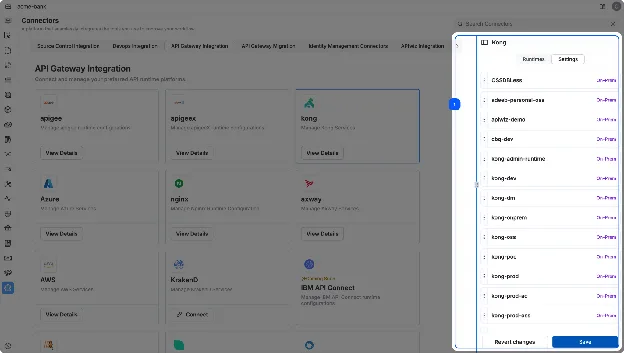
1. From this window, you can seamlessly use the **Edit** function to update your details, use the **Revert Changes** button to undo any unsaved modifications, or use the **Delete** function to completely remove the connection if it is no longer required.

## **Azure**

This connector integrates with Azure API Management \(APIM\), enabling centralized API publishing, monitoring, and security through Microsoft’s cloud platform. It allows seamless management of APIs across environments with secure authentication.

### **Prerequisites: Configuring Azure**

To access this connector in APIwiz, you must have an active Azure account and an API Management service instance running. You may also need to register an application in Azure Active Directory if you plan to use Azure Functions.

**Step 1: Access Azure Portal** - Ensure you have administrative access to your Azure portal and the specific resource group containing your API Management service.

- Website: [https://portal.azure.com](https://portal.azure.com/)
- Documentation: [Create a new Azure API Management service instance](https://learn.microsoft.com/en-us/azure/api-management/get-started-create-service-instance)

**Step 2: Gather Credentials** - You will need specific details from your Azure instance.

- APIM Details: Locate your Management Host, Gateway Host, and generate a Shared Access Token for authentication.
  - Reference: [Azure API Management REST API Authentication](https://learn.microsoft.com/en-us/rest/api/apimanagement/apimanagementrest/azure-api-management-rest-api-authentication)
- Azure Functions \(Optional\): If integrating with Functions, you need an App Registration to obtain a Client ID and Secret.
  - Reference: [Register an application with the Microsoft identity platform](https://learn.microsoft.com/en-us/entra/identity-platform/quickstart-register-app)

### **Connecting to Azure in the APIwiz Workspace**

Follow the steps below to configure the connector.

**Step 1: Locate the Connector** - Navigate to the Connectors module and select the API Gateway Integration category. Locate the Azure Connector card.

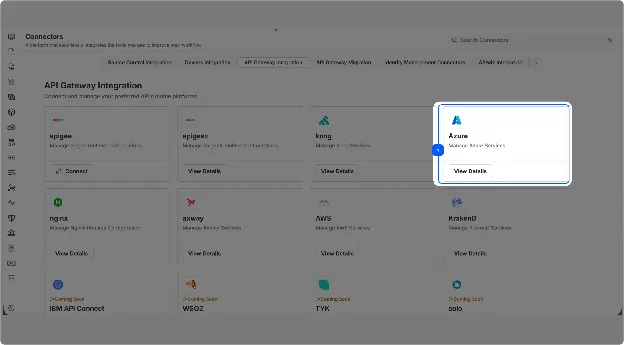

**Step 2: Initiate Connection** - Press the Connect button on the connector card. A configuration panel will appear on the right-hand side. Click on the \+New Connection button.

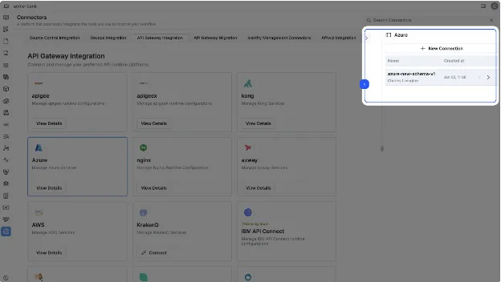

**Step 3: Configure Basic Details** - In the window that opens, provide the initial settings:

- Connector Name: Enter a unique name for the connector \(e.g., azure-apim-connector-prod\).
- Teams: \(Optional\): Select specific teams from the dropdown to restrict access to this connector. If left blank, it will be accessible to all users.

**Step 4: Configure Azure Gateway Credentials** - Enable the Azure Gateway Credentials toggle to configure the APIM connection. Fill in the following fields:

- **Management Host**: The endpoint for the APIM management API \(e.g., [https://management.azure.com](https://management.azure.com)\).
- **Gateway Host**: The endpoint for your specific API Gateway \(e.g., [https://api.mycompany.azure-api.net](https://api.mycompany.azure-api.net)\).
- **Subscription ID**: The Azure subscription ID associated with the APIM instance \(e.g., 12345678-abcd-90ef-1234-567890abcdef\).
- **Resource Group**: The name of the Azure resource group containing the service \(e.g., rg-apim-prod\).
- **Service Name**: The name of the API Management service instance \(e.g., apim-mycompany-prod\).
- **Shared Access Token**: The token used for secure authentication with the management API \(e.g., shared-token-abc123\!\).

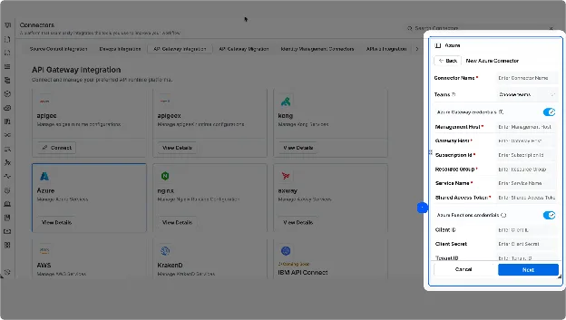

**Step 5: Configure Azure Functions Credentials \(Optional\)** - If you wish to connect to Azure Functions alongside APIM, enable the Azure Functions Credentials toggle and provide the following:

- Client ID: The Application \(client\) ID registered in Azure Active Directory \(e.g., client-app-12345\).
- Client Secret: The secret key generated for the client application \(e.g., AzureSecret@2025\!\).
- Tenant ID: The Directory \(tenant\) ID of your Azure Active Directory \(e.g., abcd1234-5678-90ef-aaaa-1234567890ab\).
- Subscription ID: The Azure subscription ID linked to your Azure Functions \(e.g., 98765432-aaaa-bbbb-cccc-abcdef123456\).

**Step 6: Save Configuration** - Once the required toggles are set and fields are filled, click the Next or Save button at the bottom of the panel. You will receive a success message at the bottom of the screen indicating the connection has been established.

**Step 7: Verify Connection** - Once the connection is successful, the button on the Connector Card will change from "Connect" to "View Details".

**Step 8: Manage Connector** - If you click on View Details, a window will open displaying the current configuration of the connector. You can use this window to edit the connector details or Delete the connection if necessary.

## **NGINX**

This connector integrates with the NGINX API Gateway, enabling the configuration and management of APIs through NGINX’s high-performance reverse proxy and load balancer. It provides flexibility for setting up API routing, scaling, and security across environments by syncing configurations directly from your source control system.

### **Prerequisites: Configuring NGINX**

To use this connector, you must have an active nginx deployment and a Source Control Management \(SCM\) repository where your NGINX configuration files are stored.

**Step 1: Prepare NGINX Host** - Ensure your NGINX instance is running and accessible via a host URL.

- Documentation: [NGINX Documentation](https://nginx.org/en/docs/)

**Step 2: Prepare Source Control Credentials** - Since this connector syncs configurations from a repository, you will need the Git URL and a Personal Access Token \(PAT\) \(or equivalent credential\) for the repository hosting your NGINX config files. The supported SCM types are GitHub, GitLab, Bitbucket, AWS CodeCommit, and Azure DevOps.

- GitHub Token Guide: [Managing your personal access tokens](https://docs.github.com/en/authentication/keeping-your-account-and-data-secure/managing-your-personal-access-tokens)
- GitLab Token Guide: [Personal access tokens](https://docs.gitlab.com/ee/user/profile/personal_access_tokens.html)
- Bitbucket App Password: [Create an App Password](https://support.atlassian.com/bitbucket-cloud/docs/create-an-app-password/)

### **Connecting to NGINX in the APIwiz Workspace**

Follow the steps below to configure the connector.

**Step 1: Locate the Connector** - Navigate to the Connectors module and select the API Gateway Integration category. Locate the NGINX Connector card.

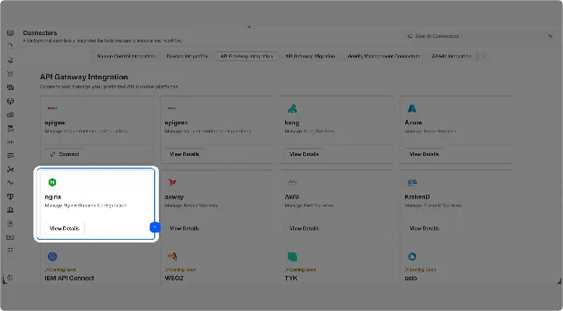

**Step 2: Initiate Connection** - Press the Connect button on the connector card. A configuration panel will appear on the right-hand side. Click on the \+New Collection button to start a new configuration.

**Step 3: Configure Runtime and SCM Details** - In the window that opens, fill in the following fields to link your NGINX instance with your configuration repository:

- Runtime: Enter a unique name to identify this NGINX runtime \(e.g., nginx-runtime-prod\).
- Host: Enter the host URL where your NGINX gateway is deployed \(e.g., [https://nginx-api.mycompany.com](https://nginx-api.mycompany.com)\).
- SCM Type: Select your source control system from the dropdown menu \(Options: GitHub, GitLab, Bitbucket, AWS CodeCommit, or Azure DevOps\).
- Repository Name: Enter the name of the repository storing your NGINX configurations \(e.g., nginx-config-repo\).
- Default Config Branch: Specify the branch to be used for configuration updates \(e.g., main\).
- SCM Url: Enter the full Git repository URL \(e.g., [https://github.com/myorg/nginx-config-repo.git](https://github.com/myorg/nginx-config-repo.git)\).
- SCM Token: Enter the authentication token \(PAT\) required to access the repository \(e.g., ghp\_ABC123TOKEN456\).
- SCM Folder: Specify the folder path within the repository where the configuration files are stored \(e.g., /configs/nginx\).
- NGINX Path: Enter the file path on the server where the NGINX configurations should be applied \(e.g., /etc/nginx/conf.d/\).

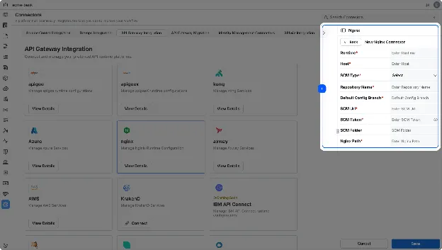

**Step 4: Save Configuration** - After entering the details, click on the Save button at the bottom of the panel. You will receive a success message at the bottom of the screen indicating the connection has been established.

**Step 5: Verify Connection** - Once the connection is successful, the button on the Connector Card will change from "Connect" to "View Details".

**Step 6: Manage Connector** - If you click on View Details, a window will open displaying the current configuration of the connector. You can use this window to edit the connector details or Delete the connection if necessary.

## **Axway**

This connector integrates with Axway API Gateway, enabling configuration and management of APIs through Axway’s secure and scalable API management platform. It allows users to configure runtime environments, manage services, and authenticate connections across various deployment environments directly from the workspace.

### **Prerequisites: Configuring Axway**

To access this connector in APIwiz, you must have an active Axway API Gateway instance running and accessible. You will need the Host URL and valid Administrative Credentials \(Username and Password\) to authenticate the connection.

- Website: [https://www.axway.com/](https://www.axway.com/)
- Documentation: [Axway Documentation](https://docs.axway.com/)

### **Connecting to Axway in the APIwiz Workspace**

Follow the steps below to configure the connector.

**Step 1: Locate the Connector** - Navigate to the Connectors module and select the API Gateway Integration category. Locate the Axway Connector card.

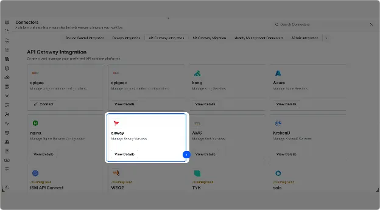

**Step 2: Initiate Connection** - Press the Connect button on the connector card. A configuration panel will appear on the right-hand side.

**Step 3: Add New Connection** - Click on the \+ New Connection button in the side panel.

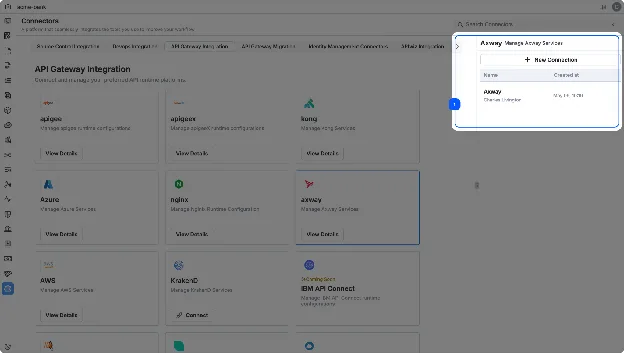

**Step 4: Configure Connection Details** - In the fields provided, enter the following details to establish the connection:

- Connector Name: Enter a unique name for the Axway connector \(e.g., axway-prod-connector\).
- Host: Enter the Axway host URL where the services are deployed \(e.g., [https://axway-api.mycompany.com](https://axway-api.mycompany.com)\).
- Username: Enter your Axway username for authentication \(e.g., [api.admin@mycompany.com](mailto:api.admin@mycompany.com)\).
- Password: Enter the corresponding password for the username.

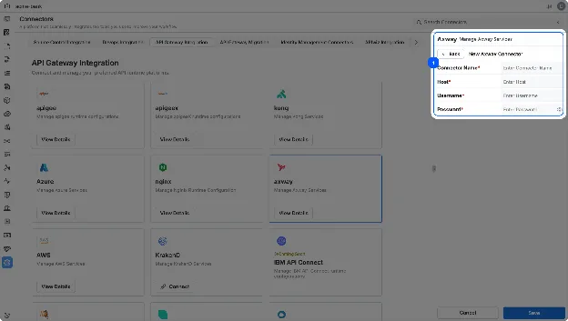

**Step 5: Save Configuration** - After entering all the required details, click the Save button at the bottom of the panel. You will receive a success message at the bottom of the screen indicating the connection has been established.

**Step 6: Verify Connection** - Once the connection is successful, the button on the Connector Card will change from "Connect" to "View Details".

**Step 7: Manage Connector** - If you click on View Details, a window will open displaying the current configuration of the connector. You can use this window to edit the connector details or Delete the connection if necessary.

## **AWS**

This connector integrates with AWS API Gateway, enabling you to create, manage, and secure APIs on the AWS cloud. It provides seamless connectivity to deploy APIs at scale with full lifecycle support directly from the workspace.

### **Prerequisites: Configuring AWS**

To access this connector in APIwiz, you must have an active AWS account and the appropriate Identity and Access Management \(IAM\) permissions to manage API Gateway resources. You will need to either generate Access Keys or configure an IAM Role.

**Step 1: Access AWS Console** - Ensure you have administrative access to your AWS environment.

- Website: [https://aws.amazon.com/console/](https://aws.amazon.com/console/)
- Documentation: [What is Amazon API Gateway?](https://docs.aws.amazon.com/apigateway/latest/developerguide/welcome.html)

**Step 2: Prepare Credentials** - You must choose one of two authentication methods:

- Access Key & Secret Key: Suitable for direct user authentication. You will need to generate these in the IAM console.
  - Guide: [Managing access keys for IAM users](https://docs.aws.amazon.com/IAM/latest/UserGuide/id_credentials_access-keys.html)
- IAM Role: Suitable for cross-account access or temporary credential management. You will need to create a role with a specific trust relationship.
  - Guide: [Creating a role to delegate permissions to an IAM user](https://docs.aws.amazon.com/IAM/latest/UserGuide/id_roles_create_for-user.html)

### **Connecting to AWS in the APIwiz Workspace**

Follow the steps below to configure the connector.

**Step 1: Locate the Connector** - Navigate to the Connectors module and select the API Gateway Integration category. Locate the AWS Connector card.

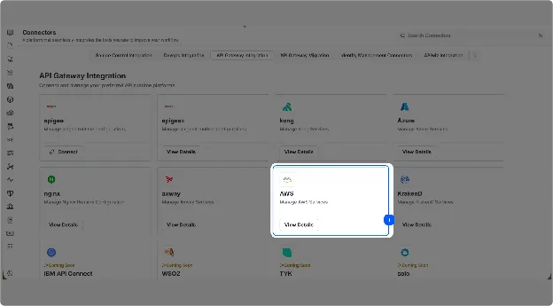

**Step 2: Initiate Connection** - Press the Connect button on the connector card. A configuration panel will appear on the right-hand side.

**Step 3: Select Authentication Type** - In the configuration window, you must choose between Access Key or IAM authentication.

Option A: Access Key Configuration - If you select Access Key, provide the following details:

- Connector Name: Enter a unique name for the connector \(e.g., aws-apigw-accesskey-prod\).
- Access Key: Enter the AWS IAM access key ID \(e.g., AKIAYOURACCESSKEYID\).
- Secret Key: Enter the AWS IAM secret access key linked to the access key \(e.g., wJalrXUtnFEMI...\).
- Region: Enter the AWS region where the API Gateway is deployed \(e.g., us-east-1\).
- CloudWatch Log ARN: Enter the ARN of the CloudWatch log group used for API Gateway monitoring \(e.g., arn:aws:logs:us-east-1:123456789012:log-group:/aws/apigateway/my-api-log\).
- Teams: \(Optional\) Select specific teams to restrict access to this connector.

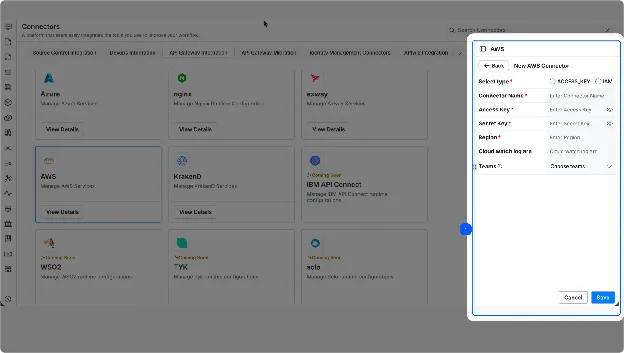

Option B: IAM Configuration - If you select IAM, follow the guided setup provided in the window:

- Step 1 – Create Role:
  - Go to IAM \> Create Role in the AWS Console.
  - Select AWS Account as the Trusted Entity Type.
  - Paste the Account ID and External ID provided in the APIwiz setup window into the AWS configuration.
- Step 2 – Attach Policy:
  - Add a new inline policy in AWS using the JSON snippet provided in the APIwiz setup window.
  - This policy grants the necessary permissions for API Gateway management.

**Step 4: Save Configuration** - After completing the chosen authentication method, click the Save button at the bottom of the panel to finalize the setup. You will receive a success message at the bottom of the screen indicating the connection has been established.

**Step 5: Verify Connection** - Once the connection is successful, the button on the Connector Card will change from "Connect" to "View Details".

**Step 6: Manage Connector** - If you click on View Details, a window will open displaying the current configuration of the connector. You can use this window to edit the connector details or Delete the connection if necessary.

>

## **KrakenD**

This connector integrates with KrakenD API Gateway, an open-source, high-performance API Gateway designed for the aggregation, transformation, and optimization of API traffic. It enables centralized configuration and secure management of API endpoints directly from the platform.

### **Prerequisites: Configuring KrakenD**

To access this connector in APIwiz, you must have an active KrakenD runtime and a Source Control Management \(SCM\) repository where your KrakenD configuration files are stored.

**Step 1: Prepare KrakenD** - Ensure your KrakenD instance is running and you have access to the repository hosting its configuration.

- Website: [https://www.krakend.io/](https://www.krakend.io/)
- Documentation: [KrakenD Documentation](https://www.krakend.io/docs/)

**Step 2: Prepare Source Control Credentials** - Since KrakenD configurations are often managed via GitOps, you will need credentials \(such as a Token or Password\) for the SCM provider hosting your configuration files. Supported providers include GitHub, GitLab, Bitbucket, Azure, and AWS.

### **Connecting to KrakenD in the APIwiz Workspace**

Follow the steps below to configure the connector.

**Step 1: Locate the Connector** - Navigate to the Connectors module and select the API Gateway Integration category. Locate the KrakenD Connector card.

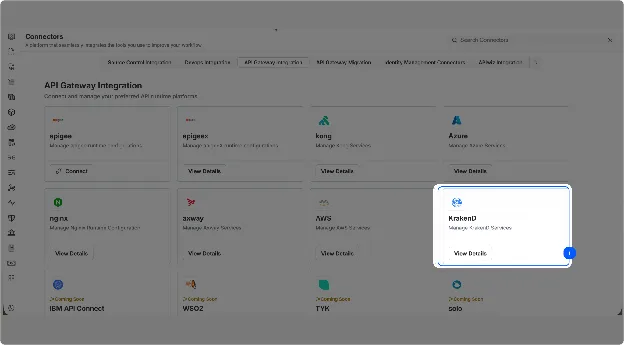

**Step 2: Initiate Connection** - Press the Connect button on the connector card. A configuration panel will appear on the right-hand side.

**Step 3: Add New Connection** - Click on the \+ button in the right-hand side window to start a new configuration.

**Step 4: Configure Runtime Details** - Fill in the following details to link your KrakenD runtime with the source control repository:

- Runtime: Enter a unique identifier for the KrakenD runtime \(e.g., krakend-runtime-prod\).
- Source: Select the source control system where your configuration is stored from the options: GitHub, GitLab, Bitbucket, Azure, or AWS.
- Host: Enter the URL of your source control or KrakenD host \(e.g., [https://github.com](https://github.com) or [https://krakend.mycompany.com](https://krakend.mycompany.com)\).
- Repository Name: Enter the name of the repository containing the KrakenD configuration files \(e.g., krakend-config-repo\).
- Branch: Specify the default branch used for configuration updates \(e.g., main\).
- Type: Select the authentication type for accessing the repository: Token or Password.
- File Path: Enter the path to the KrakenD configuration file within the repository \(e.g., /configs/krakend.json\).

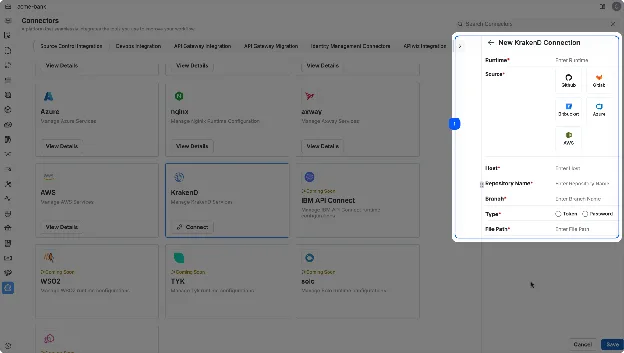

**Step 5: Save Configuration** - Once all fields are completed, click the Save button at the bottom of the panel to establish the connection. You will receive a success message at the bottom of the screen.

**Step 6: Verify Connection** - Once the connection is successful, the button on the Connector Card will change from "Connect" to "View Details".

**Step 7: Manage Connector** - If you click on View Details, a window will open displaying the current configuration of the connector. You can use this window to edit the connector details or Delete the connection if necessary.