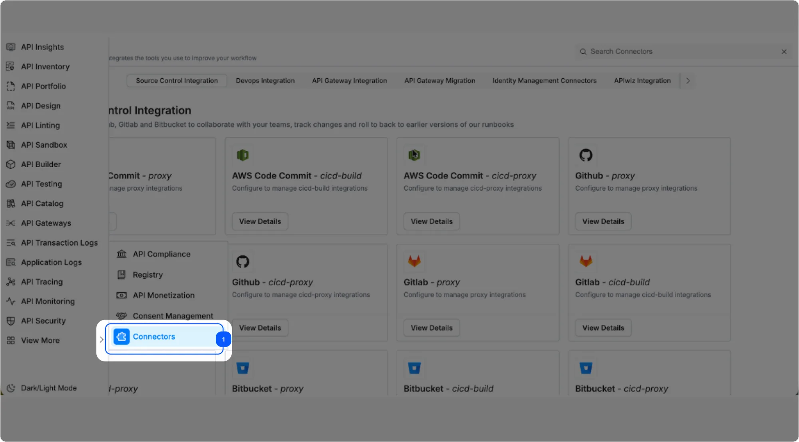

Use this procedure to access the Connectors module in the APIwiz platform.

To open the Connectors module, follow these steps:

1. Sign in to the APIwiz platform with your credentials.
1. On the left side of the screen, point to the vertical navigation bar to view the names of the available modules.
1. Select **Connectors**.
  

The Connectors module opens.