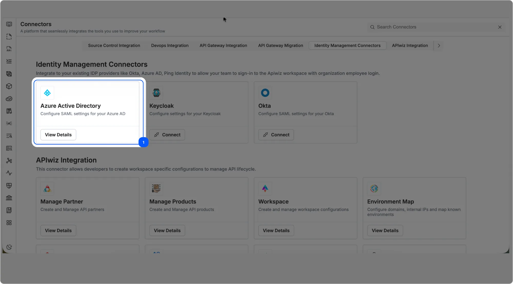
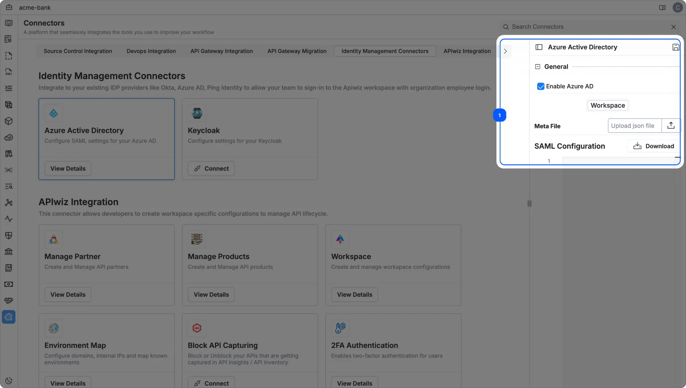
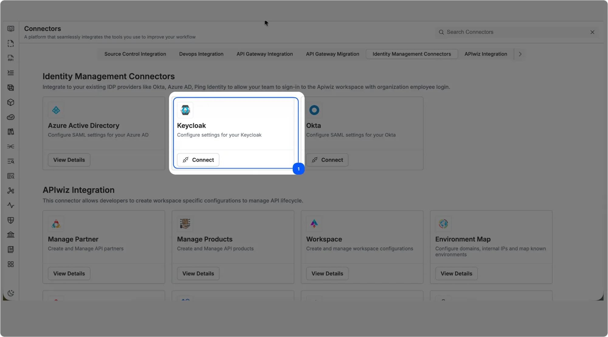
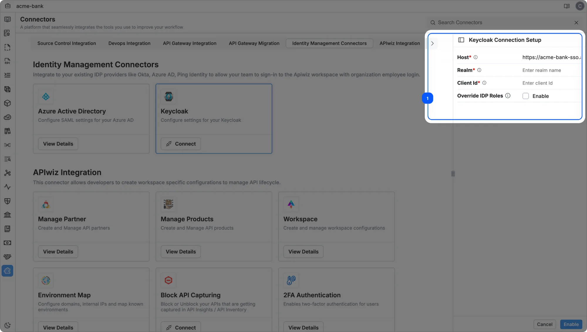
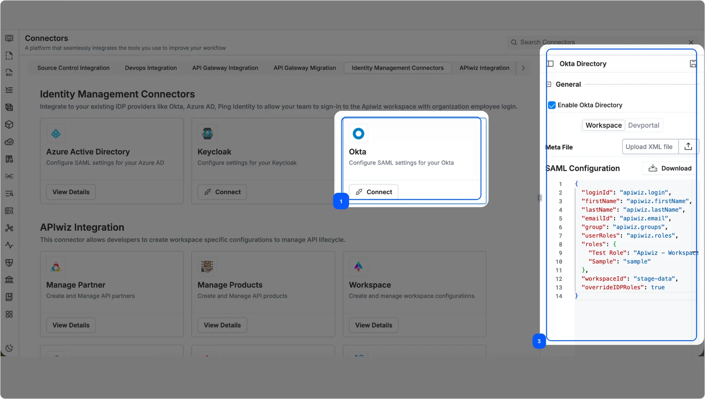

Identity Management \(IAM\) Connectors are a critical category of integrations within the APIwiz platform designed strictly to secure access to your workspace and your APIs. In a modern enterprise environment, managing individual user accounts across dozens of disconnected tools creates massive security vulnerabilities and administrative overhead. IAM connectors solve this by acting as a secure bridge between your API management platform and your organization's existing Identity Providers \(IdPs\).

By configuring these connectors, organizations can seamlessly handle user provisioning, deprovisioning, and authentication from a centralized location. They effectively bridge legacy identity systems with modern, cloud-based IAM solutions, establishing a unified access control mechanism across the entire API lifecycle.

**The Role of Identity Management in API Lifecycle Management**

IAM connectors play a foundational role in the overall security and governance of the API ecosystem. Their primary functions and strategic benefits include:

- **Enforcing Secure Access and Compliance:** Security is the foremost priority in API management. Identity connectors enforce secure access to the platform through robust authentication and authorization mechanisms. They also manage compliance reporting, ensuring that organizations can easily audit who accessed the system and what permissions they held.
- **Enabling Single Sign-On \(SSO\):** Instead of forcing developers and administrators to create and memorize separate usernames and passwords for the APIwiz workspace, these connectors enable Single Sign-On \(SSO\). The Identity Provider acts as the central authentication authority; it verifies the user's identity and passes that secure verification directly to APIwiz, granting seamless access using existing corporate credentials.
- **Facilitating Role-Based Access Control \(RBAC\):** Access shouldn't just be granted; it must be appropriately restricted. IAM connectors allow organizations to map their existing organizational security groups directly to specific roles within the APIwiz platform \(such as "admin" or "developer"\). This ensures that users automatically inherit the correct permissions based on their departmental role, facilitating strict Role-Based Access Control \(RBAC\).
- **Automated Identity Synchronization:** These integrations automate the tedious process of user provisioning and access synchronization across systems. When an employee joins a company or changes departments, their access is updated in the central Identity Provider, and the IAM connector ensures those changes are immediately reflected within the API ecosystem.

**Supported Identity Management Connectors in APIwiz**

To integrate with your existing infrastructure, the platform provides three specific connectors under the Identity Management category. Here is a one-line description for each:

- [Azure Active Directory](#azure-active-directory)**:** Integrates your platform with Azure AD via SAML 2.0 to enable Single Sign-On \(SSO\) and secure authentication, allowing your team to sign in to the workspace using their existing Microsoft organization credentials.
- [Keycloak](#keycloak)**:** Integrates your platform with Keycloak to provide secure authentication, role synchronization, and OpenID Connect-based access control for your workspace.
- [Okta](#okta)**:** Enables secure integration with Okta using SAML 2.0 to provide seamless identity synchronization, user provisioning, Single Sign-On \(SSO\), and robust role-based access control \(RBAC\).

## **Azure Active Directory** \{\#azure-active-directory\}

This connector integrates your platform with Azure Active Directory \(Azure AD\), enabling secure authentication and management of users and groups via SAML. It allows your team to sign in to the APIwiz workspace using their organization credentials. It even supports Single Sign-On \(SSO\).

About Azure AD SSO

- **Centralized Login:** Azure AD SSO \(Single Sign-On\) is an identity management service that allows your team to sign in to the APIwiz workspace using their existing organization employee credentials.
- **Identity Provider Role:** Azure AD acts as the central authentication provider. It verifies the user's identity and passes that verification to APIwiz, eliminating the need for separate usernames and passwords.
- **SAML 2.0 Standard:** It utilizes **SAML 2.0** \(Security Assertion Markup Language\) to securely exchange authentication data between Azure AD \(the Identity Provider\) and APIwiz \(the Service Provider\).
- **Secure Access Management:** It provides token-based authentication and centralized control, allowing you to manage user access and security policies from a single location.

### **Prerequisites - Configure Azure AD SSO**

Before configuring the connector in the APIwiz workspace, you must set up the application in the Azure Portal.

**Step 1: Create an Enterprise Application**

1. Log in to the [Azure Portal](https://azure.microsoft.com/en-us/get-started/azure-portal/?msockid=2654a8ec165066a516debd8117fd67cf). Create an account if you haven’t.
1. Navigate to **Entra ID \(formerly Azure AD\)** \> **Enterprise Applications** \> **New Application**.
1. Select **Create your own application \(Non-gallery\)**.
1. Enter the name \(e.g., APIwiz Workspace\) and click **Create**.
  **Note**: Refer to [this](https://learn.microsoft.com/en-us/entra/identity/enterprise-apps/add-application-portal) documentation for creating an Azure AD Enterprise Application.

**Step 2: Set up Single Sign-On \(SAML\)**

1. Under the application menu, select **Single sign-on** and choose **SAML**.
1. Provide the following SAML configuration values: Single sign-on URL: \{\{ssoHost\}\}[/itorix/saml/SSO ](https://stage-data-sso.apiwiz.io:443/itorix/saml/SSO) Audience URI \(SP Entity ID\): \{\{ssoHost\}\}[/itorix/saml/metadata ](https://stage-data-sso.apiwiz.io:443/itorix/saml/metadata) Default RelayState: Leave blank Name ID Format: Unspecified
  **Note**: You can refer to [this](https://learn.microsoft.com/en-us/entra/identity/enterprise-apps/add-application-portal-setup-sso) documentation to enable SAML Single Sign-On for an Enterprise
1. **Basic SAML Configuration**:
  - **Identifier \(Entity ID\):** Enter a temporary placeholder URL \(e.g., [https://temp.com](https://temp.com)\).
  - **Reply URL \(Assertion Consumer Service URL\):** Enter a temporary placeholder URL \(e.g., [https://temp.com](https://temp.com)\). ***Note***\*: You will replace these placeholders with the actual APIwiz URLs in the final phase.\*

**Step 3: Configure Attributes & Claims**

*To ensure APIwiz can create a user profile \(with name, email, and roles\), you must manually configure Azure to send these specific attributes.*

1. In the **Attributes & Claims** section, click **Edit**.
1. Add or update the following claims. You must ensure the **Claim Name** in Azure matches the names below exactly so they align with the JSON configuration you will create later.

Note: You can refer to [this](https://learn.microsoft.com/en-us/entra/external-id/customers/how-to-add-attributes-to-token) documentation for adding attributes to token claims.

**How to Map Groups:** To support Role-Based Access Control \(RBAC\), you must add a "Group Claim".

- Click **Add a group claim**.
  - Select **Security groups**.
  - Under "Advanced options", ensure you customize the name of the group claimed to be apiwiz.groups.

**Step 4: Download Metadata**

1. Scroll to the **SAML Signing Certificate** section.
1. Download the **Federation Metadata XML**.

**Step 5: Prepare the JSON Configuration File**

**Action Required**: APIwiz requires a JSON file, not the raw XML. You must create this file manually.

1. Create a new file on your computer named aad-metafile.json.
1. Copy the code block below. This JSON tells APIwiz which Azure attributes to look for \(apiwiz.firstName, etc.\) and how to map your Azure Groups to APIwiz Roles.
1. **Update the "roles" section** \(see explanation below\).

```text

{
  "loginId": "apiwiz.login",
  "firstName": "apiwiz.firstName",
  "lastName": "apiwiz.lastName",
  "emailId": "apiwiz.email",
  "group": "apiwiz.groups",
  "userRoles": "apiwiz.roles",
  "roles": {
    "developer": "developer",
    "admin": "admin",  "qa": "developer"
  },
  "workspaceId": "stage-data",
  "overrideIDPRoles": true
}

```

- **How to Map Security Groups to Roles:** In the "roles" section, the *key* is the role in the platform \(e.g., "developer", "admin"\) and the *value* is your role in Azure.
  - **If you send Group Names:** Replace "Azure\_Dev\_Group\_Name\_Or\_ID" with the exact name of your Azure group \(e.g., "Engineering Team"\).
  - **If you send Group IDs:** Replace it with the Object ID of the group \(e.g., "a1b2c3d4-..."\).

### **Configure Azure AD in the APIwiz Workspace**

After configuring the Azure AD application and creating your JSON file, follow these steps to enable the connector.

**Step 1: Locate the Connector**

Navigate to the **Connectors** module and select the **Identity Management Connectors** category. Locate the **Azure Active Directory** Connector card.



**Step 2: Initiate Configuration**

Click the **View Details** button on the connector card. A configuration panel will appear on the right-hand side.

To begin configuration, select the Enable Azure Active Directory checkbox. Once enabled, the panel expands to reveal all available settings required to configure and manage Azure AD integration within your APIwiz workspace.

**Step 3: Enable Integration**

In the **General** section of the panel:

1. **Enable Azure AD:** Check this box to activate the integration.
1. **Environment:** Ensure the **Workspace** button is selected.



**Step 4: Upload Configuration**

Locate the **Meta File** section:

1. Click the **Upload json file** button.
1. Select and upload the aad-metafile.json file you created in "Step 5" of the previous section.
1. Think of this json file as a bridge between APIwiz and Azure AD Platform.

**When should a metafile be uploaded?**

In the SAML Configuration, let's say there are five roles. You have uploaded the file, configured, and even saved it, and the application is running. Now, you want to add a sixth role. In that case, you have to upload the metafile again and repeat the process from step 2. Refer to the FAQ Section for more information on SAML Configuration.

**Step 5: Exchange SAML Details**

1. **Download Service Provider Metadata:** Click the **Download** button inside the **SAML Configuration** section of the panel.
  - *This file contains the specific Entity ID and ACS URL generated by APIwiz.*
1. **Update Azure Portal:**
  - Return to the **Azure Portal \> Single sign-on \> Basic SAML Configuration**.
  - Replace the temporary placeholder URLs \(from Phase 1, Step 2\) with the actual **Identifier \(Entity ID\)** and **Reply URL** found in the file you just downloaded.
  - Click **Save** in Azure.

**Step 6: Save Configuration** - Return to the APIwiz workspace panel and click the **Save** button at the bottom right.

- You will receive a success message.
- The connector status will update to **View Details**, indicating the connection is active.

### **FAQ’s**

1. In the SAML Configuration, can duplicate roles be given? Even if duplicates are there, the roles will override.
1. When a user logs in, what if the role in the key isn't there, but the role in the value is there? eg, in "guest":"developer", if the user is a guest and he is assigned the role of a developer what would happen? If the mapping is not proper, then the default role will be taken.
1. What are overrideIDPRoles in SAML Configuration? It will override the existing roles of the user with the current roles coming from Azure.
1. What will happen if duplicate roles are given? It will take the distinct ones.
1. If a role in SAML Configuration gets deleted in the platform, what will happen? The user won’t have access which is related to that role.

## **Keycloak**

This connector integrates your platform with Keycloak, allowing secure authentication and role synchronization.

### **Prerequisites - Configure Keycloak**

Useful Links:

• Admin Console: This is unique to your installation \(e.g., https:///auth/admin/\).

• Documentation: [Keycloak Server Administration Guide](https://www.keycloak.org/docs/latest/server_admin/)

Steps to Gather Credentials:

**1. Prepare the Realm:**

- Log in to your Keycloak Admin Console.
- Create or select the Realm you wish to use \(e.g., mycompany-realm\). Note this name.

**2. Create a Client:**

- Go to Clients \> Create.
- Client ID: Enter a unique ID \(e.g., apiwiz-client\). Note this ID.
- Client Protocol: Select openid-connect.

**3. Configure Client Access:**

- Valid Redirect URIs: You must add your APIwiz Workspace URL here \(e.g., [https://your-workspace-url/\*](https://your-workspace-url/*)\) to ensure users are redirected back successfully after logging in.
- Web Origins: Add \+ or your specific workspace URL to allow CORS.

### **Configure Keycloak in the APIwiz Workspace**

**Step 1: Locate the Connector** - Navigate to the Connectors module and select the Identity Management Connectors category. Locate the Keycloak Connector card.



**Step 2: Initiate Connection** - Click the Connect button on the connector card.

**Step 3: Enter Connection Details** - Fill in the fields using the data gathered from Phase 1:

• Host: Enter the full Keycloak server URL \(e.g., [https://acme-data-sso.apiwiz.io](https://acme-data-sso.apiwiz.io)\).

• Realm: Enter the exact Realm name \(e.g., mycompany-realm\).

• Client ID: Enter the Client ID you created \(e.g., apiwiz-client\).



**Step 4: Configure Role Mapping**

• Override IDP Roles \(Checkbox\): Toggle this option if you want to override the logged-in user’s local roles with the roles defined in Keycloak.

**Step 5: Enable Connection** - Click the Enable button at the bottom of the panel. You will receive a success message, and the card will display View Details.

## **Okta**

The Okta connector enables secure integration between your platform and Okta, providing authentication, user provisioning, and group management capabilities. It supports seamless identity synchronization, Single Sign-On \(SSO\), and role-based access control \(RBAC\), helping maintain consistent and centralized access management. Prerequisites

Before accessing **Okta** from the **APIwiz workspace**, you must first configure **Okta Single Sign-On \(SSO\)**.

**What is Okta SSO?**

- Okta SSO \(Single Sign-On\) is an identity and access management service that allows users to log in once and securely access multiple applications.
- Okta acts as the central authentication provider. Users authenticate with Okta, and Okta passes the verified identity to integrated applications, such as APIwiz.
- Okta uses SAML 2.0 \(Security Assertion Markup Language\) to enable SSO between Okta \(Identity Provider\) and applications like APIwiz \(Service Provider\). SAML provides secure, token-based authentication without requiring users to enter credentials into each application.

### **Configure Okta SSO**

Follow the steps below to complete the initial setup.

**Step 1: Sign in to Okta**

1. Sign in to the [Okta Admin Console](https://login.okta.com/).
1. In the left navigation pane, select Applications.

**Step 2: Create a New Application Integration**

1. Click Create App Integration.
1. Select SAML 2.0 as the sign-in method.
1. Enter the application name, and then select Next.

**Step 3: Configure SAML Settings**

Provide the following SAML configuration values:

1. Single sign-on URL: \{\{ssoHost\}\}[/itorix/saml/SSO](https://stage-data-sso.apiwiz.io:443/itorix/saml/SSO)
1. Audience URI \(SP Entity ID\): \{\{ssoHost\}\}[/itorix/saml/metadata](https://stage-data-sso.apiwiz.io:443/itorix/saml/metadata)
1. Default RelayState: Leave blank
1. Name ID Format: Unspecified
1. Select **Next**.
1. Navigate to the **Sign On** tab.
1. Scroll to the bottom of the page to locate the **Attribute Statements** section.

**Step 4: Add Attribute Statements**

Add the following attribute mappings:

Group Attribute Statements

1. After adding the attribute statements, select Save.
1. Select Finish to complete the application setup.

**Step 5: Configure SAML Certificate**

1. Navigate to the Sign On tab of the application.
1. Scroll to the SAML Signing Certificates section.
1. If a certificate is not available, generate a new one.
1. Select Actions, and then choose View idpMetadata from the dropdown. Copy the metadata content, save it to an XML file, and upload the file in the APIwiz workspace.

### **Configure Okta in the APIwiz Workspace**

After you configure Okta SSO, select the Okta connector from the Connectors page. When you click the Okta connector card, a configuration panel appears on the right side of the screen.

This panel displays the Okta Activity Directory settings and provides controls to enable and manage the connector.

By default, the connector is not enabled, and the panel indicates that no configuration can be edited.

To begin configuration, select the Enable Okta Activity Directory checkbox. Once enabled, the panel expands to reveal all available settings required to configure and manage Okta integration within your APIwiz workspace.



The configuration panel includes the following elements:

General Section: This section houses the primary activation control for the Okta Activity Directory. It includes:

- Enable Okta Activity Directory \(Checkbox\): When selected, it activates the Okta integration for the workspace. Enabling this option unlocks additional configuration fields and options within the same panel.

Workspace / Devportal Toggle: Two buttons appear after the connector is enabled:

- Workspace: Select this to configure Okta for your APIwiz workspace environment.
- Devportal: Allows configuration for the Developer Portal environment if supported.

Only one environment can be active for configuration at a time; the active selection is highlighted.

Meta File Section:This section provides file upload options for SAML metadata.

- Upload XML File \(Button\): Use this to upload a SAML metadata file in XML format. This file typically contains SAML configuration details exported from Okta.

SAML Configuration Editor: A large panel where the SAML metadata and configuration details are displayed.

- Configuration Viewer: Displays the SAML configuration in a formatted editor. This section remains empty until you manually populate the configuration.

To complete the setup, you must add the metadata in the following JSON format:

```json

{
  "loginId": "apiwiz.login",
  "firstName": "apiwiz.firstName",
  "lastName": "apiwiz.lastName",
  "emailId": "apiwiz.email",
  "group": "apiwiz.groups",
  "userRoles": "apiwiz.roles",
  "roles": {
    "developer": "Admin Test",
    "admin": "admin"
  },
  "workspaceId": "stage-data",
  "overrideIDPRoles": true
}

```

In the roles section, you must map your Okta groups to the corresponding APIwiz roles. This establishes the correct role assignment for users signing in through Okta.

- Download Button: Allows you to download the current Metadata. This helps with exporting or backing up the configuration.

Saving the Configuration: Once all required fields are completed and the metadata file is uploaded, select the Save button located in the upper-right corner of the configuration panel to establish the connector. After saving:

- A success message appears at the bottom of the screen.
- The Okta connector card on the Connectors page updates to show View Details instead of Connect.

Viewing and Managing Connector Details: When you click View Details, a detailed connector information window opens. From this screen, you can:

- Edit the connector configuration
- Disable the connector if needed