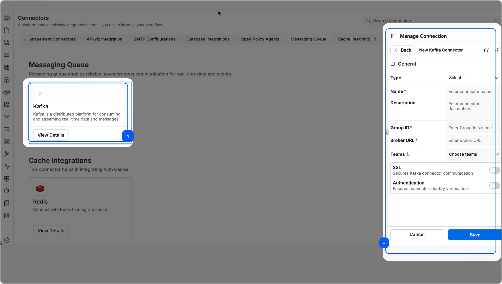
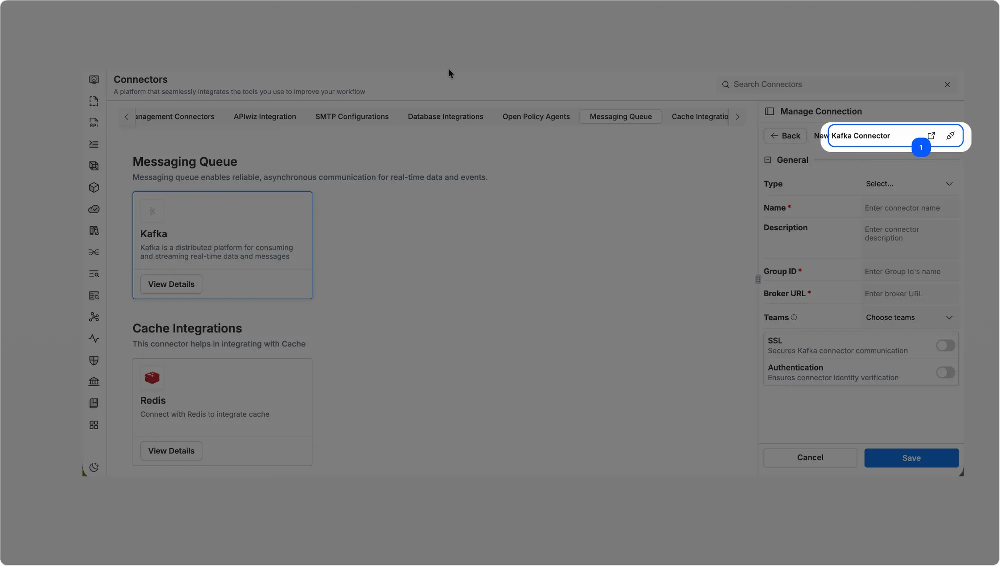
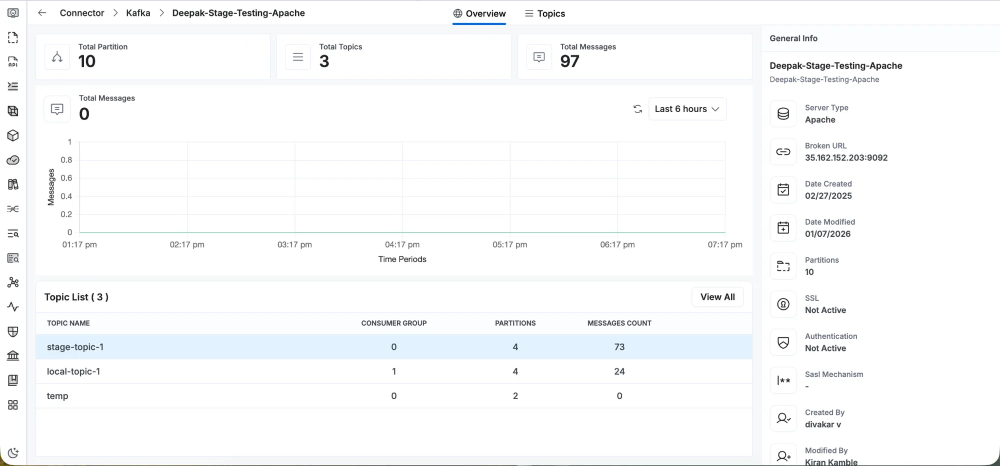
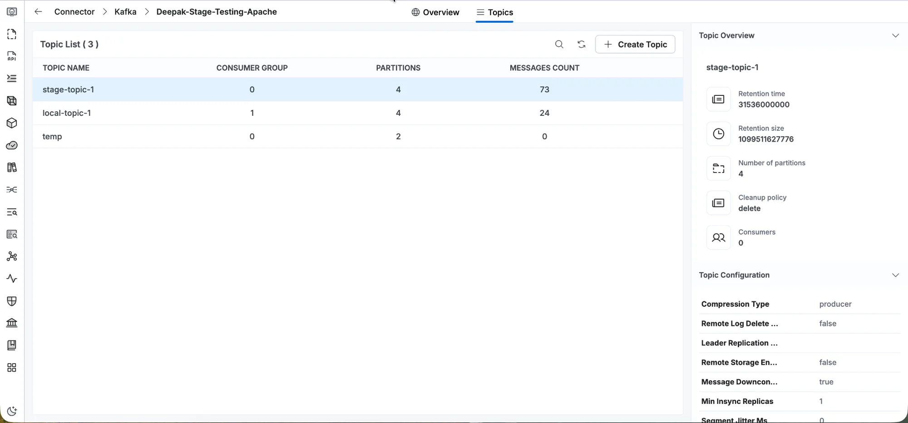
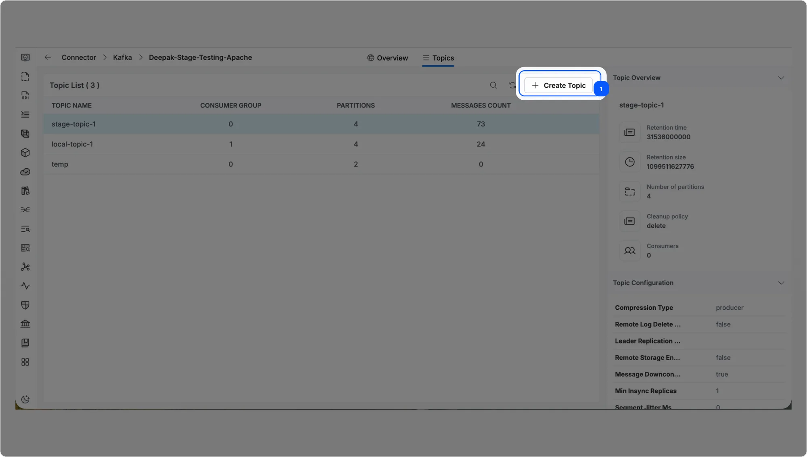
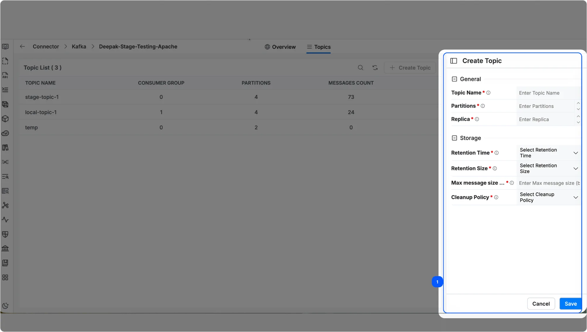

Messaging Queue integrations serve as a foundational component for modern, scalable API ecosystems by enabling asynchronous, event-driven communication. In traditional synchronous communication, a service sends a request and must wait for a response before continuing its operations. This can lead to bottlenecks, increased latency, and system failures if the receiving service is down or overwhelmed. Messaging queues solve this by acting as an intermediary broker that stores messages until the receiving service is ready to process them.

By utilizing these message broker systems, organizations can transition to a decoupled microservices architecture. This means that the services producing data \(publishers\) and the services consuming data \(subscribers\) do not need to interact directly or even be running at the same time. This decoupling significantly reduces the dependencies between different APIs and backend services.

The primary functions and benefits of Messaging Queues in an API platform include:

- **Workflow Orchestration and Event-Driven Architecture:** Messaging queues allow APIs to publish and consume messages seamlessly, triggering workflows based on real-time events rather than scheduled batches.
- **Real-Time Data Streaming:** They facilitate the continuous flow of data across systems, enabling real-time processing and immediate event notifications.
- **System Scalability and Reliability:** Because messages are safely stored in the queue until they are processed, the system can handle massive spikes in traffic without crashing backend services. If a consumer service goes down, the messages remain in the queue, ensuring reliable, fault-tolerant message delivery once the service comes back online.

## **Kafka**

The Kafka connector allows your API platform to seamlessly integrate with Apache Kafka, a powerful distributed messaging system. It enables your APIs to reliably send and receive messages through specific Kafka "topics". By bridging your workspace with Kafka, you can support real-time data streaming, build event-driven communications, and ensure scalable, fault-tolerant message processing across your decoupled microservices.

### **Prerequisites: Preparing to Connect Kafka**

**Step 1: Set up or Access your Kafka Instance**

1. Determine your Kafka distribution type. You must know whether your organization is using a managed **Confluent** platform or a standard **Apache** Kafka installation, as you will need to specify this in the workspace.
1. Ensure you have administrative or developer access to this Kafka environment to retrieve the connection details.

**Step 2: Locate your Broker URL**

1. Navigate to your Kafka provider's dashboard or configuration files.
1. Locate the endpoint address for your Kafka broker \(the server that manages the messages\).
1. Copy this exact endpoint \(e.g., broker1.kafka.local:9092\), as this will be your **Broker URL**.

**Step 3: Define a Group ID**

1. Identify the consumer group ID that your Kafka consumer will use to manage message consumption.
1. Note this **Group ID** down, as it is required to track which messages have been successfully read by your services.

**Step 4: Generate Authentication Credentials**

1. Determine the security protocol your Kafka broker uses.
1. If authentication is enabled, note your **SASL Mechanism** \(Options include: PLAIN, SCRAM-SHA-256, SCRAM-SHA-512, or OAUTHBEARER\).
1. Generate or locate the specific **Username** and **Password** required to authenticate with the broker securely.

### **Connecting Kafka in the APIwiz Workspace**

Once you have gathered the prerequisite details, follow these exact steps to connect Kafka to your workspace:

**Step 1: Locate the Kafka Connector**

1. Log in to your APIwiz workspace dashboard.
1. Navigate to the **Connectors** module from the main menu.
1. Select the **Messaging Queue** category from the top navigation tabs.
1. Locate the **Kafka** Connector card and click the **Connect** button directly on the card. A configuration panel will slide open on the right-hand side of your screen.

**Step 2: Initiate a New Connection**

1. Inside the right-hand panel, click the **\+ New Connection** button to begin defining your Kafka environment.

**Step 3: Enter General Configuration Details** - Fill out the General fields using the prerequisite information you gathered:

1. **Type:** Click the dropdown and select your Kafka distribution \(choose either **Confluent** or **Apache**\).
1. **Name:** Enter a unique, identifiable name for this connector \(e.g., OrderEventsConnector\).
1. **Description:** \(Optional\) Enter a brief description of what this connector will be used for.
1. **Group ID:** Enter the specific consumer group ID used to manage your message consumption.
1. **Broker URL:** Paste the Kafka broker endpoint you copied during the prerequisite phase.
1. **Teams \(Optional\):** Click the dropdown to select specific teams to restrict access to this connector. If left blank, it will be accessible to all users.

**Step 4: Configure Security Settings** - If your Kafka instance requires secure communication, configure the following toggles:

1. **SSL:** Toggle this to **Enable** if you need to secure your Kafka communication with SSL encryption.
1. **Authentication:** Toggle this to **Enable** if your broker requires identity verification. If enabled, three new fields will appear:
  - **SASL Mechanism:** Select the appropriate mechanism from the dropdown \(PLAIN, SCRAM-SHA-256, SCRAM-SHA-512, or OAUTHBEARER\).
  - **Username:** Enter your Kafka authentication username.
  - **Password:** Enter the corresponding Kafka password.

**Step 5: Save and Verify the Connection**

1. Once all fields are accurately filled out, click the **Save** button at the bottom of the panel.
1. To verify the connection is successful, click the **Check Connection** icon \(the plug icon\) located at the top-right of the connector window.
1. The connector card on your main dashboard will now display **View Details** instead of "Connect".

**Step 6: Access the Kafka Dashboard**

1. To view your Kafka metrics, click the **Go to Dashboard** icon \(the box with an arrow pointing out\) at the top-right of the connector window.
1. You will see an **Overview** tab displaying total messages, partitions, topics, and connector metadata.
1. Click the **Topics** tab to view a list of all existing topics and their consumer groups.

**Step 7: Create a New Topic \(Optional\)** - If you need to create a new topic for messages, follow these steps from the Topics tab:

1. Click the **\+ Create Topic** button.
1. Under **General**, fill in the **Topic Name**, **Partitions** \(number of partitions\), and **Replica** \(number of copies across brokers for fault tolerance\).
1. Under **Storage**, configure the **Retention Time** \(how long messages are kept\), **Retention Size** \(max size before deletion\), **Max message size \(bytes\)**, and the **Cleanup Policy** \(choose between delete or compact\).
1. Click **Save** to add the new topic to your Kafka list.

### Creating a Topic

1. Click on the \+ Create Topic button
  
1. Fill in the parameters and click on Save.
  