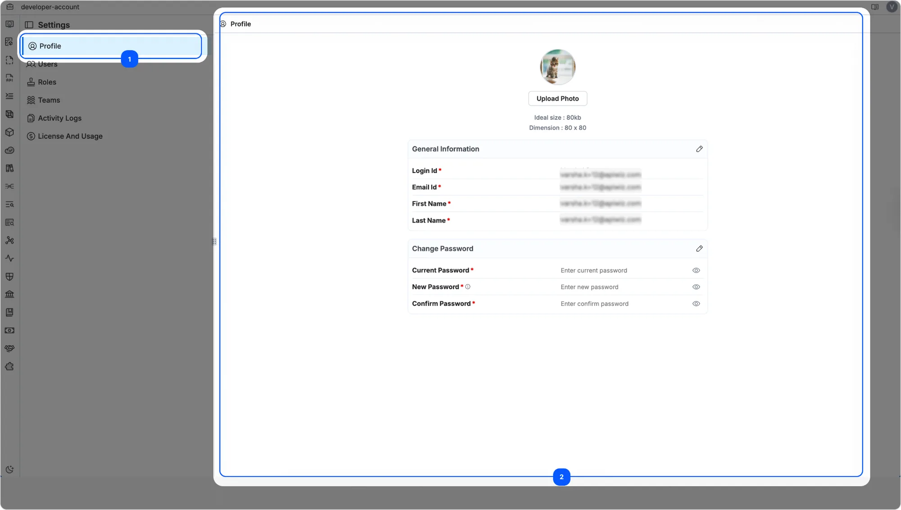

Use the **Profile** page to view and manage your account information. From this page, you can update your profile details, upload a profile photo, and change your account password.

The **Profile** page includes the following sections:

- Profile photo
- General information
- Change password

## Upload a profile photo

To add or update your profile photo:

1. Select **Upload Photo**.
1. Select the image that you want to upload.
1. Save your changes.

## Update your profile information

Use the **General Information** section to view and update your account details.

The following information is available:

To update your profile information:

1. Select **Edit**.
1. Update the required fields.
1. Select **Save**.

The updated information is saved to your profile.

### Change your password

Use the **Change Password** section to update your account password.

To change your password:

1. Select **Edit**.
1. Enter your current password.
1. Enter a new password.
1. Re-enter the new password in the **Confirm Password** field.
1. Ensure that the new password meets the password requirements and matches the value entered in the **Confirm Password** field.
1. Select **Save**.

Your password is updated successfully.