Use the **Roles** tab to view, manage, and configure user permissions within the system. Roles define the specific actions and resources that users can access.

There are two types of roles available: **Predefined Roles** and **Custom Roles**.

### Predefined roles

Predefined roles are built-in system roles available by default. These roles cannot be edited or deleted. Each role includes a fixed set of permissions designed for common administrative and operational use cases. To extend functionality, administrators can create custom roles based on predefined roles.

### Custom roles

Administrators create custom roles to extend or modify permissions based on predefined roles. You can import permissions from existing roles, adjust them as required, and assign the new role to users or teams.

To create a custom role, do the following:

1. In the **Custom Roles** section, select the **\+** icon.
1. Enter a role name in the text field.
  
1. Select **Save**. The **Inherit Permissions From** window opens on the right side of the screen.
  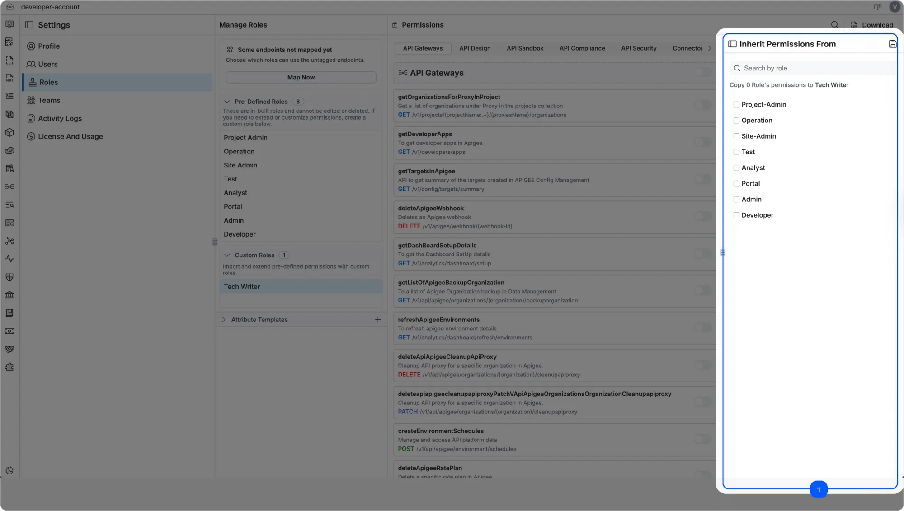
1. Select the predefined roles whose permissions should be inherited.
1. Select **Save** to confirm.

The new custom role is added to the **Custom Roles** list.

### Map endpoints to custom roles

Use the **Map Now** feature to identify and assign permissions to API endpoints that are not yet mapped to any custom role. This ensures that all endpoints have appropriate role-based access.

When new endpoints are created, they may remain untagged and not assigned to any role. The **Map Now** option provides visibility into these unmapped endpoints and allows you to quickly assign them to the appropriate custom roles.

#### Map unmapped endpoints

To map unmapped endpoints to custom roles, do the following:

1. If unmapped endpoints exist, a notification appears indicating that some endpoints are not mapped.
1. Select **Map Now**. The **Map Roles** window opens, displaying the list of endpoints that are not currently mapped to any custom role.
  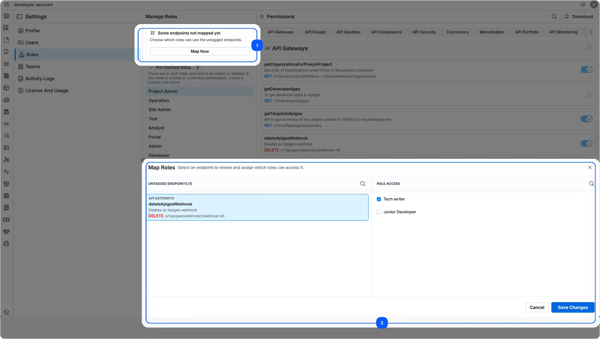
1. From the **Untagged Endpoints** list, select an endpoint.
1. In the **Role Access** section, select the custom roles that should have access to the endpoint.
1. Select **Save Changes**.

The selected endpoint permissions appear under the corresponding custom roles, ensuring that all configured endpoints have the appropriate access permissions assigned.

### Feature availability

## Attribute-based access control configuration

Use attribute-based access control \(ABAC\) to apply fine-grained, conditional access rules to API endpoints based on request attributes. This configuration includes attribute templates, role permissions, and advanced permission rules.

### Attribute templates

Use **Attribute Templates** to create and manage reusable templates that store predefined sets of role attributes. Templates simplify the process of assigning permissions when creating or modifying roles.

Attribute templates are a global feature and can be reused across the system. A single template can be applied multiple times and attached to multiple roles and endpoints, ensuring consistent permission configuration across the system.

#### Create an attribute template

To create an attribute template, do the following:

1. In the **Attribute Templates** section, select the **\+** icon.
  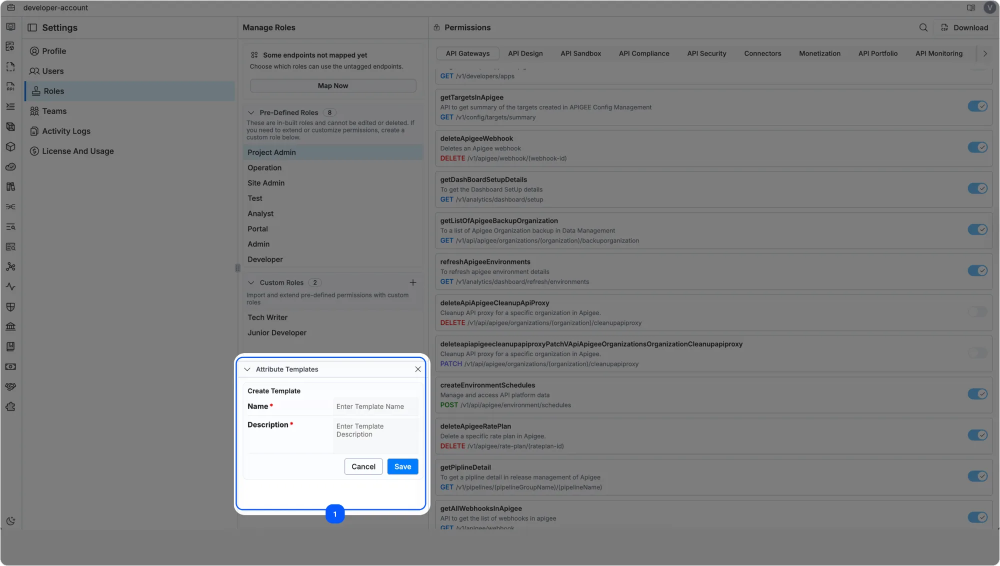
1. Enter the **Name** and **Description** of the template.
1. Select **Save**.

The attribute template is created and becomes available for use across roles and endpoints.

### Permissions

The **Permissions** section displays all available permissions associated with the selected role. Permissions define the specific actions a role can perform within various system modules.

Permissions are grouped by functional module, displayed as tabs in the navigation bar at the top of the panel. Each tab corresponds to a specific module, such as **API Builder**, **API Catalog**, **API Compliance**, **API Design**, and **API Gateways**.

#### View and edit permissions

When you select a predefined role or custom role, the **Permissions** panel displays the available permissions across all modules for that role.

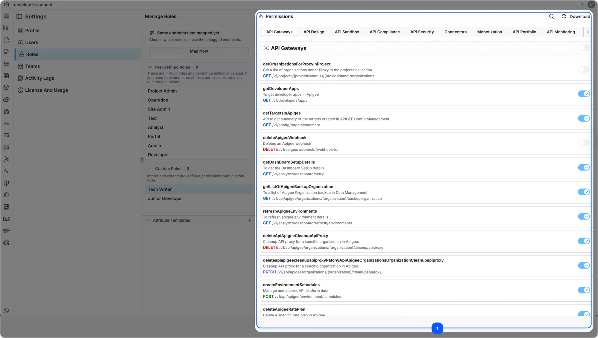

Each permission entry includes the following details:

#### Permission control behavior

#### Enable or disable all permissions in a module

Each module includes an **Enable/Disable All** toggle at the top-right corner of the module section. Selecting this toggle enables or disables all endpoint permissions within that module.

### Advanced permissions

Use **Advanced Permissions** to configure attribute-based access control \(ABAC\) for API endpoints. This feature provides fine-grained control over endpoint access by applying conditional rules based on request attributes.

Advanced permissions are available for both predefined roles and custom roles, but can only be configured for enabled endpoint permissions. When the **Advanced Permissions** checkbox is selected, an additional configuration panel appears below the permission entry, allowing you to define attribute-based access conditions.

#### Purpose

Use advanced permissions to:

- Restrict QA users from accessing production data
- Limit access to sensitive operations for specific roles
- Apply consistent restrictions across multiple endpoints

#### Configure advanced permissions

To configure advanced permissions, do the following:

1. Select a predefined role or custom role.
1. In the **Permissions** panel, enable the required endpoint permission.
1. Select **Advanced Permissions**.
  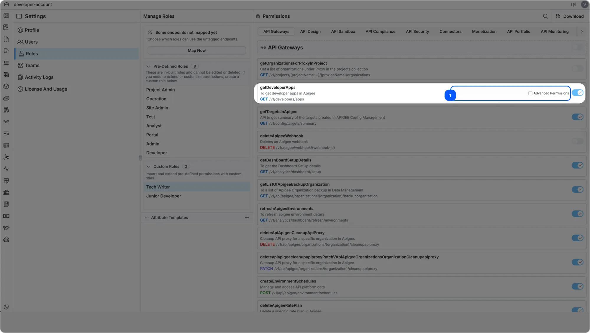
1. The **Manage Attribute-Based Access** panel opens with configuration options.
  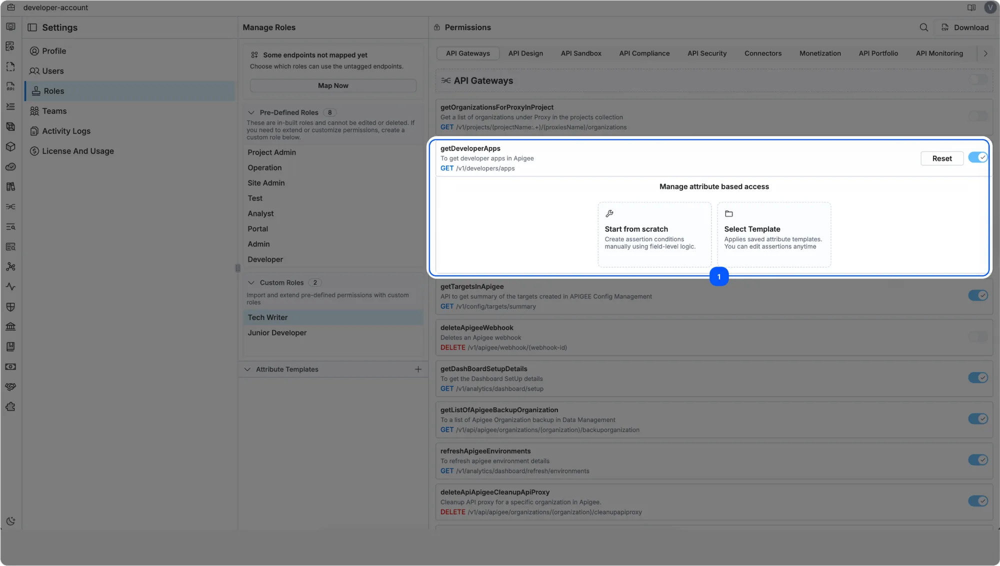
1. Configure the access conditions using one of the following methods.

#### Start from scratch

Use this option to manually create attribute-based rules using field-level conditions.

To configure access conditions from scratch, do the following:

1. Select **Start from Scratch**. The **Manage Attribute Templates** window opens.
  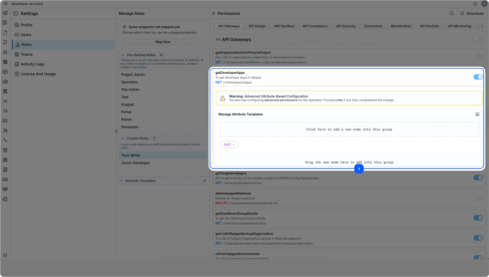
1. Select **Click here to add a new node into this group**.
  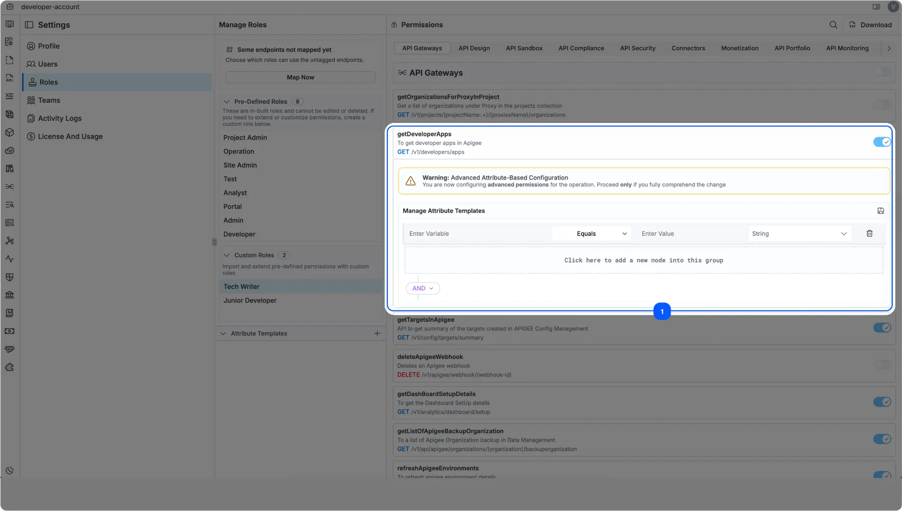
1. Enter the following details:

1. Combine multiple conditions using logical operators such as **AND** or **OR**.
1. Select **Save**.

The access rule is applied to the selected endpoint permission based on the configured request parameters.

#### Select a template

Use this option to apply predefined attribute templates for faster configuration. Templates can be modified at any time and reused across multiple roles and endpoints.

To configure access conditions using a template, do the following:

1. Select **Template**. A window opens, displaying the templates created using [Attribute Templates](https://docs.apiwiz.io/guides?guideId=6a3e41fcd0dd14afc277b20f&groupId=APIwiz+Settings&pageId=6a4362c8777f9d62fa74fd00#a5d7809e-c1e8-45b8-b976-03aa87627208).
  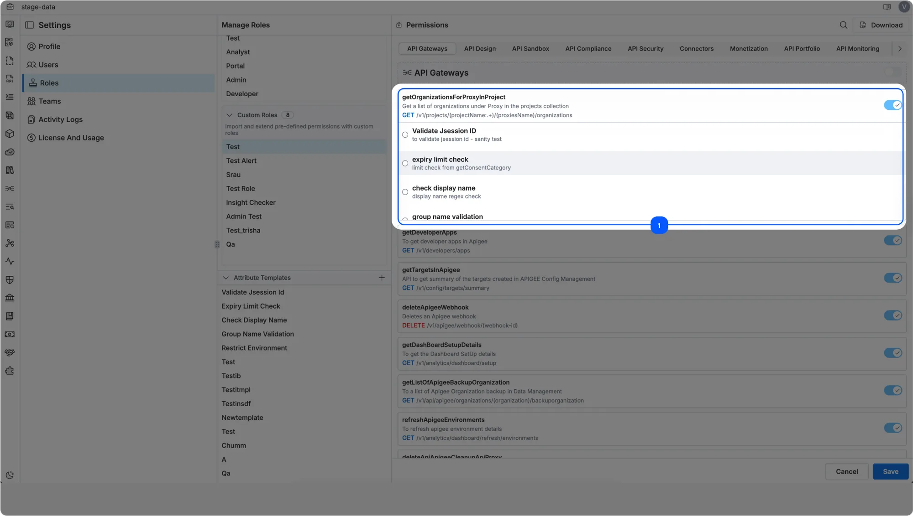
1. Choose an existing template from the list.
1. Apply the template to the endpoint.
1. Select **Save**.

## Example use case: Restrict access to a specific environment

Administrators can restrict user access to specific endpoints by defining attribute-based conditions. For example, you can restrict access to an endpoint by validating a query parameter in the request and creating a rule to allow or deny access based on the parameter value.

To implement this restriction:

1. Create a custom rule using **Start from Scratch** or a template.
1. Define the condition using the required parameter and operator.
1. Save the configuration.

This ensures the endpoint behaves differently based on the defined conditions.

The following example shows how Advanced Permissions, Attribute Templates, and Custom Roles work together to restrict a user's access to data in a specific environment.

**Goal:** Restrict the user User1 from viewing data from the dev environment.

### Step 1: Create a custom role

To create a custom role, follow these steps:

1. Go to **Settings** \> **Roles**.
1. Create a custom role named **QA**.
  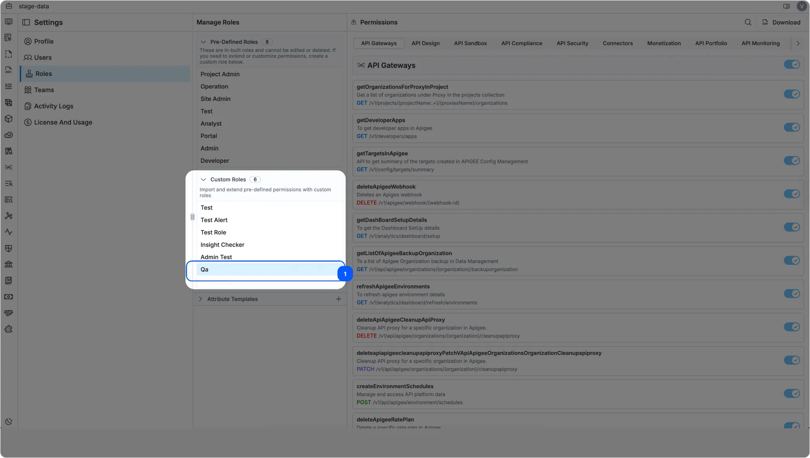
1. Select the attribute template you created based on the required condition. This applies the predefined restriction rule to the selected endpoint.

Attribute templates let you reuse the same restriction logic across multiple endpoints, reducing the need to manually configure the same rule repeatedly.

### Step 2: Assign the custom role to the user

After creating a restricted role, assign it to the required user. Once applied, the user can only access endpoints that meet the configured conditions.

To assign the custom role, follow these steps:

1. Go to **Settings** \> **Users**.
1. Locate the user **User1**, then select **Manage Roles**.
  
1. Change the assigned role from **Admin** to the newly created **QA** role.

The role is updated for User1.

### Step 3: Create an attribute template

To create an attribute template, follow these steps:

1. Select **Attribute Templates**.
1. Select the **\+** icon to create a new template.
1. Enter a template name, for example, QA.
1. Create a rule to restrict access to endpoints where the environment equals dev.
  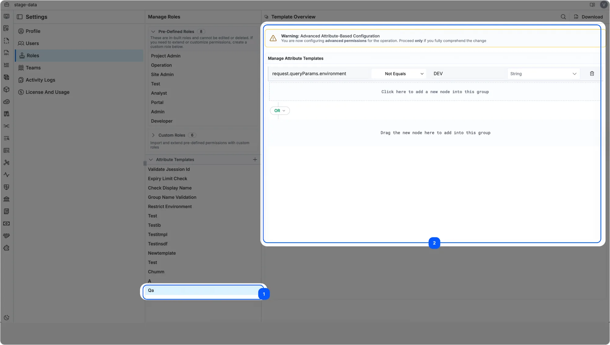

#### Configure the restriction rule

Enter the following values:

This rule allows users to access all environments except dev. Users assigned to the QA role are restricted from viewing dev environment data.

### Step 4: Configure endpoint restriction using Advanced Permissions

To configure endpoint restriction, follow these steps:

1. Identify the endpoint triggered when accessing the **Insights** section.
1. Go to the **Inspect** \> **Network** tab and copy the endpoint path.
  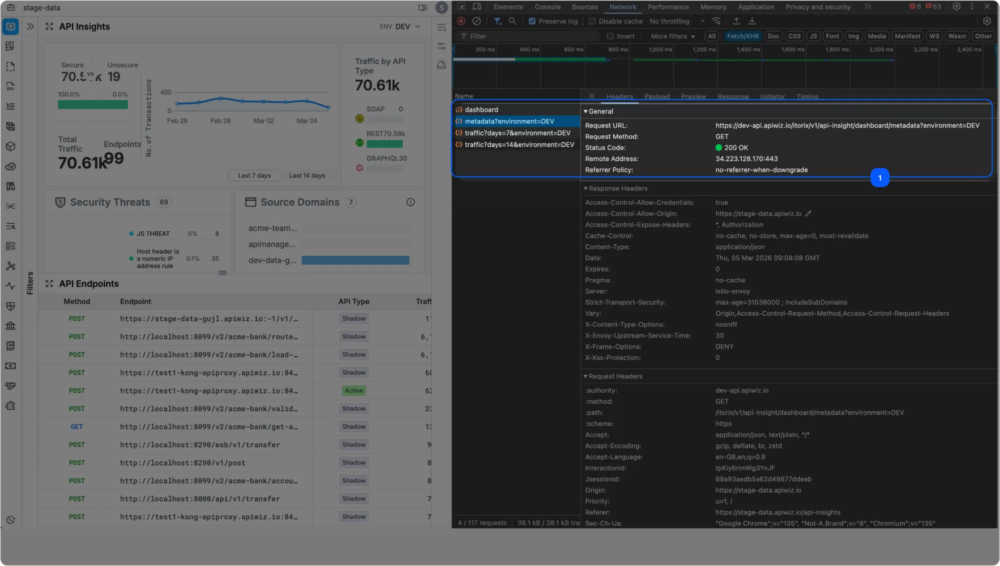
1. Return to the **QA** role and search for the endpoint using the copied path in the **Permissions** section.
  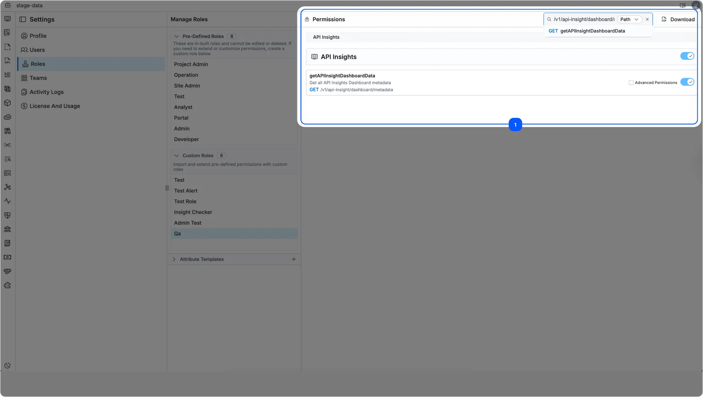
1. Enable **Advanced Permissions** for the endpoint.
1. Select **Select Template**.
  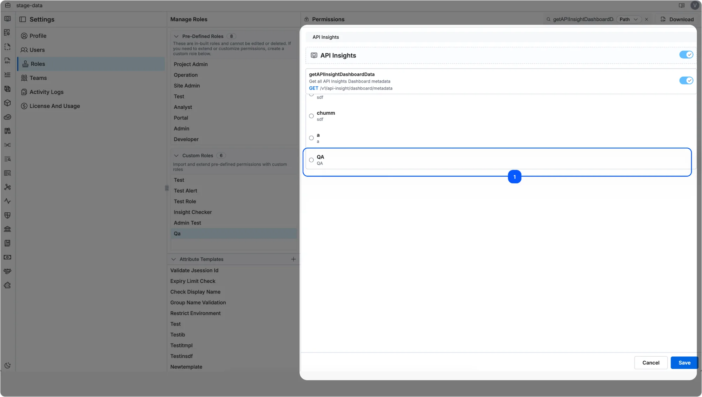
1. Select the attribute template you created based on the required condition. This applies the predefined restriction rule to the selected endpoint.

You can view the configured restriction rule based on the request parameter. This rule allows access to all environments except dev.

### Step 5: Apply the template to other endpoints

For consistent access control, apply the same template to multiple endpoints. This ensures the same restriction logic is enforced across different API operations.

In some cases, request attributes may be passed in different parts of the API request, such as query parameters or the request body \(payload\). During testing, you may observe that the dev environment is restricted on one endpoint, but other endpoints still return dev environment data.

To ensure complete restriction, follow these steps:

1. Apply the same attribute template to all relevant endpoints that return environment data.
1. If an API call passes the environment value in the request body instead of query parameters, update the attribute rule to evaluate the request body field instead. **Example:**

The restriction works correctly regardless of where the environment value is passed in the request.

The restriction logic can be reused across multiple endpoints using attribute templates.

## Search endpoints in Permissions

Use the search bar in the top-right corner of the **Permissions** panel to quickly locate a specific permission or endpoint. This is useful when managing a large number of modules and endpoint permissions.

To search for an endpoint or permission, follow these steps:

1. Next to the search field, select the dropdown to choose a search type:

1. Enter your search term in the search field.
  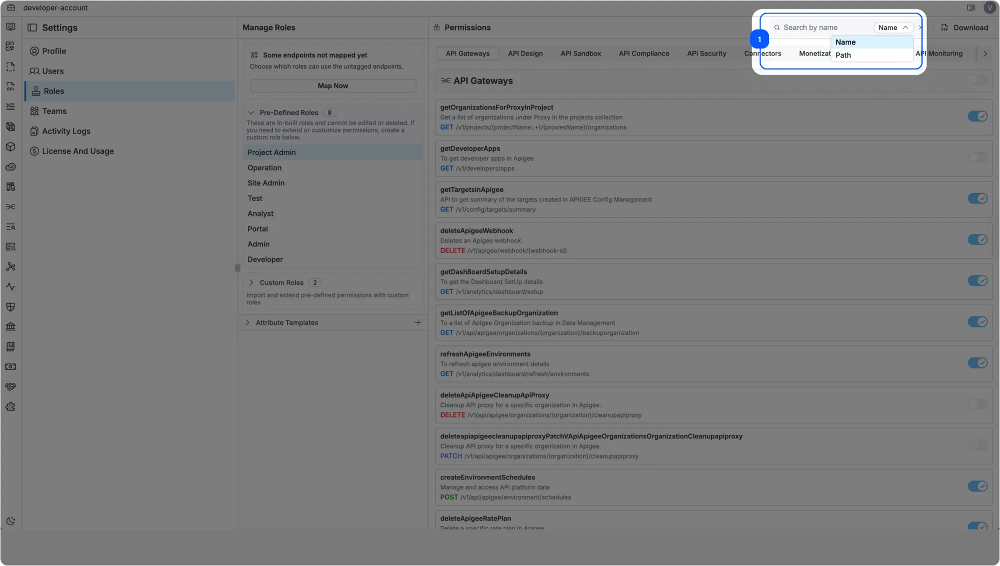

The system displays a list of permissions that match your search.

## Download module permission information

Download module permission details as a CSV file for reference or auditing purposes.

To download permission information, follow these steps:

1. In the top-right corner, select **Download**.
  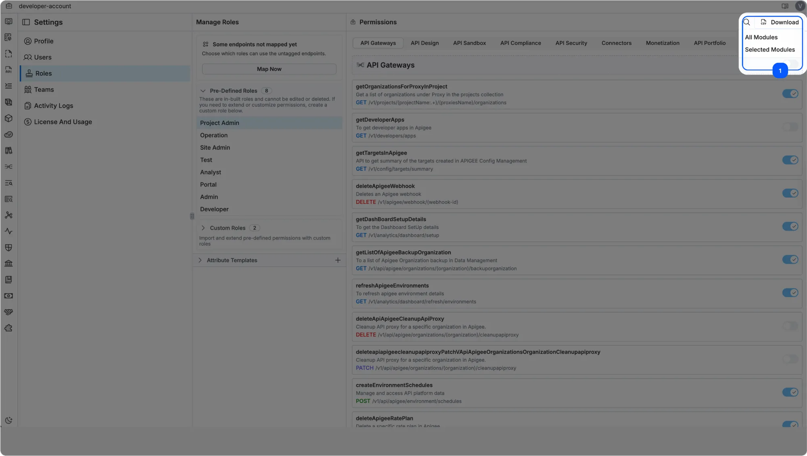
1. Select an option:

1. If you selected **Selected Modules**, a panel opens displaying the list of available modules. Select the modules you want, then select **Done**.
  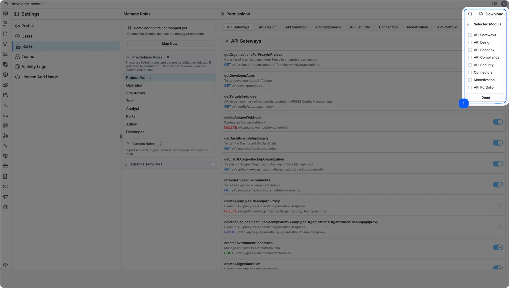

The system downloads a CSV file containing permission information for the selected modules and saves it to your local system.