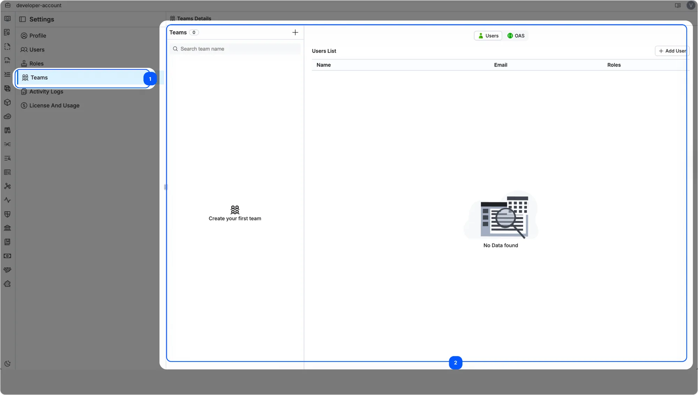
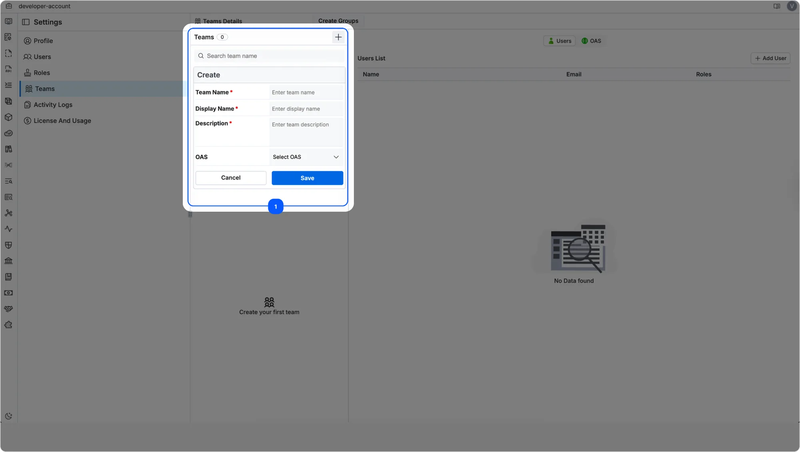
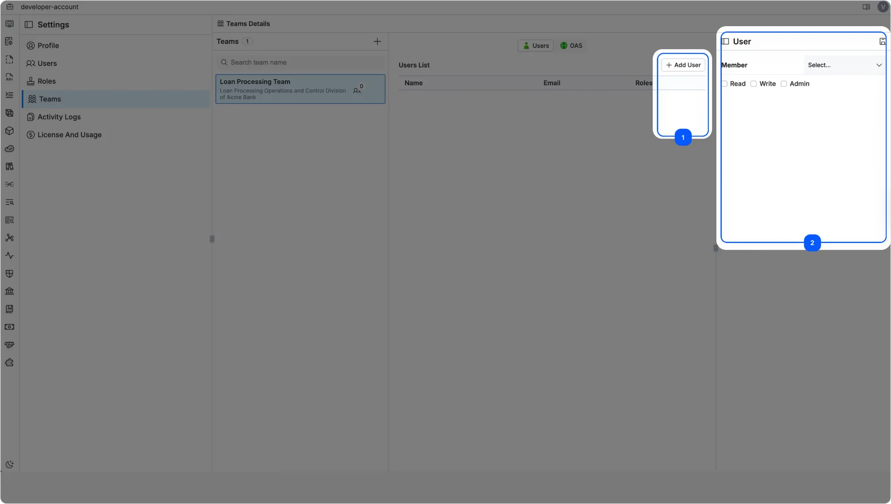
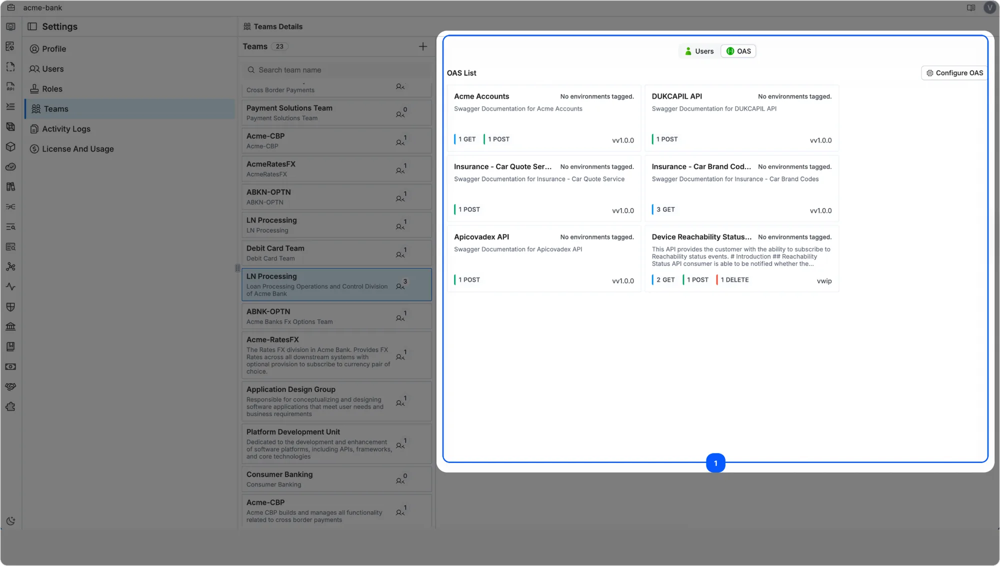
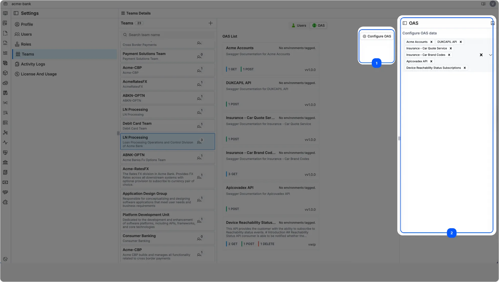

The **Teams** tab lets administrators organize users into logical groups for efficient role assignment, access management, and collaboration. Teams simplify permission management by letting you apply access controls at a group level rather than configuring them for individual users.

## Create a new team

To create a new team, follow these steps:

1. In the top-right corner of the **Teams** panel, select the **\+** icon.
  
1. Enter the following details:

1. Select Save to create the team, or Cancel to discard the changes.
  \*  Indicates a required field.

The new team appears in the Teams list.

## Viewing and managing teams

The **Teams** tab lists all teams in the organization, showing the team name, purpose summary, and user count. Use the **Search Bar** to find a team, or select **Add Team \(\+\)** to create one.

To manage a team, select **More options** \(⋮\) next to the entry, then select **Edit** to update the team, or **Delete** to remove it.

## Add new users to a team

To add a user to a team, follow these steps:

1. In the top-right corner of the **Users List** panel, select **\+ Add User**. The **User** panel opens on the right side of the screen.
  
1. Configure the following fields:

1. Select **Save**.

The user is added to the team and appears in the team's **Users List**, in the **Users** tab.

## Viewing the Users List

Select a team from the **Teams** list to display its associated users in the **Users List**, on the right side of the screen. The list shows each user's full name, email address, and assigned roles.

To manage a user, select **More options** \(⋮\) next to the entry, then select **Edit** to update the user's access roles, or **Delete** to remove the user from the team.

## View associated OAS in the OAS tab

Select the **OAS** tab to view all OpenAPI specifications associated with the selected team. Each card shows the OAS Name, Description, Environment Tag, Endpoints Count, and Version.

If more OAS are attached, scroll through the list or use the **Search** bar to locate a specific specification.

## Modify associated OAS

To add or remove OAS entries associated with a team, follow these steps:

1. In the top-right corner of the **OAS List** panel, select **Configure OAS**. The **OAS Configuration** form opens on the right side of the screen.
  
1. In the **Configure OAS Data** section, select the **×** icon next to a specification name to remove it, or place the cursor in the field and select from the list to add one.
1. Select **Save**.

The updated OAS entries appear in the OAS List panel for the selected team.