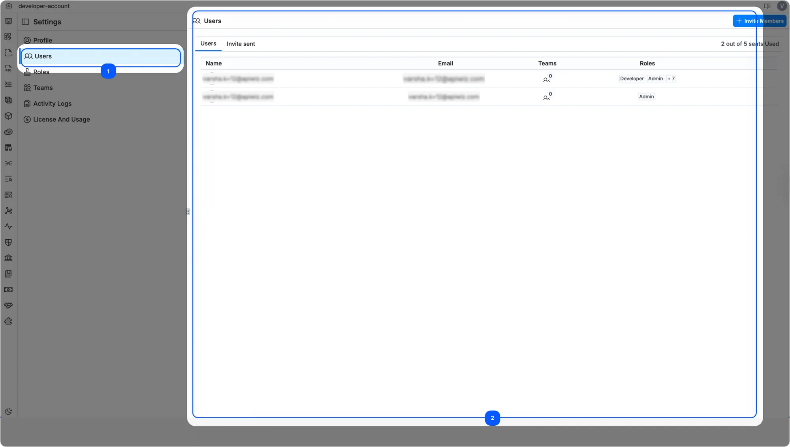
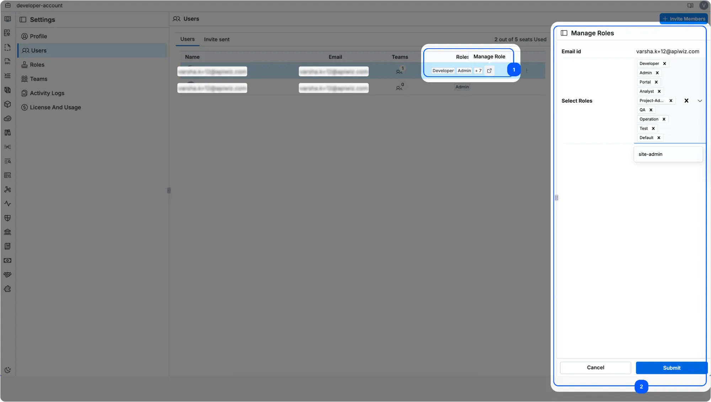
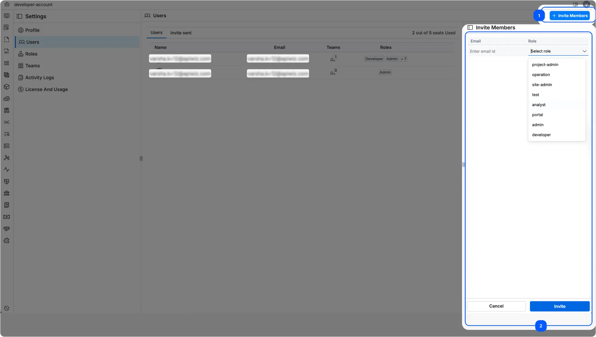

The **Users** tab displays the details of all users in your organization who have access to the portal. This section contains two sub-tabs: **Users** and **Invite Sent**. The **Users** tab lists all active users, while the **Invite Sent** tab tracks pending invitations sent to new users.

### View existing users

The **Users** tab lists all existing users in the organization with the following details:

### Manage user roles

Use the **Manage Roles** window to view and modify the roles assigned to a user.

To manage a user's roles, do the following:

1. In the **Roles** column, select the arrow icon next to the role name. The **Manage Roles** window opens, displaying the user's email ID and the list of currently assigned roles.
  
1. To add a role, select the required role from the **Select Roles** list.
1. To remove a role, select the **×** icon next to the assigned role.
1. Select **Submit**.

The role assignments are updated immediately.

### Additional user actions

Each user entry includes a **More Options** \(⋮\) menu that provides additional administrative actions.

To access additional user actions, do the following:

1. Select the **More Options** \(⋮\) menu next to the user entry.
1. Select one of the following actions:

### Invite new members

Use the **Invite Members** option to invite new users to join the organization.

To invite a new member, do the following:

1. Select **\+ Invite Members** in the top-right corner. The **Invite Members** panel opens.
  
1. Enter the user's email ID.
1. Select the required role from the dropdown list.
1. Select **Invite**.

The invited user receives an email notification with instructions to join the organization.

### View invited members

After inviting a new member, the invitation details appear in the **Invite Sent** tab. This tab lists users who have been invited to join the workspace but have not yet accepted.

### Additional actions for invited users

Each invited user entry includes a **Resend Invitation** option and a **More Options** \(⋮\) menu.