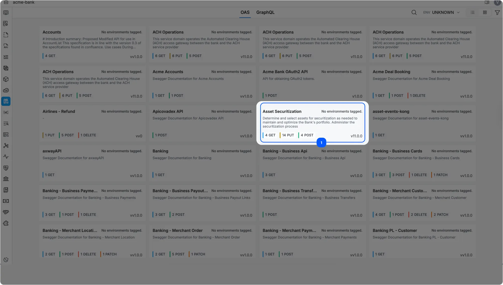
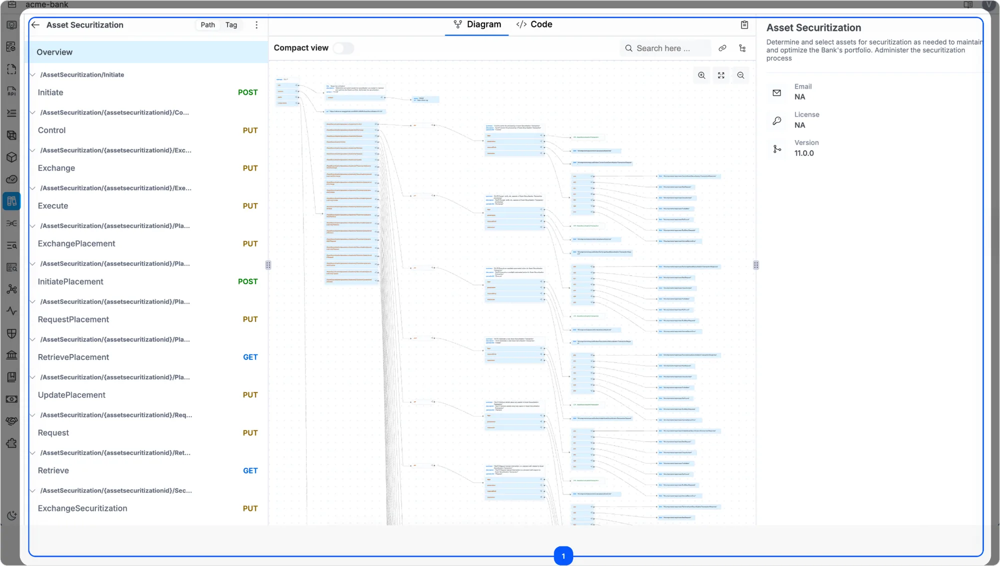
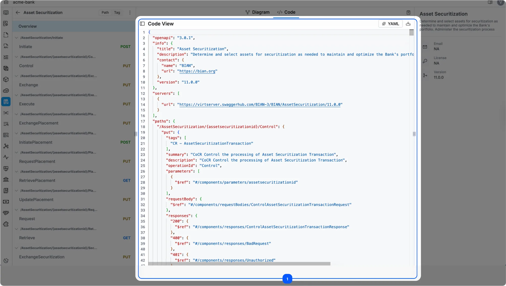
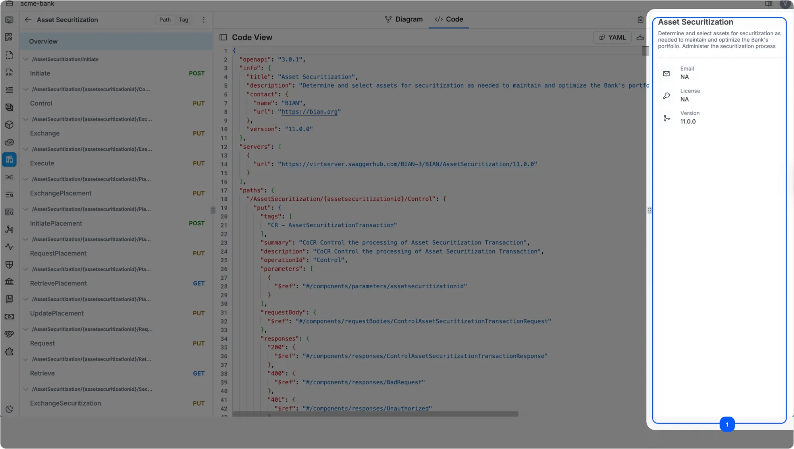
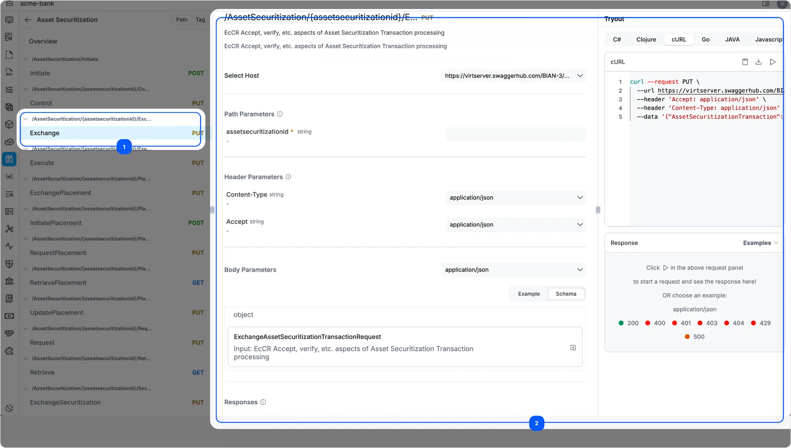
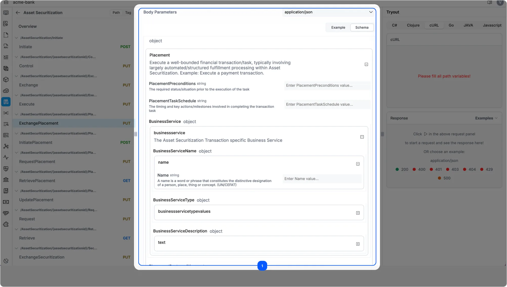
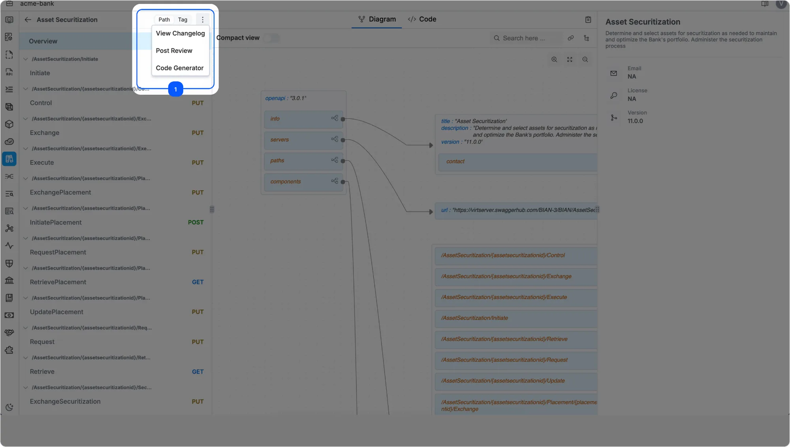
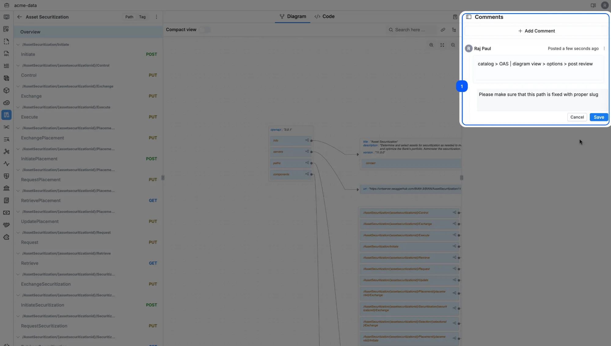
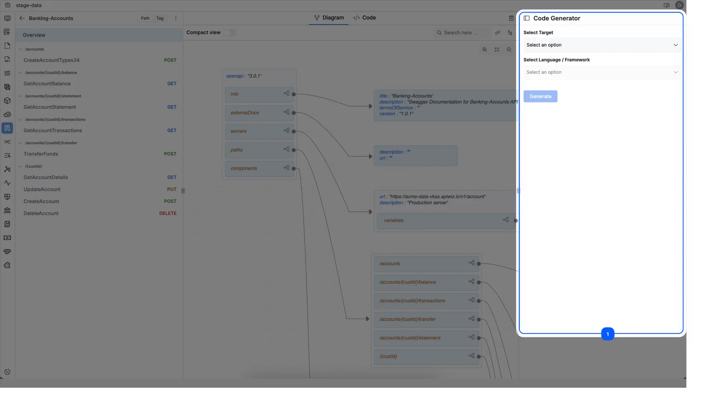

The **OAS** tab displays all published OpenAPI \(OAS\) specifications in the Catalog. Each specification represents an API and includes summary information, such as the API name, description, available HTTP methods, and version. Open a specification to view its detailed documentation.

To view documentation for a specific API, follow these steps:

1. Make sure the **OAS** tab is selected.
1. In the list, locate the API specification you want to view.
  
1. Select the specification.
  

The detailed documentation view opens, giving you a comprehensive layout of the API so you can explore its structure and endpoints.

## Explore the Overview panel

The **Overview** panel, on the left side of the API documentation page, gives you a structured view of the API endpoints in the selected specification. Use it to browse available API paths and operations. The panel header displays the name of the selected API specification, so you can confirm which API you're viewing.

Next to the API name, you can switch between two navigation options: **Path** and **Tag**.

### Path view

**Path** view lists all available API paths with their corresponding HTTP methods. Each path represents an endpoint, and its methods \(such as GET, POST, PUT, and DELETE\) indicate the operations you can perform on that endpoint.

Use this view to explore the API by endpoint structure.

### Tag view

**Tag** view organizes endpoints by the tags defined in the API specification. Each tag groups related endpoints and operations, making it easier to navigate the API by functional category or business domain rather than by path.

Use this view to locate related API operations quickly.

## Explore the Diagram and Code views

The **Body** section displays the main content of the selected API specification. At the top of the section, you can switch between two views: **Diagram** and **Code**.

### Diagram view

**Diagram** view shows the OpenAPI specification in a visual, structured format, illustrating how components such as paths, parameters, and responses connect. Use this view to understand the overall architecture and relationships within the API.

>

In the upper-right corner, you can:

- Zoom in or out to adjust the view.
- Expand or collapse sections for easier navigation.
- Enable **Compact View** to simplify the layout.

#### Compact view

The **Compact View** toggle, in the upper-left corner of the Diagram window, displays the API diagram in a condensed layout. Use this option to:

- Reduce visual clutter in large diagrams.
- View more components within the available screen space.
- Navigate complex API structures more easily.

#### Link and unlink components

The **Link/Unlink** option, in the upper-right corner of the Diagram window, lets you manage relationships between components in the diagram. Use it to:

- Link components to create a connection within the schema.
- Unlink components to remove an existing connection.

#### Move to a parent component

The **Move to Parent** option, next to **Link/Unlink**, helps you navigate deeply nested schema structures by locating the parent key associated with a selected value.

To navigate to a parent key, follow these steps:

1. Select a value within the schema diagram.
1. Select **Move to Parent**.

The diagram shifts to the parent key associated with the selected value.

**To return to a previous key:**

When viewing a nested value \(for example, **Contact**\), select the left arrow at the top of the value cell. The view moves back to the corresponding parent key in the schema hierarchy.

### Code view

To switch to Code view, select the **Code** tab.

**Code** view displays the API specification in its source format, so you can review the complete OpenAPI definition. You can view the specification in **JSON** or **YAML**.

To switch formats or download the specification, follow these steps:

1. In the upper-right corner of the Code view, select the format selector to switch between **JSON** and **YAML**.
1. Select **Download**, next to the format selector, to download the specification file in the selected format.

Use this view to inspect the raw API definition or reuse the specification in your development tools.

## View specification details

The **Specification Details** panel, on the right side of the API documentation page, displays key metadata about the selected API specification. Use it to understand the API's purpose, ownership, and version.

The panel typically includes:

## Test an API using Tryout

Use the **Tryout** feature to test API endpoints directly from the documentation interface. You can simulate API requests, configure parameters, and view responses without leaving the catalog.

To test an API method, follow these steps:

1. In the **Overview** panel, select the endpoint you want to test.
  

The interface displays three sections:

- The request configuration panel \(center\)
- The Tryout panel with generated code \(right\)
- The response panel \(below the request configuration\)

Use these sections to configure the request, run it, and review the response.

## Configure a request

The request configuration panel displays the fields required to run the selected API method.

### Host selection

Use the **Host** dropdown to select the server, from the available Swagger servers, where the API sends the request.

### Path parameters

Enter values for any path parameters required by the API endpoint.

### Header parameters

Configure the required HTTP headers before you send the request. Common headers include:

These headers ensure the request and response data are processed in the correct format.

### Body parameters

Use the **Body Parameters** section to provide the input data required by the selected API method. If the endpoint requires a request body, enter the necessary values here before you run the request.

The request body follows the schema defined in the API specification, which sets the expected structure, data types, and required fields.

Use the Schema view to understand how fields relate to each other and confirm that your request body follows the correct structure.

## Review responses

The **Responses** section displays the possible responses for the selected API method. Each response is represented by an HTTP status code, which indicates the result of the request.

To view response details, follow these steps:

1. Select a response code.

The section expands to show the response body, schema, and example payloads.

## Run a Tryout request

Use **Tryout** to generate and run API requests in different programming languages, including cURL, JavaScript, C\#, Java, Go, and Clojure.

To generate and run a request, follow these steps:

1. Select a language to view the corresponding generated request code. The code updates automatically when you modify input parameters in the request configuration panel.
1. Next to the selected language, choose an option:

If you select **Execute**, the **Response** section, below the request panel, displays the results, including:

- The HTTP status code
- The response body
- Example responses
- Additional response details

Use this information to verify whether the request ran successfully and whether the returned data matches the expected schema.

## Access the API specification management menu

Use the **More options** \(⋮\) menu, next to **Path** and **Tag**, to access additional actions for the selected API specification:

- View Changelog
- Post Review
- Code Generator

## View the changelog

Use **View Changelog** to review the update history for the selected API specification.

To view the changelog, follow these steps:

1. From the options menu, select **View Changelog**. The **Changelog** panel opens on the right side of the screen.
1. Select the calendar icon to filter log entries by date and review updates within a specific time range.

The panel displays a timeline of updates made to the API specification. When a new update is recorded, the system automatically creates a new changelog entry.

**Additional options:**

## Post a review comment

Use **Post Review** to add feedback on the selected API specification or view existing comments.

To add a comment, follow these steps:

1. From the options menu, select **Post Review**. The **Comments** panel opens on the right side of the screen.
  
1. Select **\+ Add Comment**.
1. Enter your feedback in the text field.
1. Select **Save**.

The comment is saved and displayed with the author's name and timestamp.

## Generate code

Use **Code Generator** to automatically create client or server code based on the selected API specification. This reduces manual coding effort and helps maintain consistency during API integration.

To generate code, follow these steps:

1. From the options menu, select **Code Generator**. A configuration panel opens on the right side of the screen.
  
1. Under **Select Target**, choose **Server** or **Client**.
1. Under **Select Language/Framework**, choose the programming language or framework you want.
1. Select **Generate**.

The system generates the code and downloads it automatically as a .zip file, which you can use for further development or integration.