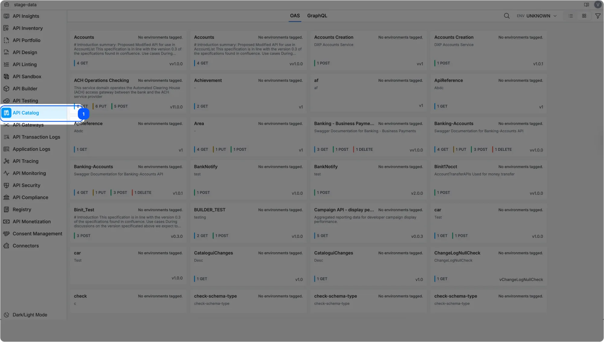

Use this procedure to access the API Catalog module in the APIWiz platform. The API Catalog gives you a centralized view of the APIs available in your organization.

### Prerequisites

At least one API specification \(OAS or GraphQL\) is published to the catalog.

### Access the API Catalog module

To open the API Catalog module, follow these steps:

1. Log in to the **APIWiz** platform.
1. On the left pane, hover over the vertical navigation bar to expand the available modules.
1. Select **API Catalog**.
  

The API Catalog module opens.