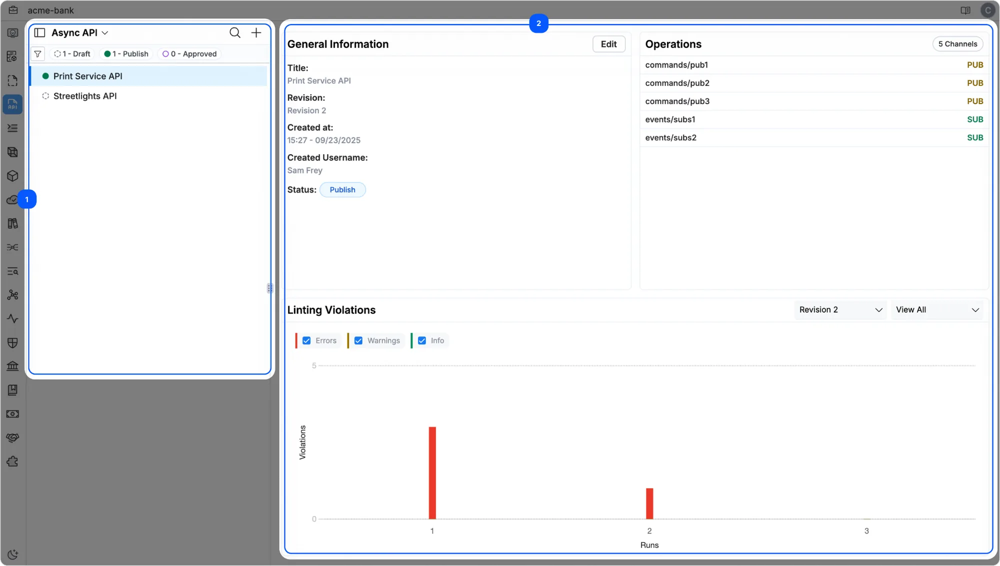

After creating an AsyncAPI, the system redirects you to the AsyncAPI interface, where you can view and manage your AsyncAPI definitions.

The interface is organized into the following four sections:

### API list

The API list panel on the left provides a centralized view to navigate and manage AsyncAPI definitions. From this panel, you can:

- Switch between different API types.
- Search and filter APIs by status.
- Create new AsyncAPI definitions.
- View existing AsyncAPI definitions in a scrollable list.
- Identify the active AsyncAPI, which is highlighted in the list.

### General information and operations

This section displays and manages the metadata and operations of the selected AsyncAPI definition.

#### General information

Select **Edit** to update the API metadata. This section displays the following details:

#### Operations

The operations section displays the following:

- The list of channels defined in the AsyncAPI.
- Available operations in a table, including the operation name and operation type.

### Linting violations

Linting examines an AsyncAPI specification for consistency and compliance with defined rules. When executed, linting identifies potential issues and generates errors, warnings, and informational messages.

#### Rule sets

A rule set is a collection of linting rules that define code style, structure, and best practices based on organizational standards. Rule sets ensure all developers follow consistent guidelines and help detect deviations from established practices.

#### Linting in APIwiz

In APIwiz, linting uses rule sets to analyze the API specification and generate reports highlighting areas that require attention.

- Linting results can be filtered by API revision and rule set, enabling targeted analysis and focused improvements.
- Each linting run displays the total number of detected errors, warnings, and informational messages.
- When changes are made to the API design or linting rules, the global rule set triggers automatically.
- Custom rule sets must be triggered manually.