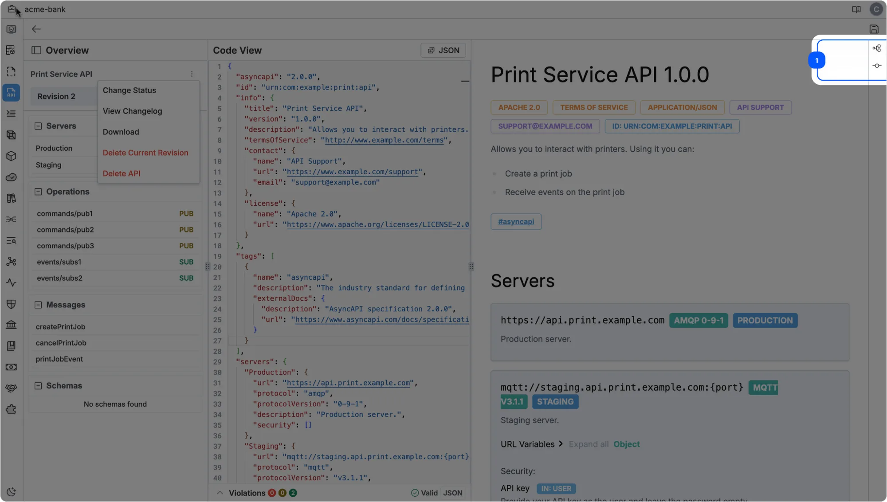
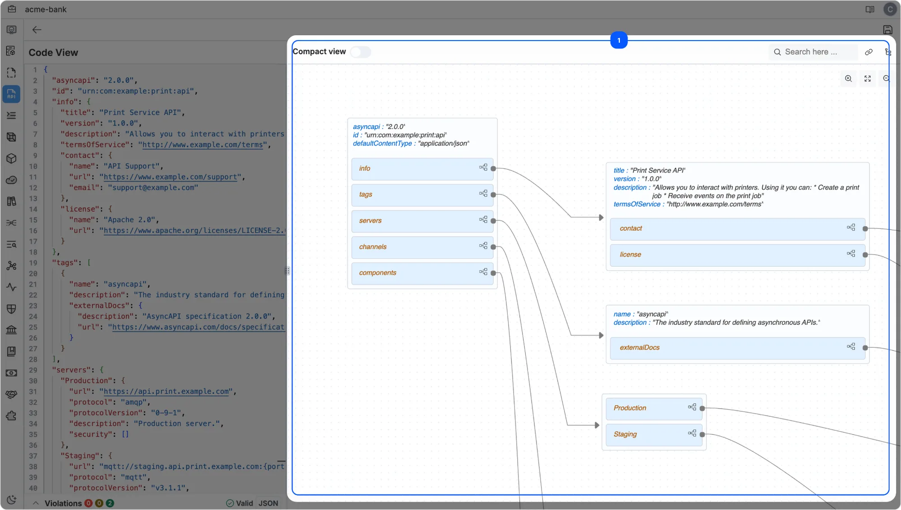
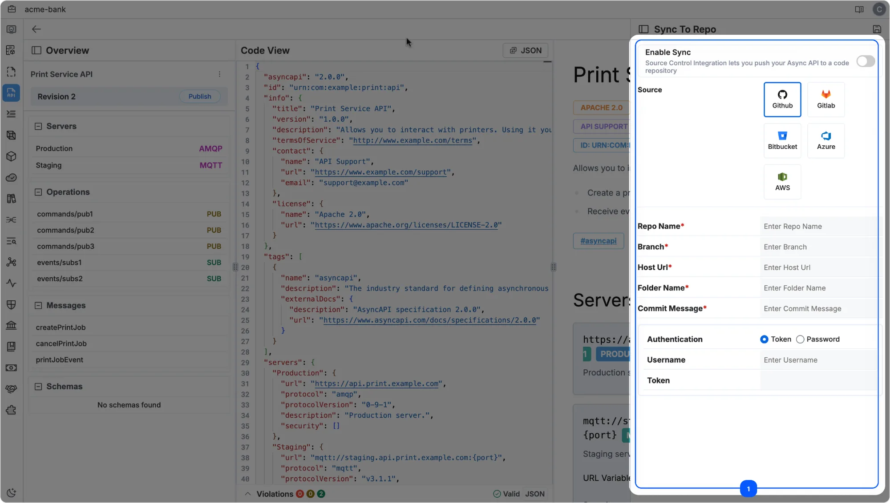

The right side of the interface provides quick access to additional views and repository integration.

### Switch to Tree View

Select **Switch to Tree View**. The AsyncAPI specification displays in a structured tree format. This view organizes the specification into expandable nodes, making it easier to navigate and locate specific elements.

### Sync to repository

Select **Sync to Repo**. A panel opens where you can synchronize the current AsyncAPI specification with your connected source control repository. This ensures version control and keeps the specification aligned with the underlying implementation.

Enter the required details to connect the AsyncAPI specification to the selected repository.

1. Enable **Sync.**
1. Select the SCM source. Supported providers: GitHub, GitLab, Bitbucket, Azure, AWS.
1. Enter the following repository details:

1. Select the authentication method and enter your credentials. Supported methods: Token, Password.
1. Select **Save**.