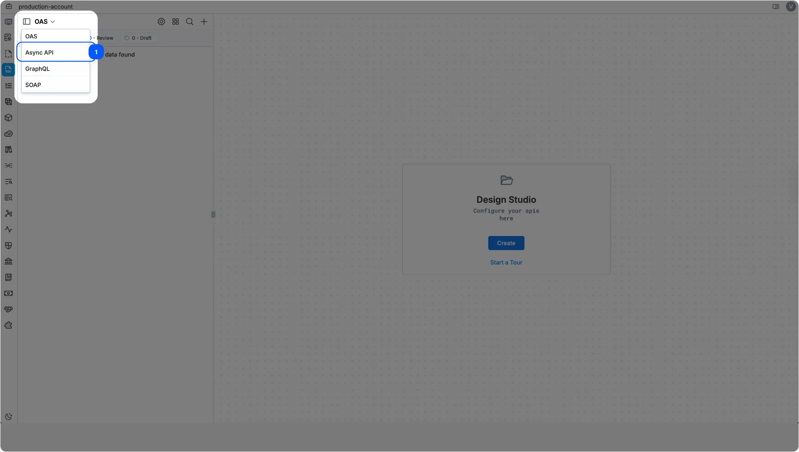
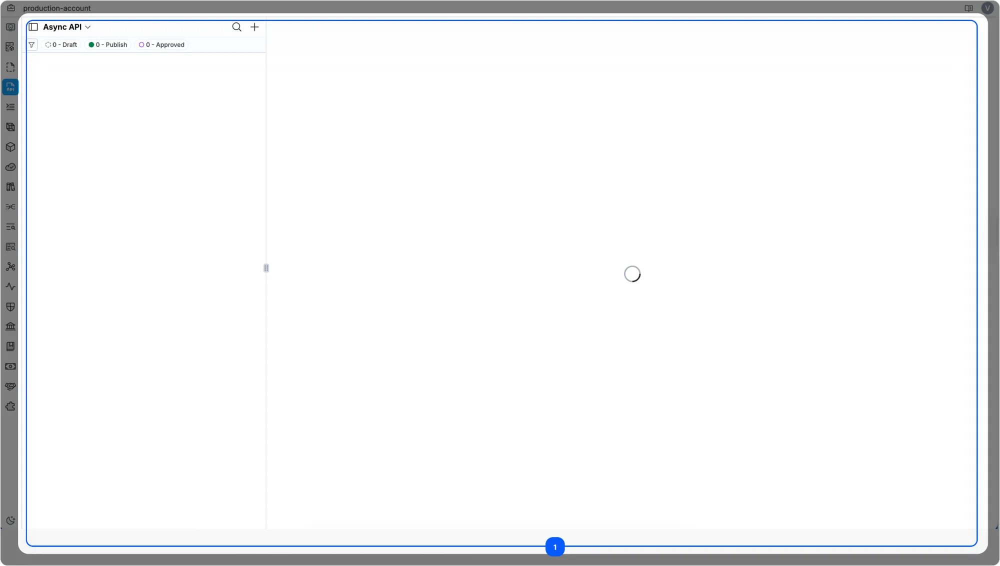

To access the AsyncAPI interface, follow these steps:

1. In the left navigation panel, select the **API Type** dropdown.
1. Select **Async API**.
  
1. You are redirected to the AsyncAPI interface, where you can view and manage your AsyncAPI definitions.
  