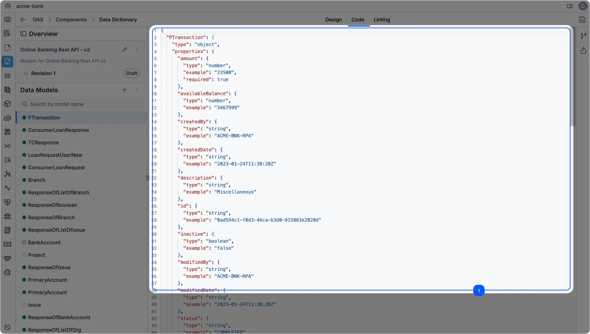

The **Code** tab displays the code representation of the model created in the **Design** tab. The system automatically converts visually designed data models into their corresponding JSON or JSON Schema format.

The **Code** tab is read-only. You cannot make direct edits in this view.

Use the **Code** tab to do the following:

- Inspect the raw code behind the models, including structure, properties, types, and metadata.
- Verify the technical accuracy of model definitions to ensure they match the intended schema.
- View metadata and inheritance models that show relationships between different data models.
- Review property details such as types, examples, and nested objects.

The **Code** tab bridges the design layer with the technical layer, making it easier for both business users who design visually and developers who need the schema in code form to collaborate effectively.