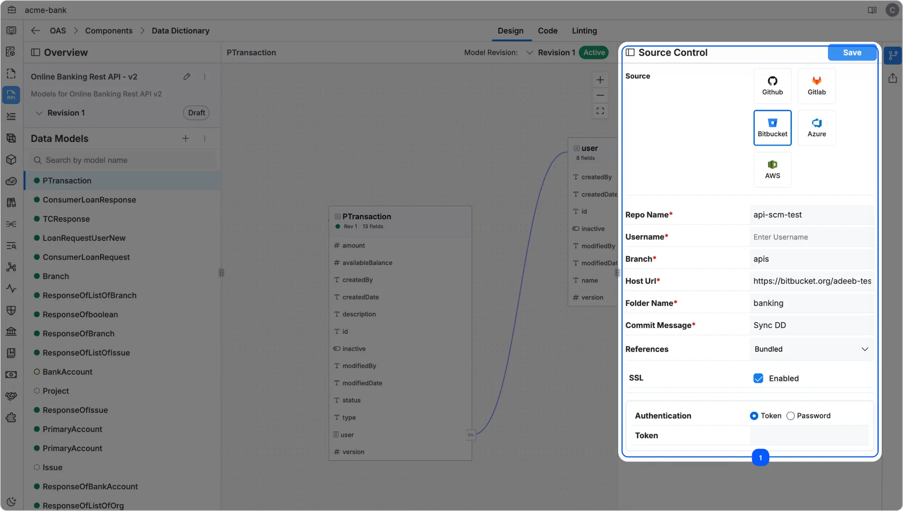

Connect your API specifications to an external source control repository for version-controlled synchronization.

The **Source Control** feature enables you to integrate your Data Dictionary with an external source code repository. This enables version control, collaborative editing, and secure backup of your API designs within your existing DevOps workflows.

### Configure source control

To connect your Data Dictionary to an external repository, follow these steps:

1. On the design canvas, select the **Source Control** icon on the right side of the screen. The **Source Control** panel opens on the right side of the canvas.
  
1. Enable **Sync**.
1. Select the SCM source. Supported providers: GitHub, GitLab, Bitbucket, Azure, AWS.
1. Enter the following repository details:

1. Select the authentication method and enter your credentials. Supported methods: Token, Password.
1. Select **Save**.