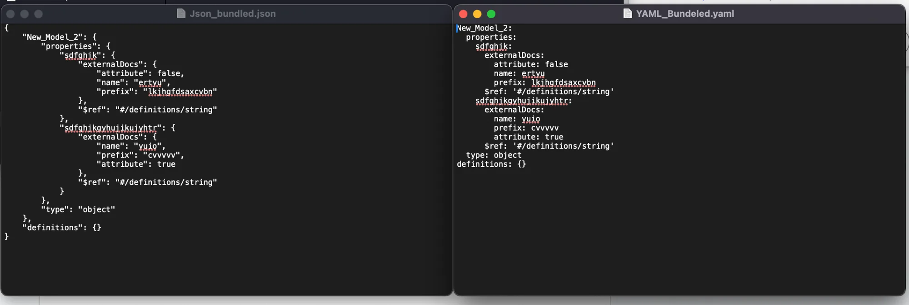
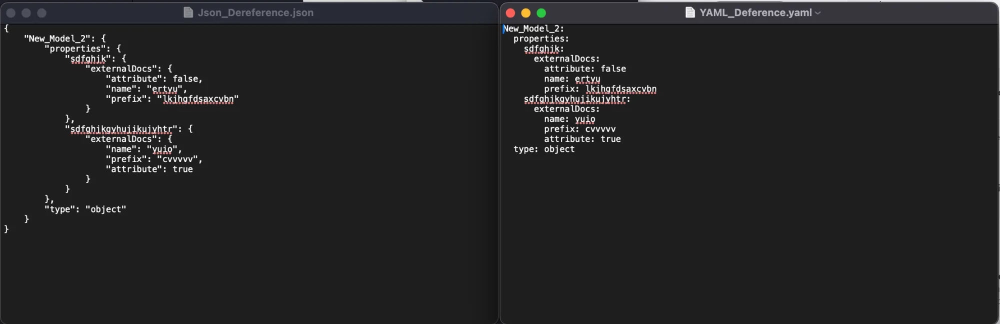

Export your data model as a JSON or YAML file to use it in external tools, systems, or documentation.

Exporting a data model generates a downloadable file in your chosen format. During export, you can control how references are handled, either kept together in a single file or expanded into full definitions. This makes the exported file ready for sharing, integration, or consumption by external tools and systems.

**Before you begin**

Ensure your data model is complete and saved before exporting.

### Export a data model

To export a data model, do the following:

1. Select the **Export** icon on the right side of the screen. The **Export** panel opens on the right side of the design canvas.
1. Select the output format:

1. Select how model references are handled in the exported file:

1. Select **Export** to generate and download the file.

### Export file types

The exported file downloads to your device. The file name and structure depend on the format and reference option you selected:

- **Bundled files** consolidate all external references into a single file.
  
- **Dereferenced files** replace all references with their actual values, resulting in fully expanded schemas.
  

The exported files include all dependencies and are ready for deployment, validation, or sharing across environments.