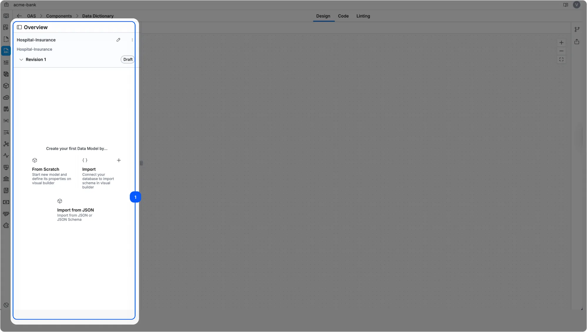
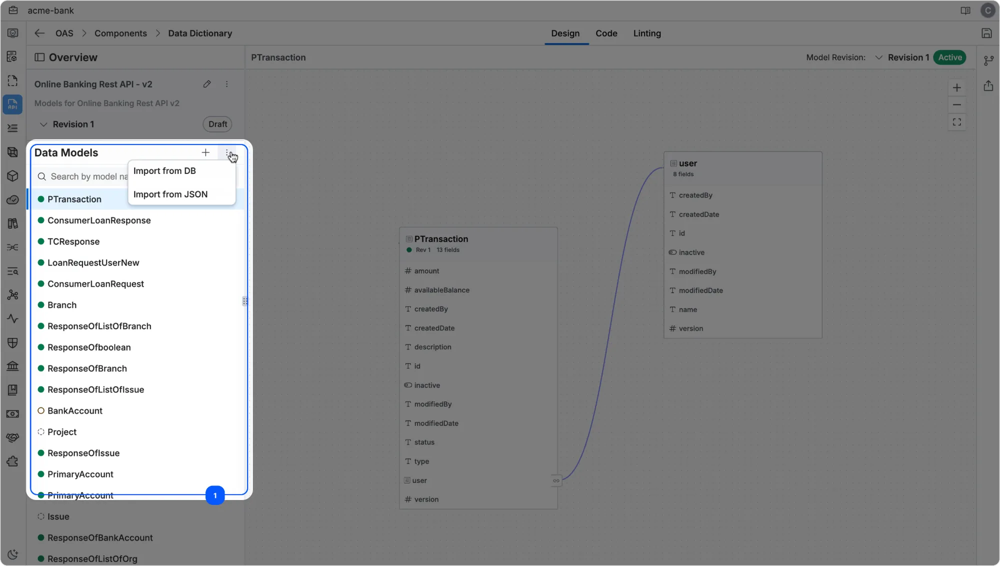
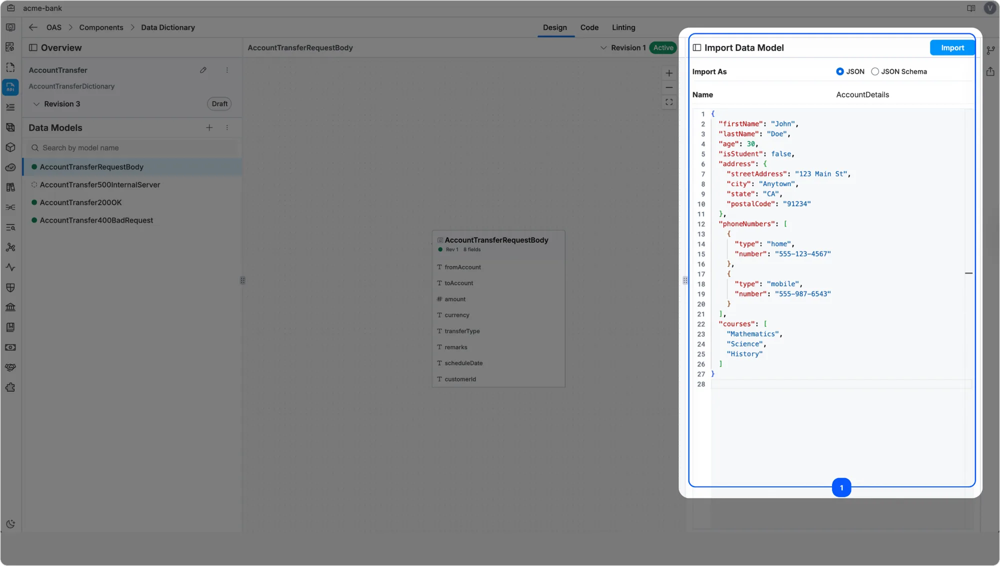

Use the **Import from JSON** option to create data models by importing an existing JSON or JSON Schema definition.

### Import a data model from JSON

To import a data model from JSON, do the following:

1. In the **Overview** panel, select **Import from JSON** if no data models exist.
  
1. \(Optional\) If data models already exist, select the **More Options** menu \(**⋮**\) next to **\+** in the **Data Models** section and select **Import from JSON**.
  
1. The **Import from JSON** panel opens on the right side of the screen.
  
1. Select the input type:

1. Enter a name for the data model in the **Model Name** field.
1. Paste the JSON code in the input field.
1. Select **Import**.

The imported schema appears on the design canvas and the data model appears in the **Data Models** list in the **Overview** panel. Select the model to open it in the **Design** panel, where you can view and modify its structure.

Once the data is imported, follow the same process used for creating a data model from scratch.