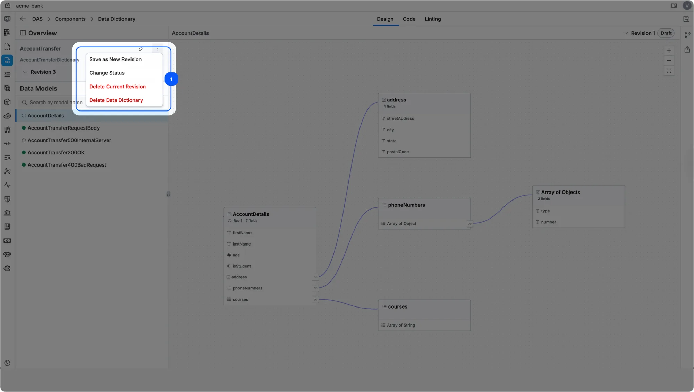
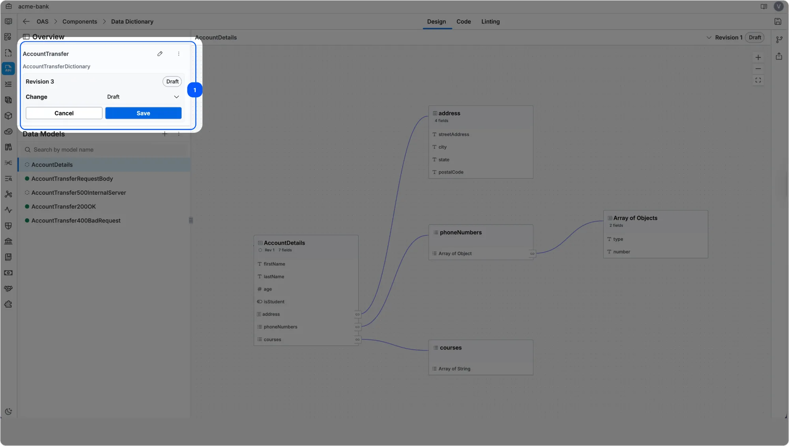
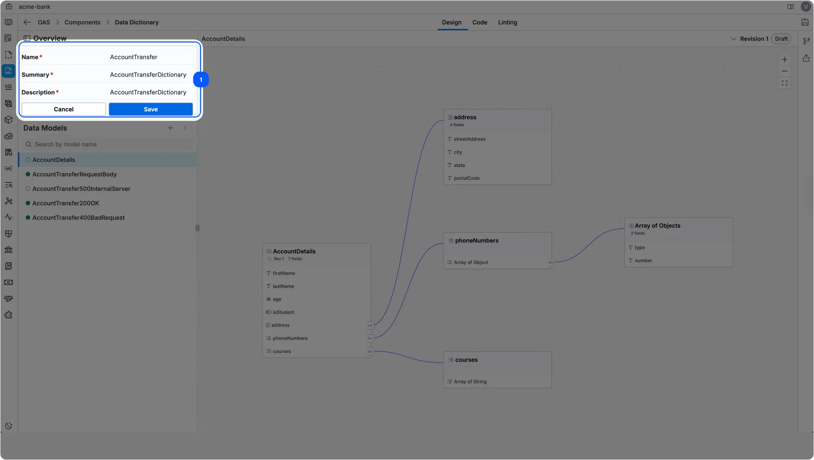

To access management options for a Data Dictionary, select the **More Options** menu \(**⋮**\) next to the Data Dictionary name in the **Overview** panel.

The following options are available:

# Save the Data Dictionary as a new revision

To save the Data Dictionary as a new revision, do the following:

1. Select the **More Options** menu \(**⋮**\) next to the Data Dictionary name in the **Overview** panel.
1. Select **Save as New Revision**.

The system creates a new revision incorporating all recent changes and saves it immediately.

# Change the Data Dictionary status

To change the status of the Data Dictionary, do the following:

1. Select the **More Options** menu \(**⋮**\) next to the Data Dictionary name in the **Overview** panel.
1. Select **Change Status**. A dialog box opens with a **Status** dropdown.
  
1. Select one of the following statuses:

1. Select **Save**.

# Delete the current Data Dictionary revision

To delete the current revision of the Data Dictionary, do the following:

1. Select the **More Options** menu \(**⋮**\) next to the Data Dictionary name in the **Overview** panel.
1. Select **Delete Current Revision**.

The system deletes the current revision and automatically reverts to the previous revision.

# Delete the Data Dictionary

To permanently delete a Data Dictionary, do the following:

1. Select the **More Options** menu \(**⋮**\) next to the Data Dictionary name in the **Overview** panel.
1. Select **Delete Data Dictionary**. A confirmation dialog appears.
1. Select **OK** to confirm the deletion.

The system permanently deletes the Data Dictionary and all data models it contains.

# Edit the Data Dictionary details

To edit the details of a Data Dictionary, do the following:

1. Select the **Edit** icon \(pencil icon\) next to the Data Dictionary name in the **Overview** panel.
  
1. The following fields become editable:
  - **Name**: Enter or update the Data Dictionary name.
  - **Summary**: Enter or update a summary of the Data Dictionary.
  - **Description**: Enter or update a detailed description of the Data Dictionary.
1. Select **Save**.