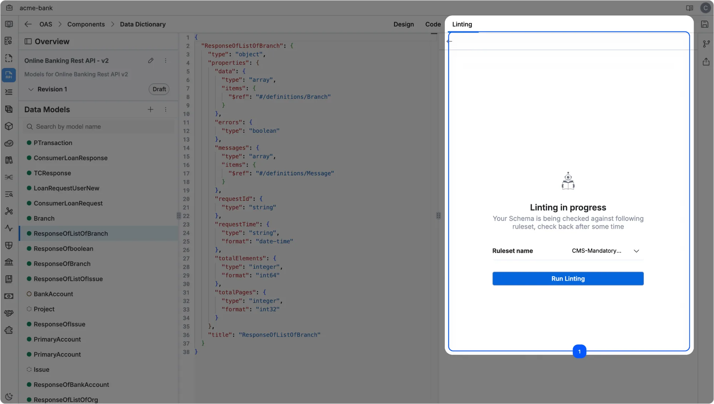

Linting analyzes JSON schemas to identify syntax errors, structural inconsistencies, and stylistic issues. It ensures that each data model or OAS complies with both organizational and industry-defined standards.

### Run linting

To run linting on a Data Dictionary, do the following:

1. Open the **Linting** panel on the right side of the screen.
  
1. Select the required ruleset from the dropdown.
1. Select **Run Linting**.

The system analyzes the schema against the selected ruleset and displays the results in the **Linting** panel.