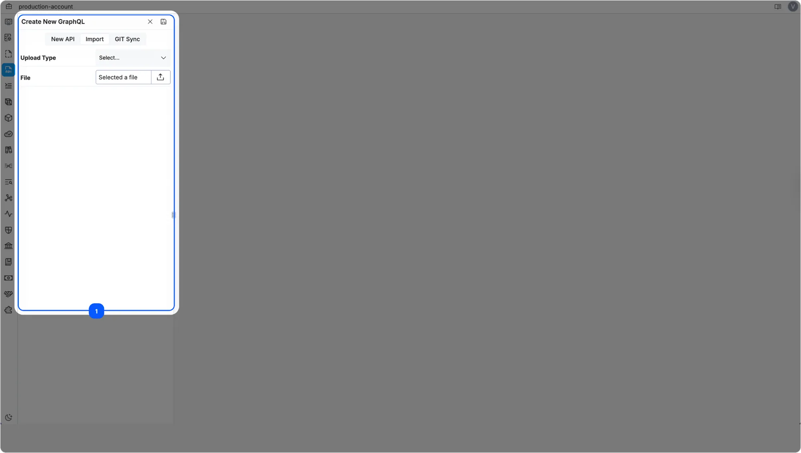
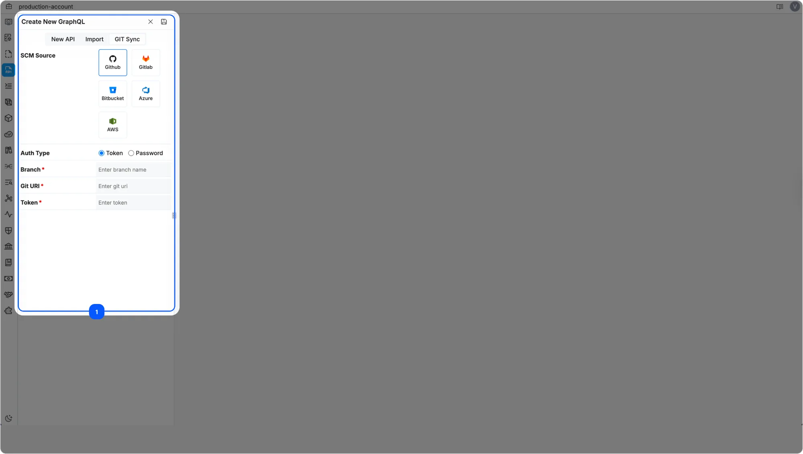

To create a GraphQL schema, select **➕**. The following creation methods are available. Select the method that best fits your workflow.

### Before you begin

Before creating a GraphQL schema, ensure you have the following:

### Create a new GraphQL schema

Use this method to design a GraphQL schema from scratch.

To create a new GraphQL schema, follow these steps:

1. Select **New API**.
  
1. Select one of the following starting options:

1. Enter a name for the GraphQL schema.
1. Select **Proceed** to open the design workspace, where you can define types, queries, mutations, and schemas.

After the GraphQL schema is created, you are redirected to the landing page. In the **General Information** section, select **Edit** to open the schema in the editor and begin design and configuration.

### Import a GraphQL schema

Use this method when you already have an existing GraphQL specification file.

To import a GraphQL schema, follow these steps:

1. Select **Import**.
  
1. In the dropdown, select the upload type.
1. Upload the GraphQL file from your local system.
1. Confirm the selection to import the file.

The system parses the uploaded file and creates a GraphQL schema using the imported definition.

### Sync a GraphQL schema from Git

Use this method to sync a GraphQL schema directly from a source control repository.

To sync a GraphQL schema from Git, follow these steps:

1. Select **Git Sync**.
  
1. Select the source control provider. Supported providers: GitHub, GitLab, Bitbucket, Azure, AWS CodeCommit.
1. Select the authentication type. Supported types: Token, Password.
1. Enter the following details:

1. Select **Proceed** to sync the repository.

The GraphQL schema is created by pulling the specification from the selected repository, enabling version-controlled API management.