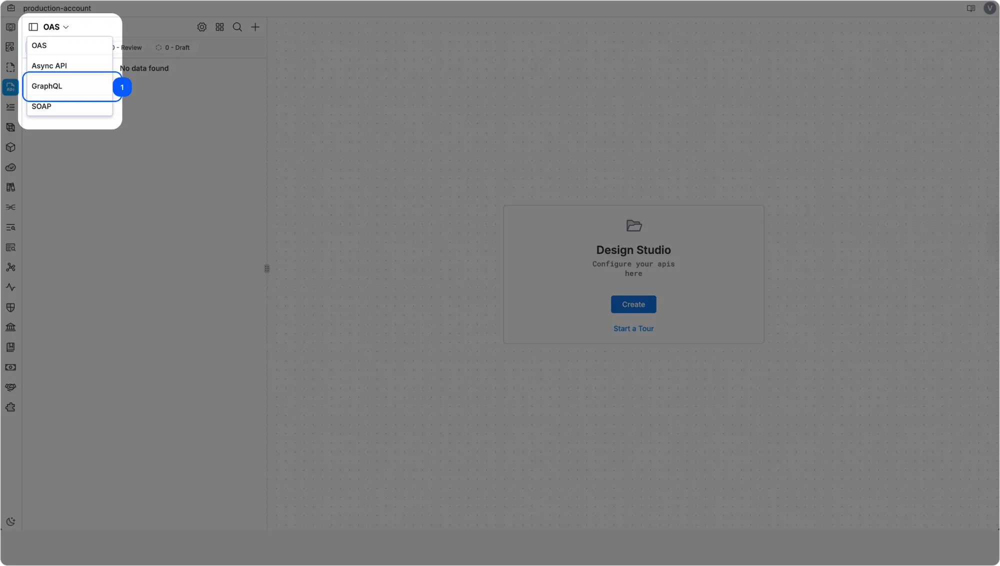
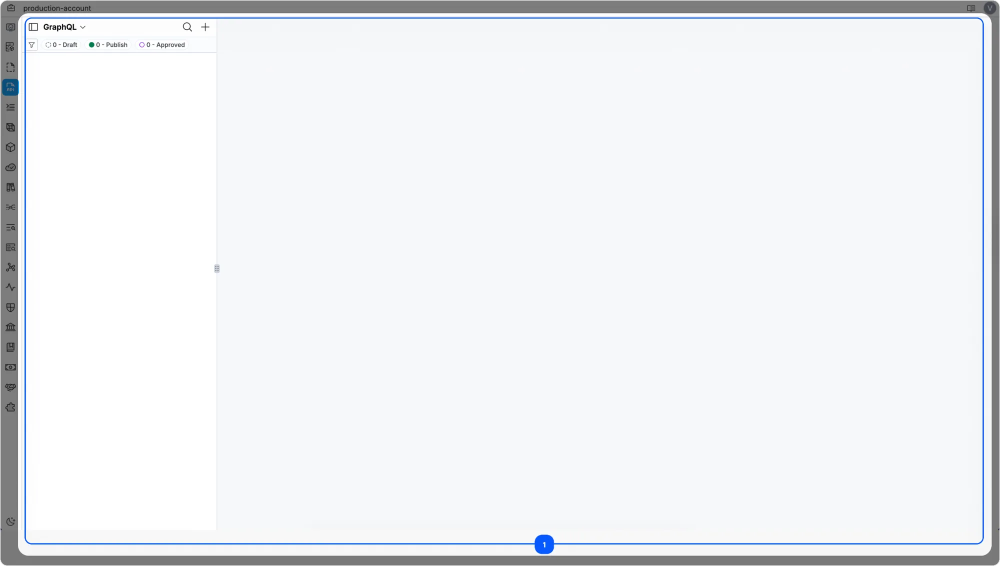

To access the GraphQL interface, do the following:

1. In the left navigation panel, select the **API Type** dropdown.
1. Select **GraphQL**.
  
1. You are redirected to the GraphQL interface, where you can view and manage GraphQL definitions.
  