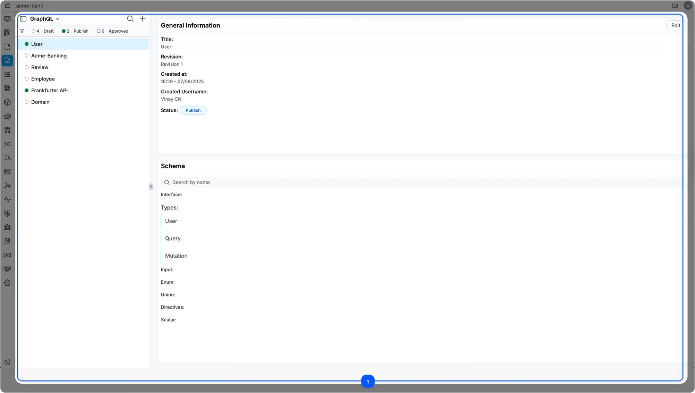

After you create a GraphQL schema, the system redirects you to the GraphQL dashboard, where you can view and manage your GraphQL API definitions.

The interface is organized into the following three sections:

### API list

The API list panel on the left provides a centralized view to navigate and manage GraphQL definitions. From this panel, you can:

- Switch between different API types.
- Search and filter APIs by status.
- Create new GraphQL definitions.
- View existing API definitions in a scrollable list.
- Identify the active API, which is highlighted in the list.

### General information and schema details

This section displays detailed information for the selected GraphQL schema, divided into two subsections.

#### General information

This subsection displays the following details:

In the top-right corner of the panel, select **Edit** to modify the schema definition.

#### Schema

This subsection includes the following:

Use this section to explore and manage schema components.