In the **General Information** section, select **Edit**. The GraphQL Editor interface opens.

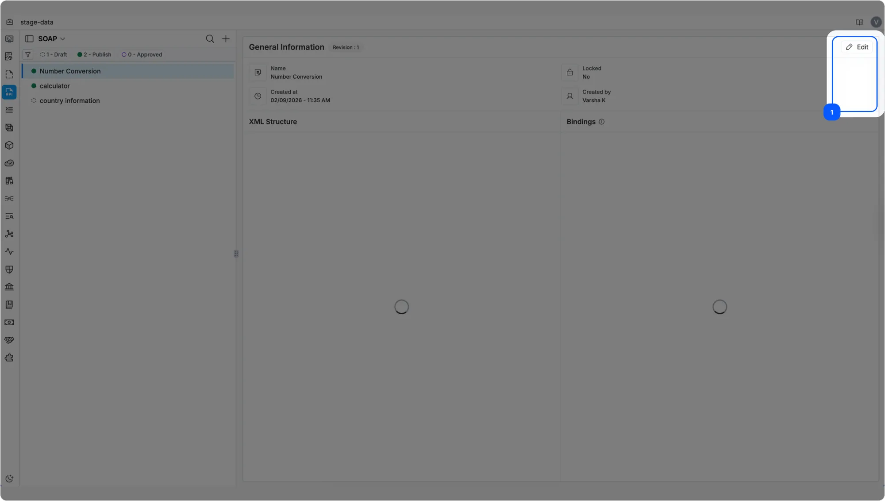

### Relation View

The Relation View shows how schema components are connected.

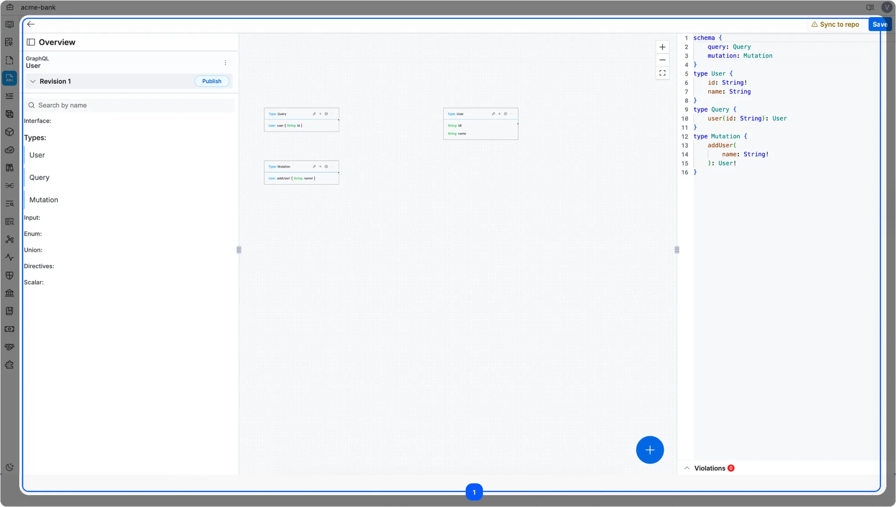

It displays the following:

- A visual, graph-based layout of schema components.
- Connected nodes representing types and operations.
- A clear view of how types, queries, mutations, and fields relate to each other.

Use the Relation View to analyze dependencies, validate relationships, and understand the overall schema structure.

### Why the Relation View matters

- Helps you quickly understand schema structure and dependencies.
- Makes it easier to identify related schema parts and validate relationships during design.
- Supports faster iteration with an at-a-glance view of complex schemas.

### User node overview

The User node represents a GraphQL object type.

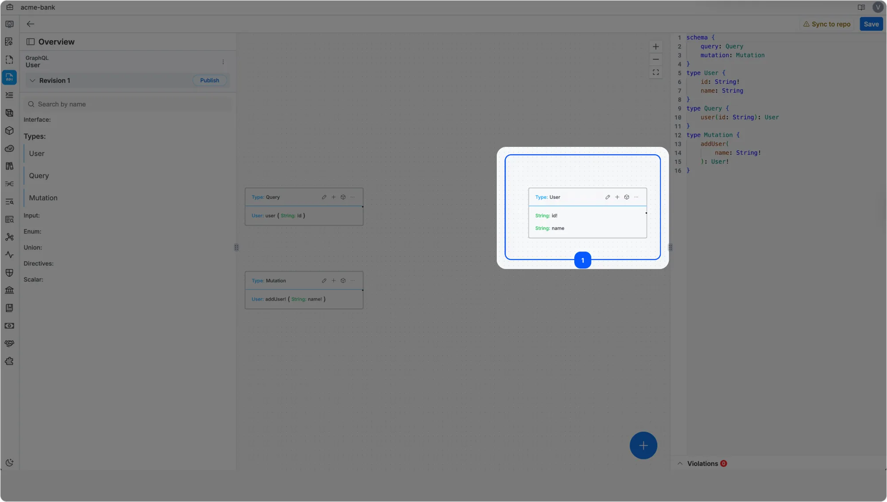

It contains the following fields:

### User node management options

Next to the User type name, the following action icons are available to manage and extend the schema:

The **More options** menu provides the following actions:

## Creating schema definitions

You can create schema definitions using the visual schema editor.

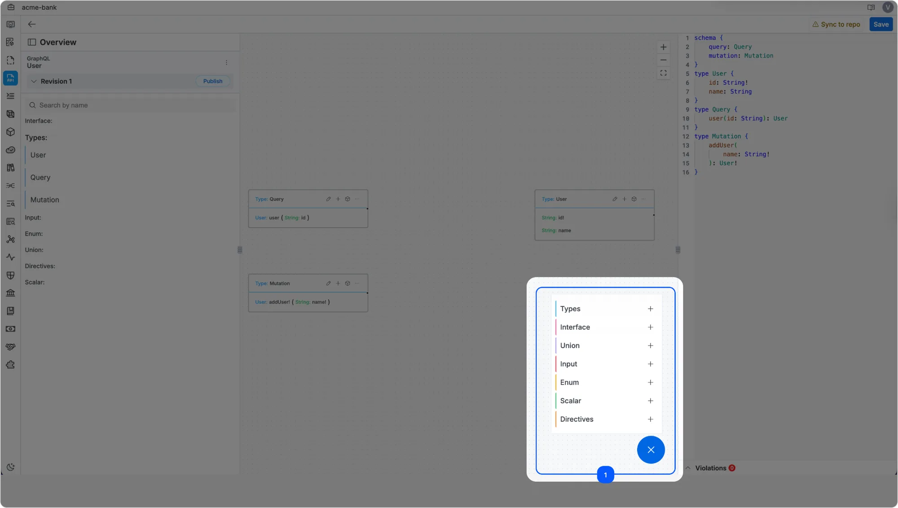

To create a new schema definition, follow these steps:

1. In the bottom-right corner of the schema editor, select **Add \(\+\)**. A menu of available schema types appears.
1. Select the required schema definition type:TypesInterfacesUnionsInputsEnumsScalarsDirectives
1. Enter the schema definition name and press **Enter**.
1. In the description field at the top of the schema definition, enter a description.

### Types

Types define the structure of data exposed by the GraphQL API. They are the core building blocks of a schema.

### Common type definitions

### Create a new type

To create a new type, follow these steps:

1. In the bottom-right corner of the schema editor, select **Add \(\+\)**.
1. Select **Types**.
1. Enter the type name and press **Enter**. The new type is added to the schema.

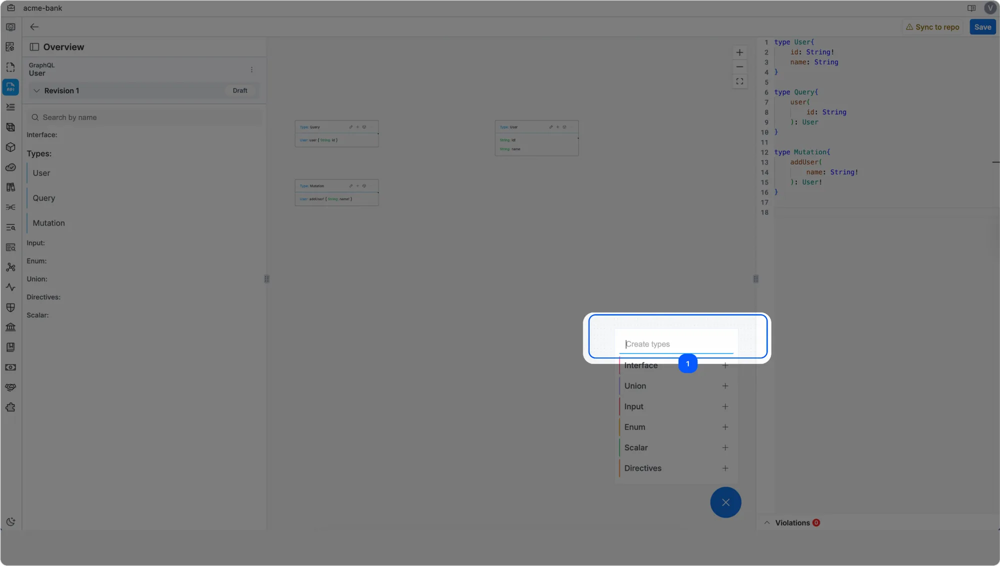

1. In the **Description** field at the top of the type definition, enter a description.

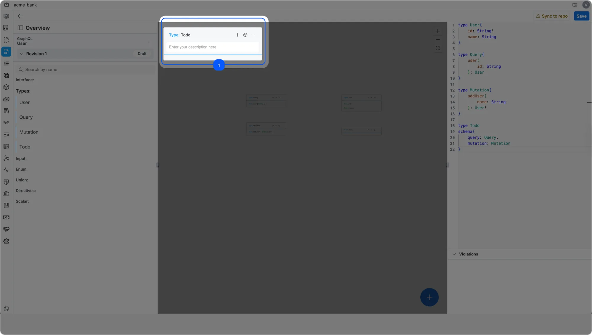

After completing these steps, you can define fields and configure relationships for the new type.

### Add fields to a type

After you create a type, add fields to define its structure.

To add fields to a type, follow these steps:

1. On the type, select **Add \(\+\)**. The system displays the following options: Add Fields, Add Types, Add Enum, Add Interface, Add Scalar, Add Union, Add Directives.


1. Select **Add** **Fields**.

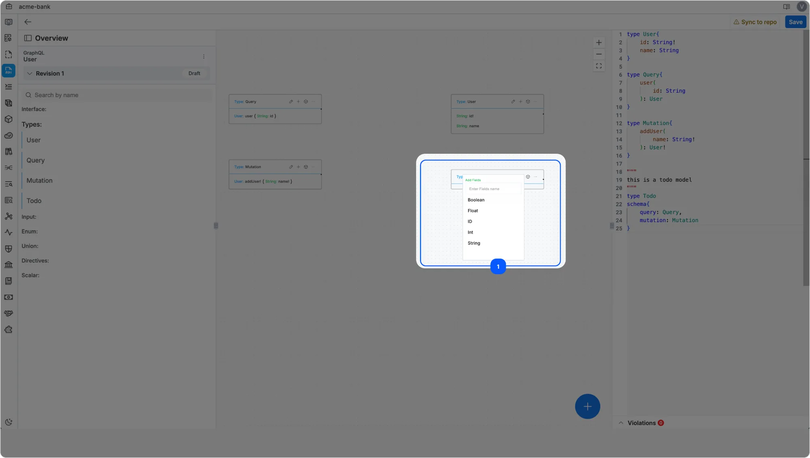

1. In the **Add Fields** dialog, enter the field name.


1. Select the required data type. Available types include String, Int, Boolean, Float, and ID.

The field is added to the type definition and becomes part of the schema structure. Repeat these steps to add additional fields.

**Example:**

```graphql

type User {
  id: ID!
  name: String
  email: String
  accounts: [Account]
}

type Account {
  id: ID!
  accountNumber: String
  balance: Float
  owner: User
}

type Query {
  user(id: ID!): User
  accounts: [Account]
}

type Mutation {
  createUser(name: String!, email: String!): User
  updateAccountBalance(accountNumber: String!, newBalance: Float!): Account
}

```

### Enum

Enum \(enumeration\) types define a fixed set of allowed values for a field. Enums improve readability and enforce type safety by restricting inputs to predefined options.

### Create a new enum

To create a new enum, follow these steps:

1. In the bottom-right corner of the schema editor, select **Add \(\+\)**.
1. Select **Enum**.

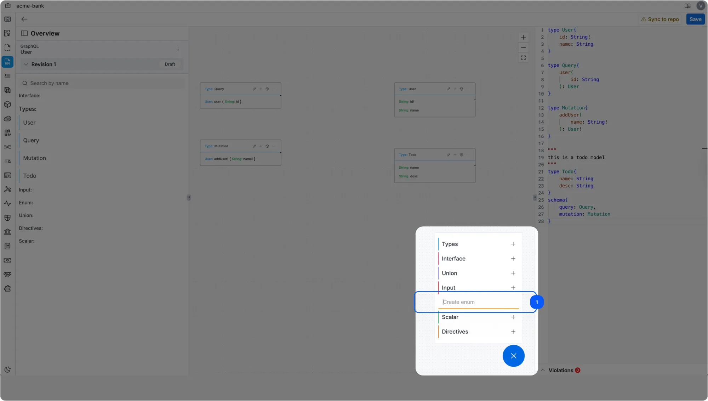

1. Enter the enum name and press **Enter**.
1. In the description field at the top of the enum, enter a description.

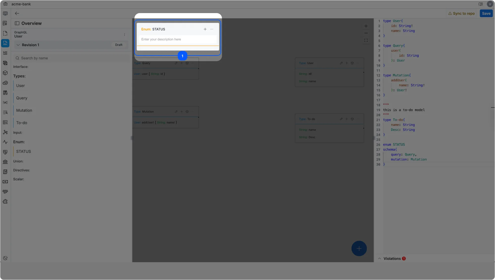

### Add an enum to the schema

Use enums to define a predefined set of allowed values for a field.

To add an enum to a type, follow these steps:

1. On the required type, select **Add \(\+\)**. The system displays the following options: Add Fields, Add Types, Add Enum, Add Interface, Add Scalar, Add Union, Add Directives.
1. Select **Add Enum**.

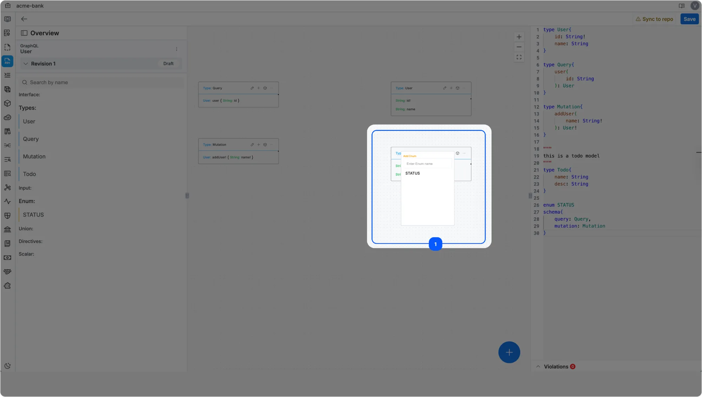

1. In the **Add Enum** dialog, enter the enum name and press **Enter**.
1. From the matching suggestions, select the appropriate type.

The enum is added to the schema and can be referenced within type definitions. After creation, add the required enum values, such as ACTIVE or INACTIVE, in the Code Editor.

**Example:**

```graphql

enum UserRole {
  ADMIN
  EDITOR
  VIEWER
}

type User {
  id: ID!
  name: String
  role: UserRole
}

```

### Scalar

Scalar types represent primitive data values in a GraphQL schema. GraphQL provides built-in scalar types and supports custom scalar definitions.

### Built-in scalars

GraphQL includes the following default scalar types:

- String
- Int
- Float
- Boolean
- ID

### Custom scalars

Custom scalars let you represent specialized data formats beyond GraphQL's built-in scalar types. When the built-in types do not meet your validation or formatting requirements, custom scalars let you define domain-specific data types such as DateTime, Email, or URL.

Custom scalars extend the schema's type system to better model real-world data. They provide the following benefits:

- Stronger typing for domain-specific values
- Centralized validation logic
- Improved schema clarity and expressiveness
- Better data consistency across the API

Instead of representing all data as a String, custom scalars let you explicitly define the expected data type.

### Common use cases for custom scalars

**Example:**

```graphql

scalar DateTime
scalar Email
scalar URL

type User {
  id: ID!
  email: Email!
  website: URL
  createdAt: DateTime!
}

```

By defining custom scalars, you can do the following:

- Improve schema readability.
- Enforce consistent data formats.
- Reduce repetitive validation logic.
- Maintain better API design standards.

### Create a new scalar

To create a new scalar, follow these steps:

1. In the bottom-right corner of the schema editor, select **Add \(\+\)**.
1. Select **Scalar**.

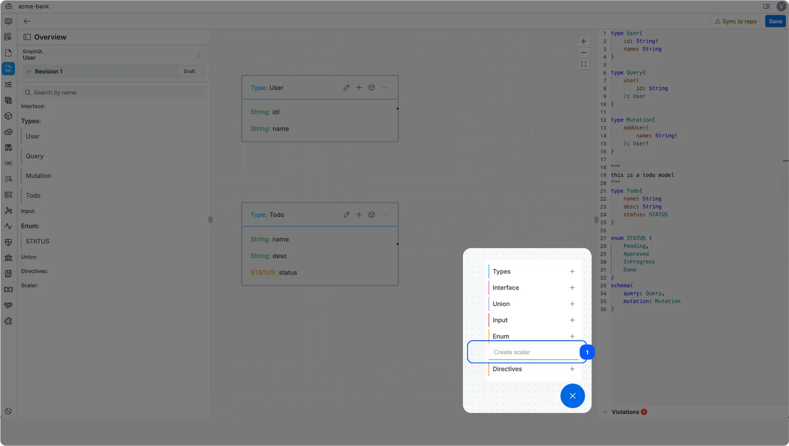

1. Enter the scalar name and press **Enter**. The scalar is added to the schema.


1. In the **Description** field at the top of the scalar definition, enter a description.


After creation, you can reference the scalar in type definitions as a field data type.

### Add a scalar to the schema

Use a scalar to define a custom primitive data type for a field.

To add a scalar to a type, follow these steps:

1. On the required type, select **Add \(\+\)**. The system displays the following options: Add Fields, Add Types, Add Enum, Add Interface, Add Scalar, Add Union, Add Directives.
1. Select **Add Scalar**.

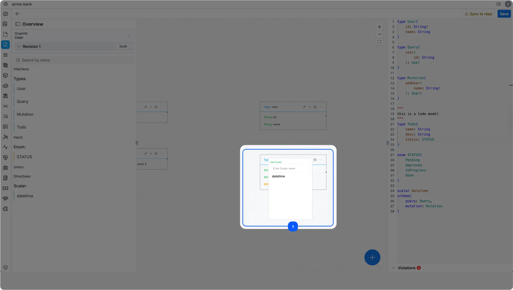

1. In the **Add Scalar** dialog, enter the scalar name, such as Timestamp or DateTime.
1. From the matching suggestions, select the appropriate type.

The scalar is added to the schema and can be referenced as a field data type within type definitions.

### Input

Input types let you pass structured data as arguments to queries or mutations. They group related fields and simplify operation definitions. Use input types when multiple related parameters need to be passed as a single argument.

### Create an input type

To create an input type, follow these steps:

1. In the bottom-right corner of the schema editor, select **Add \(\+\)**.
1. Select **Input**.

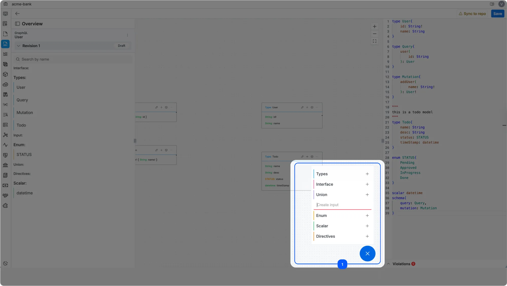

1. Enter the input name and press **Enter**. The input type is added to the schema.

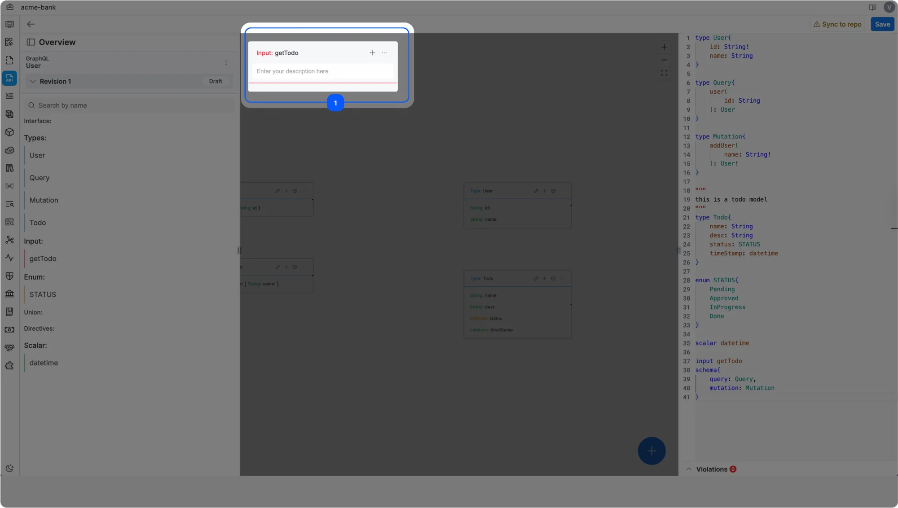

1. In the **Description** field at the top of the input definition, enter a description.

After creation, add the required fields to the input type in the Code Editor. You can then reference the input type in queries or mutations as an argument type.

GraphQL is strongly typed. Any input passed to a mutation must match the defined input type and structure in the schema. If the input does not conform to the schema definition, the operation fails during validation.

Define the mutation inside the Mutation type in the Code Editor.

**Example:**

```graphql

input CreateUserInput {
  name: String!
  email: String!
  address: AddressInput
}

input AddressInput {
  street: String
  city: String
  zipCode: String
}

type Mutation {
  createUser(input: CreateUserInput!): User
}

```

Before saving, ensure the following are already defined in the schema:

- The mutation name
- The corresponding input type
- The return type

If any of these definitions are missing, schema validation fails.

### Interface

An interface is an abstract type that defines a common set of fields. Object types that implement an interface must include all fields defined in that interface. Use interfaces when multiple object types share common characteristics.

### Create an interface

To create an interface, follow these steps:

1. In the bottom-right corner of the schema editor, select **Add \(\+\)**.
1. Select **Interface**.

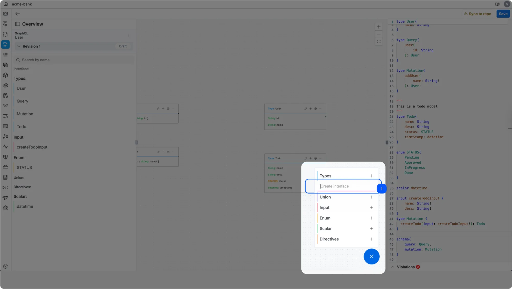

1. Enter the interface name and press **Enter**. The interface is added to the schema.
1. In the **Description** field at the top of the interface definition, enter a description.

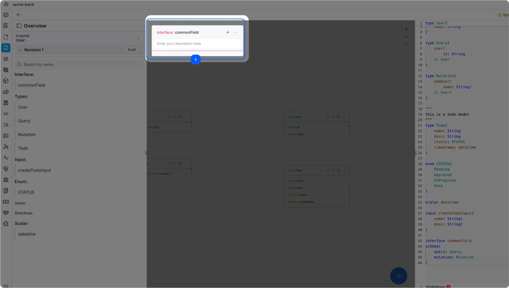

After creation, add the required fields to the interface in the Code Editor. Object types can then implement the interface using the implements keyword.

**Example:**

```graphql

interface Node {
  id: ID!
}

type User implements Node {
  id: ID!
  name: String
  email: String
}

type Account implements Node {
  id: ID!
  accountNumber: String
  balance: Float
}

```

### Union

A union type represents multiple possible object types. A field that returns a union can resolve to any one of the specified object types. Use a union when a query or mutation may return different object types that do not share a common structure.

### Create a union

To create a union, follow these steps:

1. In the bottom-right corner of the schema editor, select **Add \(\+\)**.
1. Select **Union**.

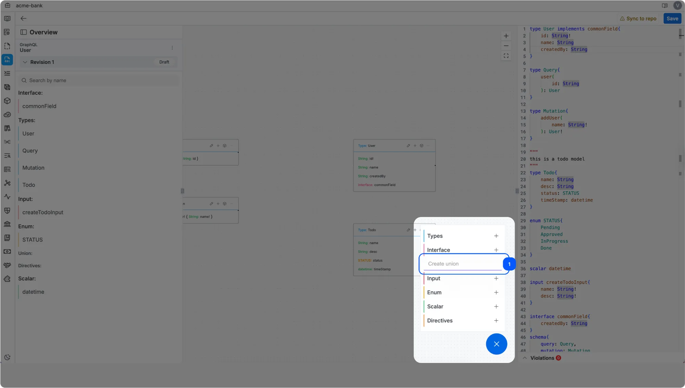

1. Enter the union name and press **Enter**. The union is added to the schema.
1. In the **Description** field at the top of the union definition, enter a description.

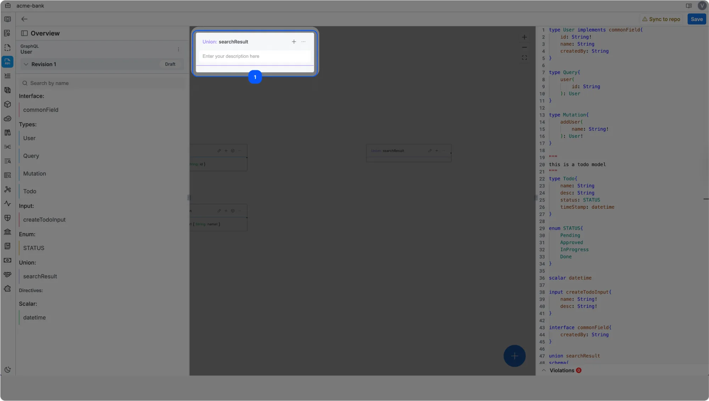

**Example:**

```graphql

union SearchResult = User | Account | Post

type Query {
  search(query: String!): [SearchResult]
}

```

### Directives

Directives add metadata or modify the behavior of fields, queries, or other schema elements. GraphQL provides the following built-in directives:

- @deprecated
- @include
- @skip

You can also define custom directives based on your application requirements.

Directives are commonly used for the following:

- Deprecation
- Authorization
- Validation
- Schema tooling and configuration

You can apply directives to types, fields, arguments, and other schema components.

### Create a directive

To create a directive, follow these steps:

1. In the bottom-right corner of the schema editor, select **Add \(\+\)**.
1. Select **Directives**.

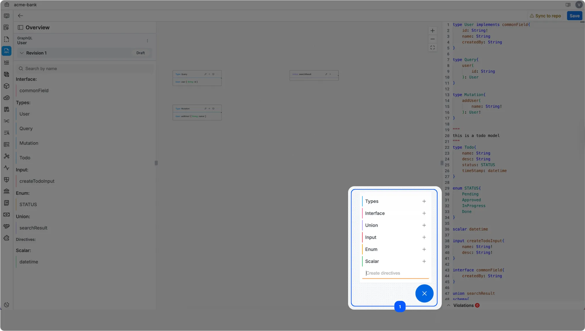

1. Enter the directive name and press **Enter**. The directive is added to the schema.
1. In the **Description** field at the top of the directive definition, enter a description.


After creation, define the directive behavior and applicable locations in the Code Editor.

**Example:**

```graphql

type User {
  id: ID!
  oldEmail: String @deprecated(reason: "Use 'email' field instead")
  email: String
}

```

### Add sub-schemas

You can add sub-schemas to existing schema elements to further define and extend the GraphQL schema.

To add a sub-schema, follow these steps:

1. Under the User type, hover over the required field. The **Add \(\+\)** icon and **More options** \(three-dot\) menu appear.
1. Select **Add \(\+\)** next to the field. The sub-schema menu opens.

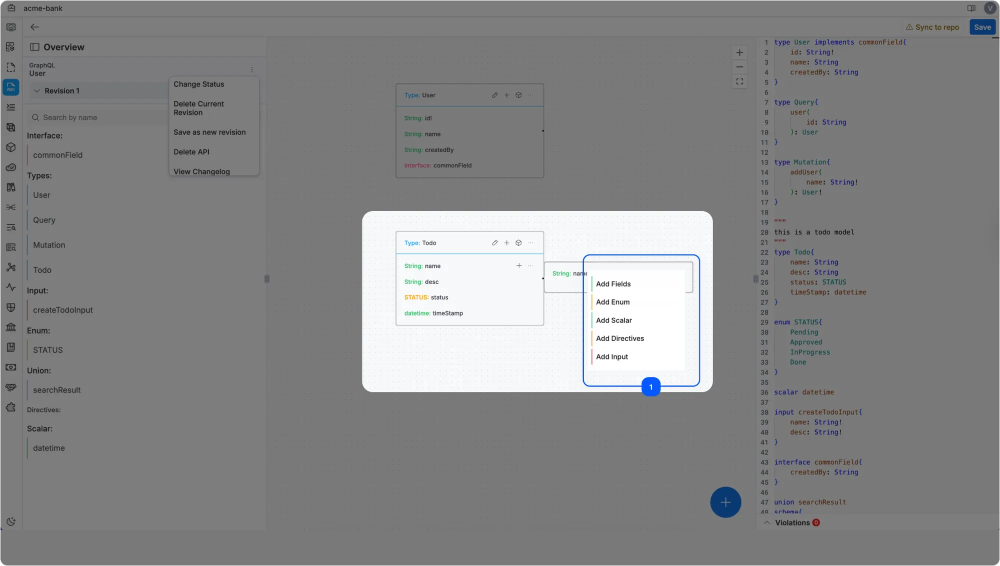

1. Select one of the following options to extend the field: Fields, Enum, Scalar, Directives, Input.

These options let you refine field behavior, define constraints, or associate additional metadata.