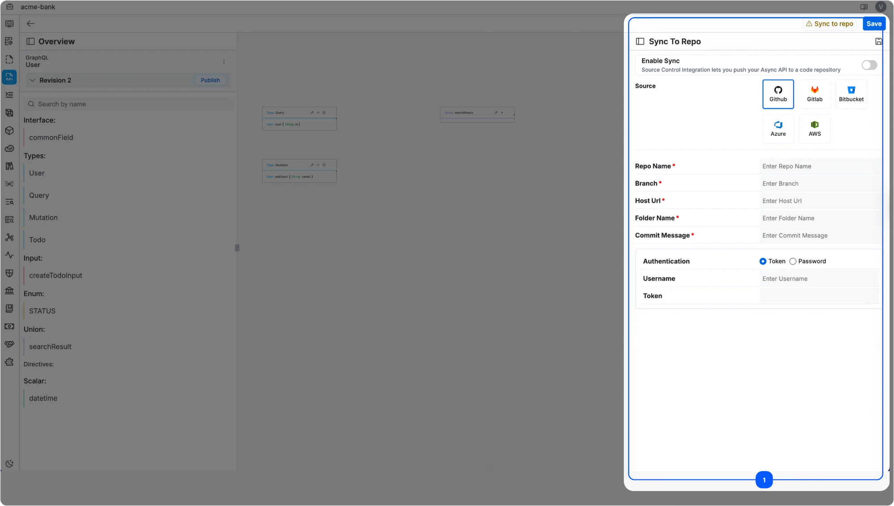

## Sync to repository

The **Sync to Repo** option lets you automatically push your GraphQL schema to a configured source control system \(SCM\).

To configure repository sync, follow these steps:

1. In the top-right corner of the screen, select **Sync to Repo**. The **Sync** form opens.
  
1. Enable **Sync**.
1. Select the SCM source. Supported providers: GitHub, GitLab, Bitbucket, Azure, AWS.
1. Enter the following repository details:

1. Select the authentication method and enter your credentials. Supported methods: Token, Password.
1. Select **Save**.