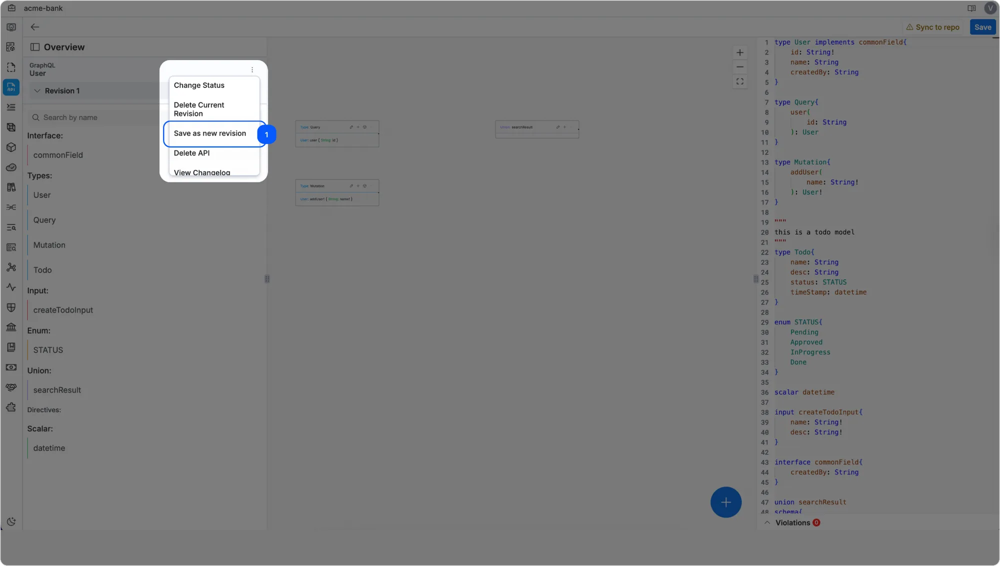

You can save your GraphQL schema changes in the following two ways.

### Save

Select **Save** in the top-right corner of the editor to save your current changes.

This option does the following:

- Updates the existing revision.
- Saves modifications without creating a new version.
- Keeps you working within the same schema revision.

### Save as new revision

To create a versioned update, follow these steps:

1. Next to the schema name, select the **More options** \(⋮\) menu.
1. Select **Save as New Revision**.

This option does the following:

- Saves the current state of the schema as a new revision.
- Preserves the previous revision.
- Enables version tracking and controlled updates.

Using revisions helps maintain change history and supports structured API evolution.