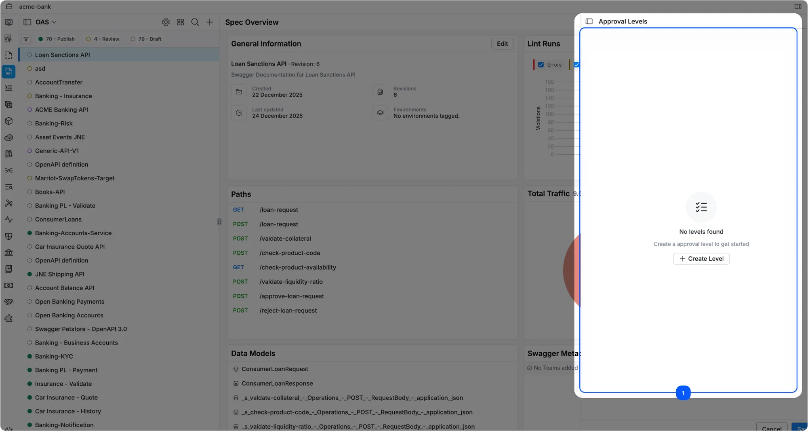
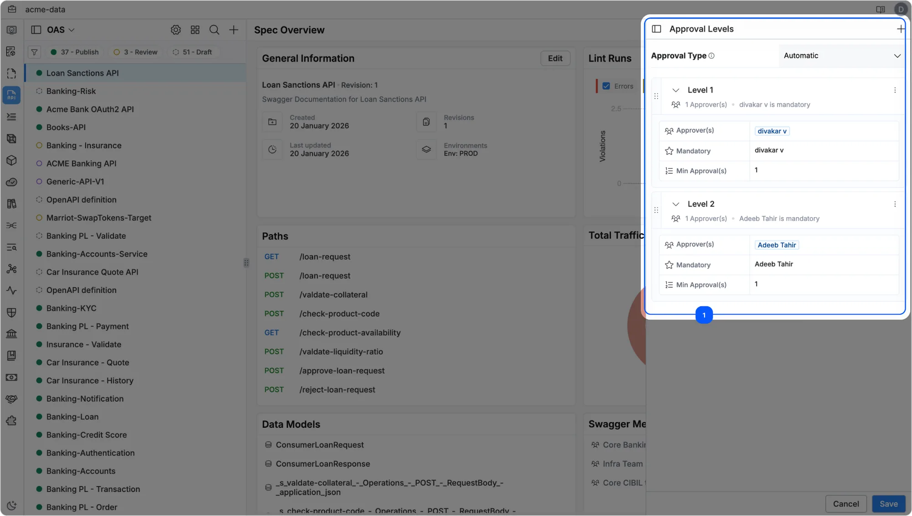

Approval settings ensure that API specifications follow a defined review process before they are published. When an API specification is created, it enters the **Draft** state. To publish the specification, it must be reviewed and approved by the assigned approvers.

Approval is processed sequentially from the lowest level to the highest level. The specification progresses to the next level only when the required approval criteria are met at the current level. Assigned approvers receive a notification to review the specification and can approve or reject it.

### Prerequisites

Before you configure approval settings, ensure the following requirements are met:

## Configure approval levels

To configure approval levels, follow these steps:

1. Select **Approval Settings**.
  
1. The **Approval Levels** panel opens on the right side of the screen, displaying all existing approval levels. If no levels have been created, the panel appears blank.
  
1. Select **\+ Create Level**. The **New Level** panel opens on the right side of the screen.
  
1. Configure the following fields:

1. Select **Add Level** to save the approval level.
1. To add additional approval levels, select **\+** in the top-right corner of the **Approval Levels** panel.
1. Repeat steps 4-5 for each additional approval level required.
  

After you add an approval level, it appears in the **Approval Levels** panel with the configured details.

### Configure the approval type

After adding at least one approval level, the **Approval Type** field becomes available in the **Approval Levels** panel. This setting defines how the approval workflow is executed.

Select one of the following options:

- **Automatic**: The OAS status changes automatically from **Review** to **Approved** after all required approval levels are completed.
- **Manual**: A designated user must manually update the OAS status to **Approved** even after all required approvals are received. Use this option to ensure a responsible owner confirms the status change before the specification progresses further.

#### Save the approval configuration

To save and apply the approval configuration, follow these steps:

In the bottom-right corner of the **Approval Levels** panel, select **Save**.

You can view the approval configuration in the OAS details by selecting the **Approval Flow** icon in the right panel.

### Edit or delete an approval level

To edit or delete an approval level, follow these steps:

1. In the **Approval Levels** panel, hover over the approval level you want to edit or delete.
1. Select **More Options** \(⋮\).

1. Select one of the following:
  - **Edit**: Updates the configuration of the selected approval level.
  - **Delete**: Permanently removes the selected approval level.