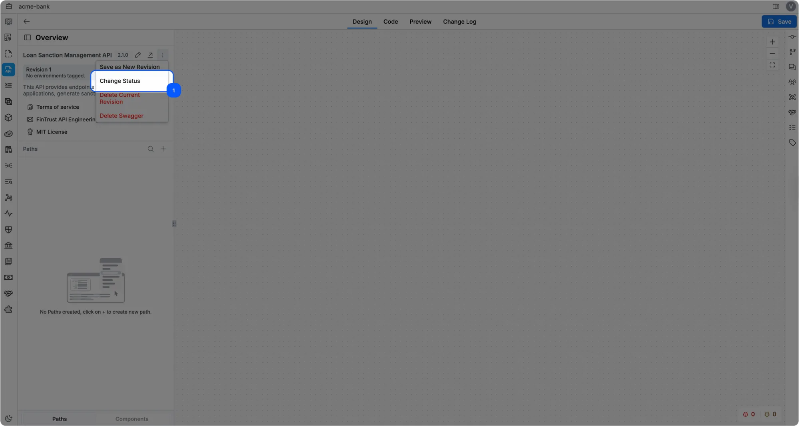
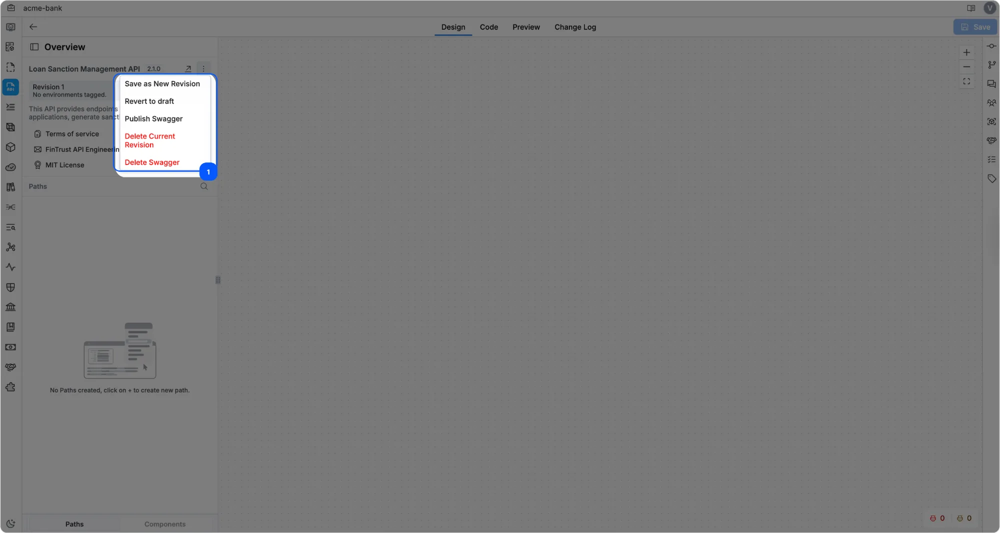
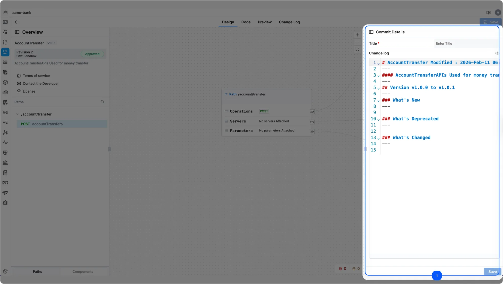

When the OAS is ready for review, you can update its status from **Draft** to **Review**.

To change the OAS status, do the following:

1. In the **Overview** panel, select the **More Options** menu \(**⋮**\) next to the current revision number.
1. Select **Change Status**. The **Change Status** form opens.
  
1. Enter the following details:
  - **Current Status**: Displays the current status of the OAS, such as DRAFT.
  - **Status**: Select the new status from the dropdown. Available statuses include:
    - Draft
    - Approved
    - Review
    - Deprecate
    - Retired
    - Change Required
  - **Change Description**: Enter a clear description explaining the reason for the status update.
1. Select **Change Status**.

The system updates the status and displays a success message.

# Post-approval actions

After the OAS is approved, select the **More Options** menu \(**⋮**\) in the **Overview** panel to access the following actions.

## Revert to draft

Select **Revert to Draft** to move the OAS back to **Draft** state, allowing further modifications before finalization.

## Publish the OAS

Select **Publish Swagger** to publish the OAS and make it available for consumption and integration across platforms.

When you publish a new revision of an OAS that already has a published revision, the **Commit Details** form opens in the right pane.

Enter the following details:

- **Title**: Enter a title for the revision.
- **Change Log**: Describe the updates, enhancements, or deprecations in this revision.
- **Version Changes**: Document version changes to maintain a clear revision history.

Providing commit details ensures that all modifications are properly tracked and helps teams understand what has changed between versions.

After publishing, the OAS is available in the internal APIwiz Catalog and in the API Marketplace and Developer Portal.

## Delete the current revision

Select **Delete Current Revision** to permanently delete the selected OAS revision.

### Scenario: deleting a published revision

When Revision 1 is published, and Revision 2 is subsequently published, Revision 1 moves to the **Retired** state. Compliance evaluates traffic against Revision 2.

If Revision 2 is deleted:

- Revision 1 remains **Retired**.
- Compliance does not evaluate traffic against Revision 1.
- All traffic is classified under the **Shadow** section.

## Delete an OAS

Select **Delete Swagger** to permanently delete the entire OAS definition, including all associated revisions.