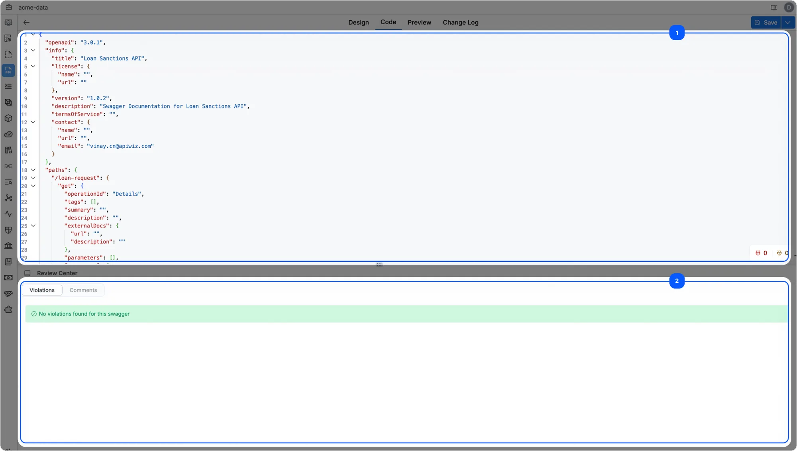
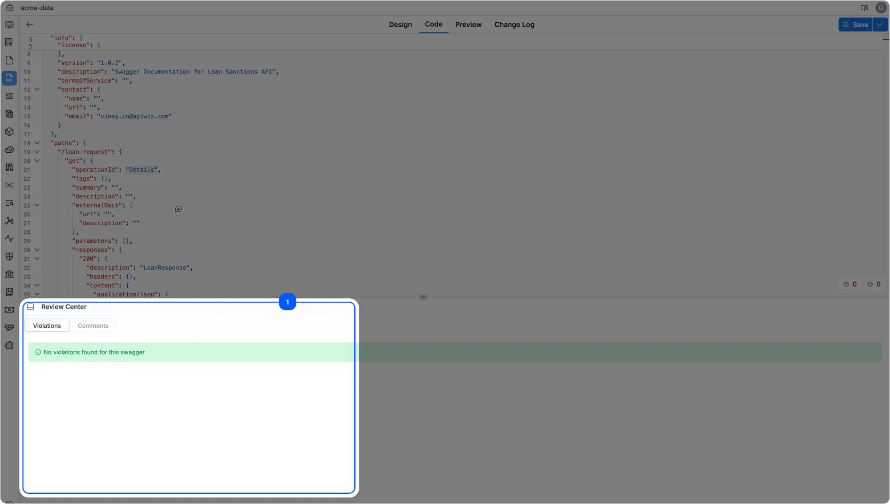
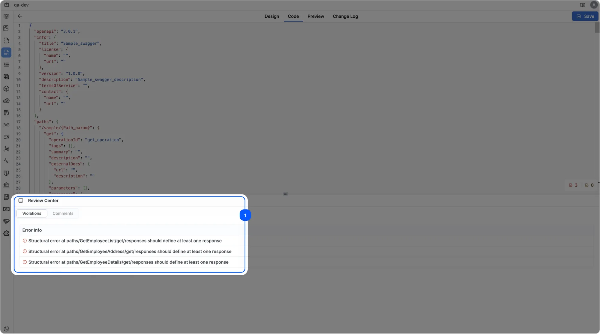
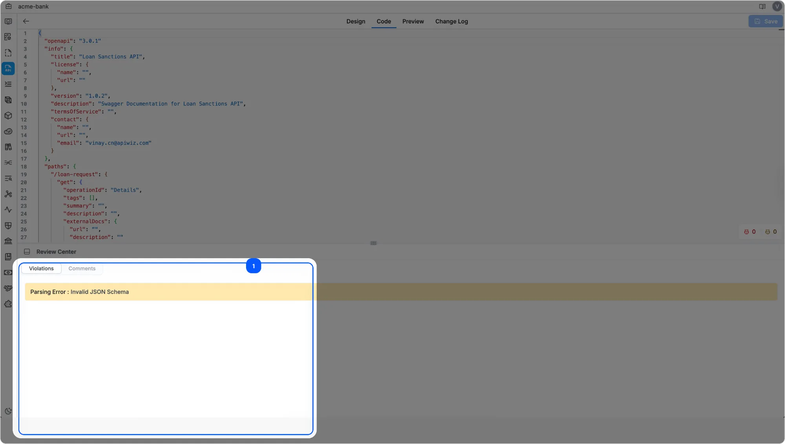
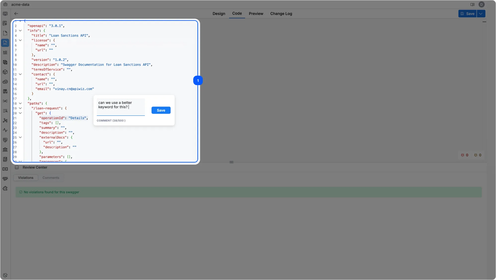
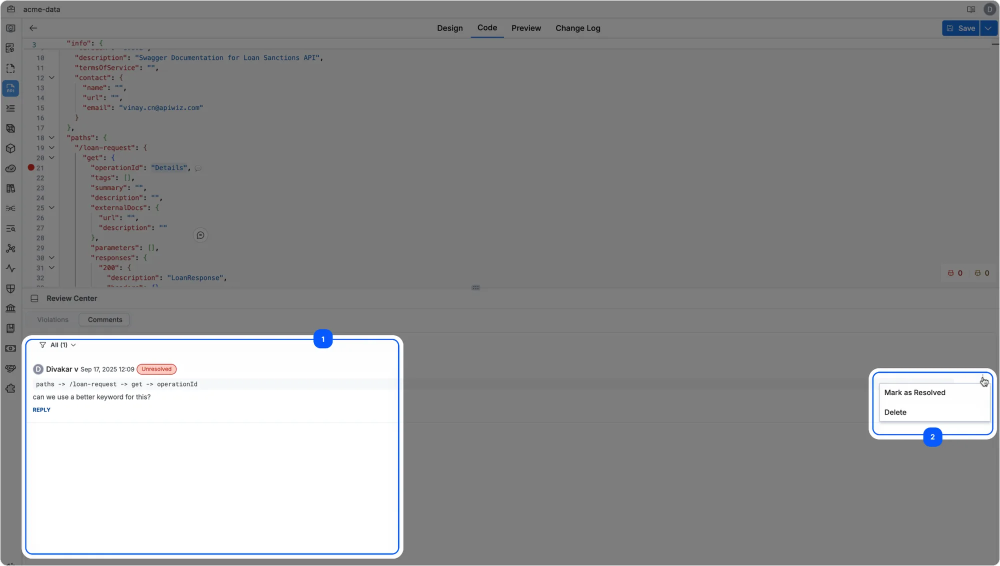

The **Code** tab displays the OAS definition in raw JSON format. Use this view to directly edit API specifications, including metadata, paths, parameters, and components. This is useful for making precise updates, troubleshooting issues, or adding details that are not available in the **Design** canvas.

Changes made in the **Code** tab are validated in real time through the **Review Center**, ensuring the specification remains accurate and compliant.

### Prerequisites

Before you use the **Code** tab, ensure the following requirements are met:

## Code editor

The **Code Editor** appears at the top of the **Code** tab and displays the full OAS definition in JSON format. Use the **Code Editor** to edit the specification directly instead of using the **Design** view.

The following key elements are visible in the editor:

From the **Code Editor**, you can:

- Manually add or edit API endpoints, metadata, servers, parameters, and components.
- Correct errors flagged during linting or validation.
- Save changes for version control.

## Review Center

The **Review Center** appears at the bottom of the **Code** tab and validates the OAS definition for JSON and OpenAPI syntax violations. It contains two tabs:

- **Violations**: Lists errors, warnings, and issues detected in the specification.
- **Comments**: Displays review notes and feedback added by collaborators.

### Violations

The **Violations** tab displays the validation status of the OAS definition and updates dynamically as changes are made.

- **No issues**: A green banner appears with the message *No violations found for this swagger*. The specification is valid and free from structural or syntax errors.
  
- **Errors**: A red banner appears with the corresponding error message. Errors indicate critical issues that must be resolved before proceeding. For example: *A structural error at paths/compliance/get/responses should define at least one response.*
  
- **Warnings**: A yellow banner appears with the corresponding warning message. Warnings indicate best-practice recommendations or potential improvements and do not prevent saving.
  

### Comments

The **Comments** tab enables collaborators to provide contextual feedback directly on specific sections of the OAS definition.

### Add a comment

To add a comment to a section of the OAS, follow these steps:

1. In the **Code Editor**, highlight the section of the OAS code you want to comment on. A comment icon appears next to the highlighted section.
1. Select the comment icon. A comment box appears next to the selected code section.
  
1. In the comment box, enter your feedback, clarification, or suggestion.
1. Select **Save**. The comment is saved and associated with the highlighted code section.
  
1. The OAS creator receives an email notification with the comment details. The comment appears under the **Comments** tab in the **Review Center** with the following details:

### Reply to a comment

To reply to an existing comment, follow these steps:

1. In the **Comments** tab, locate the comment you want to reply to.
1. In the reply text box, enter your reply. The reply box supports up to 500 characters.
1. Select **Reply**.

The reply is added and nested under the original comment, keeping the full conversation thread organized. The system sends an email notification to the relevant person. A confirmation message appears after the reply is submitted.

To remove a reply, select **Delete** \(delete icon\) next to the reply.

### Resolve a comment

To mark a comment as resolved, follow these steps:

1. In the **Comments** tab, select **More Options** \(⋮\) next to the comment you want to resolve.
1. Select **Mark as Resolved**.

The comment status changes from **Unresolved** to **Resolved**, highlighted in green. The red circle next to the highlighted element in the **Code** panel changes to a green circle. A confirmation message appears, and the system sends an email notification to the relevant stakeholders.

### Revert a resolved comment

If an issue recurs after being marked as resolved, you can revert the comment status.

To revert a resolved comment, follow these steps:

1. In the **Comments** tab, select **More Options** \(⋮\) next to the resolved comment.
1. Select **Mark as Unresolved**.

The comment status changes back to **Unresolved**. A confirmation message appears.

### Delete a comment

To permanently remove a comment from the review log, follow these steps:

1. In the **Comments** tab, select **More Options** \(⋮\) next to the comment you want to delete.
1. Select **Delete**.

The comment is permanently removed from the **Review Center**.