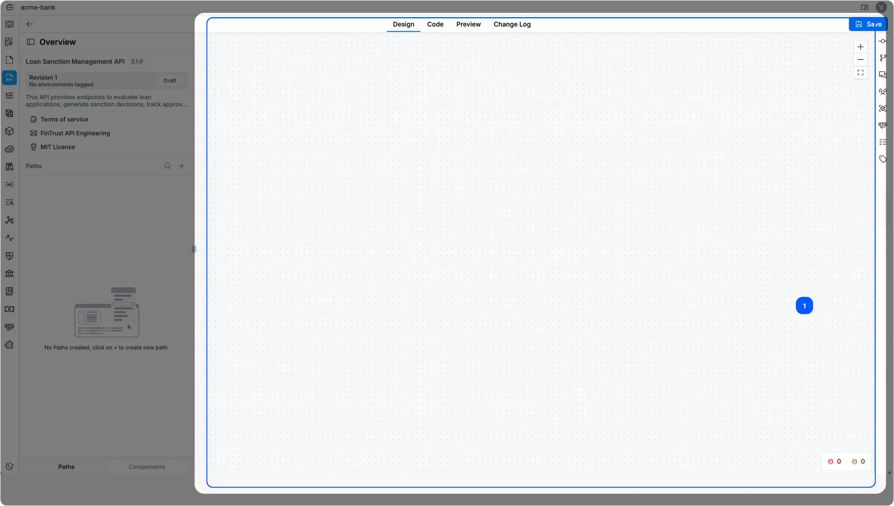
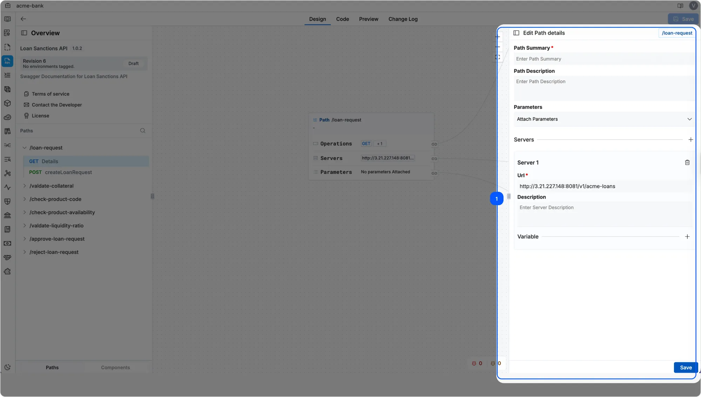
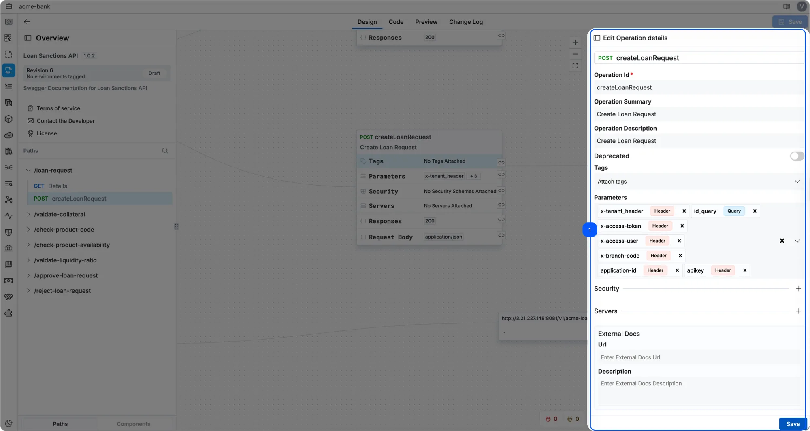
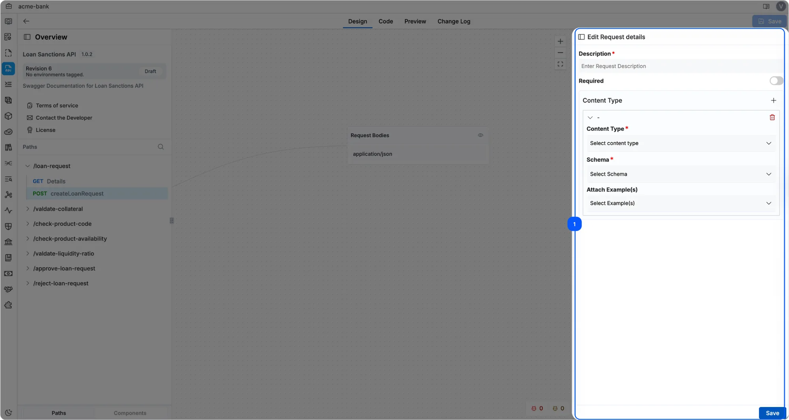
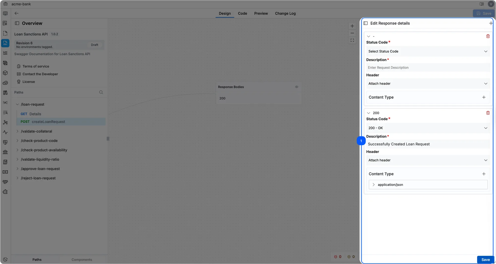

The **Design** tab is the main workspace for building and managing your API definition according to the OpenAPI Specification \(OAS\). Use the **Design** tab to attach and configure the local components and resource paths you have already created.

The **Design** tab provides a graphical editor where you can configure:

- Endpoints and resource paths.
- Parameters, request bodies, and response schemas.
- Tags, security schemes, and servers.
- Operation-level details and external documentation.

#### Prerequisites

Before you configure the design view, ensure the following requirements are met:

## Configure a resource path

Use this procedure to add or update configuration details for a selected resource path, including the path summary, parameters, and server definitions.

To configure a resource path, follow these steps:

1. In the **Paths** tab, select the resource path you want to configure.
1. In the **Design** canvas, select **Edit** \(pencil icon\) next to the path. The **Edit Path Details** form opens on the right side of the canvas.
  
1. Configure the following fields:

1. Select **Save**.

The configuration is applied to the selected resource path.

## Configure operation details

Use this procedure to configure the tags, parameters, security, servers, and external documentation for a specific operation.

To configure operation details, follow these steps:

1. In the **Design** canvas, locate the required operationId.
1. Select **Edit** \(pencil icon\) next to the operation. The **Edit Operation Details** form opens on the right side of the canvas.
  
1. Configure the following fields:

1. Select **Save**.

The operation details are updated and applied to the selected operationId.

## Configure the request body for an operation

Each operation, except GET and DELETE, includes a request body. Use this procedure to define the content type, schema, and examples for the request body.

To configure the request body, follow these steps:

1. In the **Design** canvas, locate the required operationId.
1. Next to the **Request Body** field, select the link icon. The **Request Bodies** form opens.
  
1. In the **Request Bodies** form, select **Settings** \(gear icon\). The **Edit Request Details** form opens on the right side of the canvas.
1. Configure the following fields:

1. Select **Save**.

The request body configuration is applied to the operation.

## Configure responses for an operation

Use this procedure to define the response codes, content types, schemas, and examples for an operation.

To configure responses for an operation, follow these steps:

1. In the **Design** canvas, locate the required operationId.
1. Next to the **Response Body** field, select the link icon. The **Response Bodies** form opens.
  
1. In the **Response Bodies** form, select **Settings** \(gear icon\). The **Edit Response Details** form opens on the right side of the canvas.
1. Select **\+** \(Add\) to add a response code.
1. In the **Status Code** dropdown, select the appropriate response code, such as **200 – OK**.
1. Repeat steps 4 and 5 to add all relevant response codes for the operation.
1. For each response code, configure the following fields:

1. Select **Save**.

The response configuration is applied to the operation. All defined response codes are available for validation and documentation.

### Edit a resource path

Use this procedure to rename or update the structure of an existing resource path.

To edit a resource path, follow these steps:

1. In the **Paths** tab, select **More Options** \(⋮\) next to the resource path you want to edit.
1. Select **Edit**.
1. Update the path as required.
1. Select **Save**.

The resource path is updated across the API definition.

### Delete a resource path

Use this procedure to permanently remove a resource path and all its associated operations from the API definition.

To delete a resource path, follow these steps:

1. In the **Paths** tab, select **More Options** \(⋮\) next to the resource path you want to delete.
1. Select **Delete**.

The resource path and all associated operations are permanently removed from the API definition.