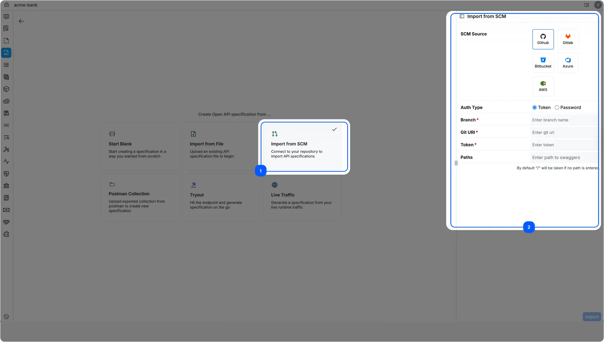

Use the **Import from SCM** method to create an OAS by connecting to a source code management \(SCM\) repository. APIwiz supports the following SCM providers: GitHub, GitLab, Bitbucket, Azure, and AWS.

To import an OAS from an SCM repository, do the following:

1. Select the **Import from SCM** card. The **Import from SCM** configuration panel opens in the right pane.
  
1. Enter the following details:
  - **SCM Source**: Select an SCM provider from the dropdown: GitHub, GitLab, Bitbucket, Azure, or AWS.
  - **Auth Type**: Select an authorization method.
    - **Token**: Enter the access token only.
    - **Password**: Enter both the username and password.
  - **Branch**: Enter the branch in the SCM repository where the OAS files are located. For example, use main for production-ready specifications or develop for specifications under development.
  - **Git URI**: Enter the URL of the Git repository hosted on the selected SCM provider. This URI identifies the repository and directs the system to the correct source location.
  - **Token**: Enter the access token for authentication.
  - **Paths**: Enter the folder path in the repository where the OAS files are stored. If no path is specified, the system defaults to the root directory /.
1. Select **Import**. If the import is successful, a confirmation message appears in the bottom-right corner. The system redirects you to the **Design Studio** landing page and the newly created OAS appears in the left pane. If any required field is missing or contains an incorrect value, an error message appears in the bottom-right corner.
1. Select the OAS from the left pane to view its details in the **Spec Overview** panel.
1. Select **Edit** in the **Spec Overview** panel to begin editing and designing the OAS.