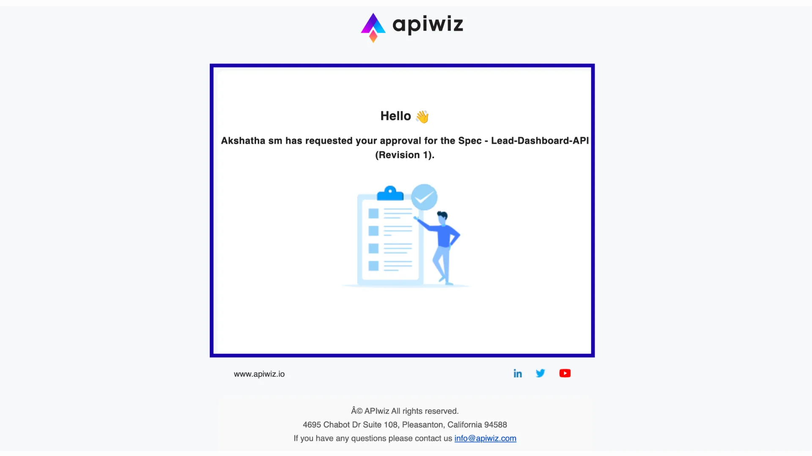
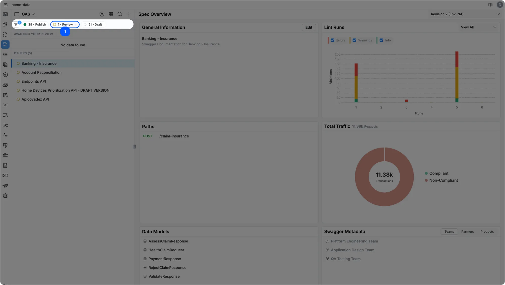
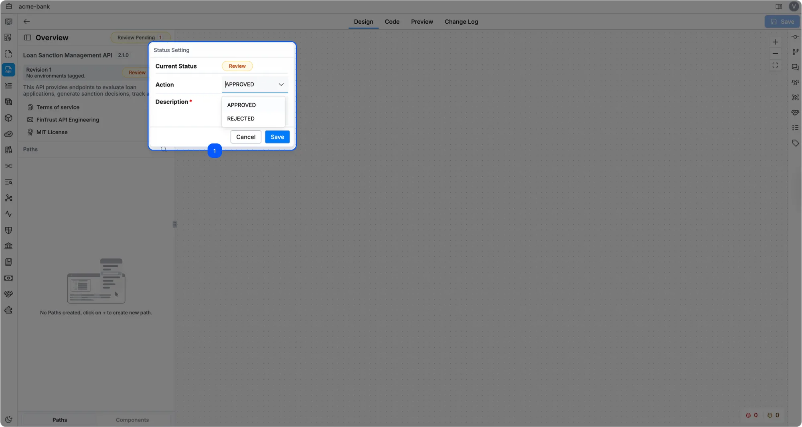

The reviewer journey describes the end-to-end process a reviewer follows to evaluate, validate, and approve or reject an OAS after it is moved to the **Review** state. Reviewers receive email notifications at each approval level and can inspect linting results, review change logs, add comments, and validate API behavior before making a decision.

The following steps describe the complete reviewer journey.

1. Go to **Approval Settings** and configure the required approval levels for the specification.
1. When the OAS is moved to **Review**, Level 1 approvers receive an email notification. After Level 1 approval is complete, the notification is sent to Level 2 approvers to continue the review process.
  
1. Go to **Design Studio** and filter the OAS list by **Review** status.
  
1. Select the OAS assigned for review.
1. Review the linting results displayed for the OAS.
1. Open the **Linting** module to view the full linting report.

1. Select **Edit** to open the OAS for review.
1. Review the change log between revisions, if required.

1. Go to the **Code** section and add review comments directly within the specification.
1. Go to the **Preview** section.
1. Select an operation and use **Try Out** to validate the API behavior.
1. Based on the Try Out results and the configured components, select one of the following actions using the pencil icon next to the current status:
  
1. **Add review feedback**: If changes are required, go to the **Swagger Review** section and add review comments.

# Approval levels - user flow

This section describes the progression of the approval workflow when an OAS is submitted for review.

## Scenario 1: multi-level approval flow

### Level 1 configuration

- Approvers: Approver 1, Approver 2, Approver 3
- Mandatory approver: Approver 1
- Minimum required approvals: 2

### Level 2 configuration

- Approvers: Approver 1, Approver 2, Approver 3, Approver 4
- Mandatory approvers: Approver 2, Approver 4
- Minimum required approvals: 2

### Approval flow

- When the OAS is moved to **Review**, Level 1 approvers receive an email notification.
- The user receives an email notification for every approval or rejection action.
- Level 1 approvers review the OAS and submit their decision.
- A level is marked as approved only when both of the following conditions are met:
  - All mandatory approvers have approved.
  - The minimum number of approvals is met.
- For example, in Level 1, if Approver 2 and Approver 3 approve the OAS but the mandatory approver \(Approver 1\) does not approve, the level is not approved, even though the minimum approval count is met.
- After Level 1 is approved, Level 2 approvers receive an email notification to proceed with the review.
- Level 2 follows the same approval rules as Level 1.
- After Level 2 approval, the OAS proceeds to the next lifecycle state.

## Scenario 2: partial approval handling

If the mandatory approver approves the OAS but the minimum required approvals are not met, the approval level is not complete. Both conditions must be satisfied for a level to be approved. After approval, the next-level approvers receive an email notification.

### Rejection flow

If any approver rejects the OAS at any level, the following occurs:

- The OAS status changes to **Changes Required**.
- A rejection email notification is sent to the user.
- All approval levels are reset.
- The review process restarts from Level 1 after the OAS is resubmitted.