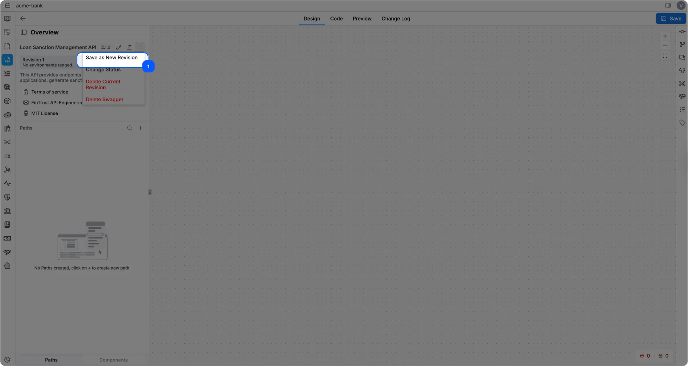
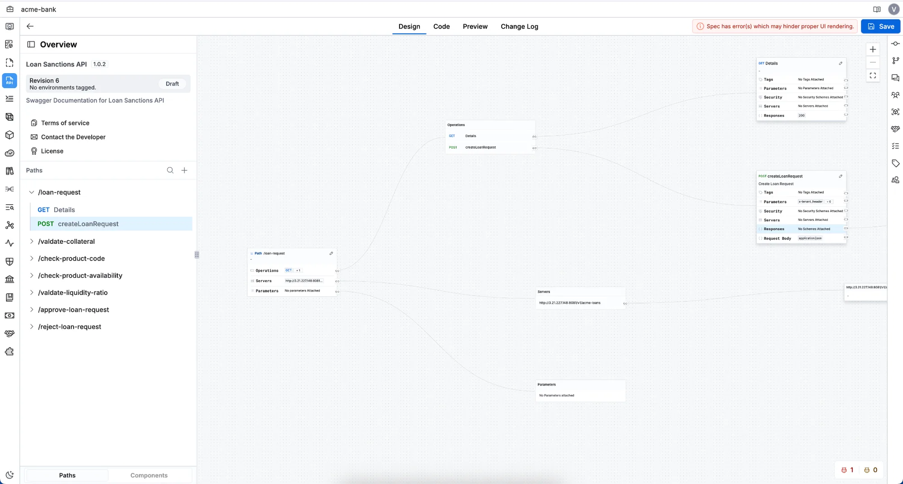

When you create a new OAS or modify an existing one, select **Save** in the top-right corner of the design canvas.

The following save options are available:

# Save as new revision

Use this option to create a new revision of the current OAS while preserving previous versions. This is useful for version control and iterative API development.

To save the OAS as a new revision, do the following:

1. In the **Overview** panel, select the **More Options** menu \(**⋮**\) next to the current revision number.
1. Select **Save as New Revision**.
  

The system saves the new revision and displays a success message.

To switch to a previous revision, select the current revision number and choose the required revision from the dropdown.

# Save with violations

Use this option to save an OAS that contains validation errors. This allows you to preserve your progress and resolve errors later without losing any unfinished work.

To save the OAS with violations, do the following:

1. Select **Save** in the top-right corner of the design canvas. If the OAS contains validation errors, the system displays a red banner near the **Save** button. For example: Spec has error\(s\) which may hinder proper UI rendering. An alert appears asking whether you want to save the OAS with errors.
  
1. Select **OK** to save the OAS with errors, or select **Cancel** to stop the action.