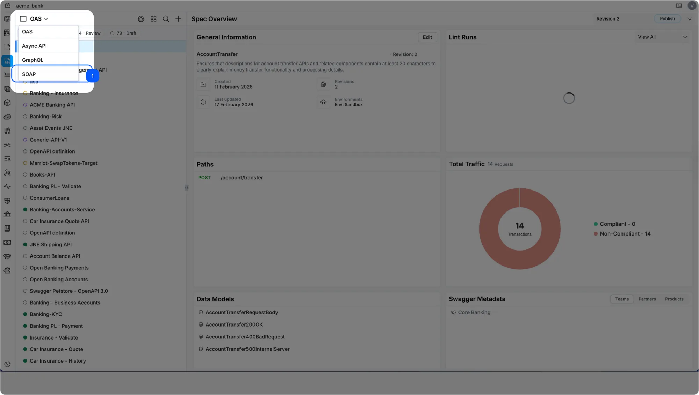
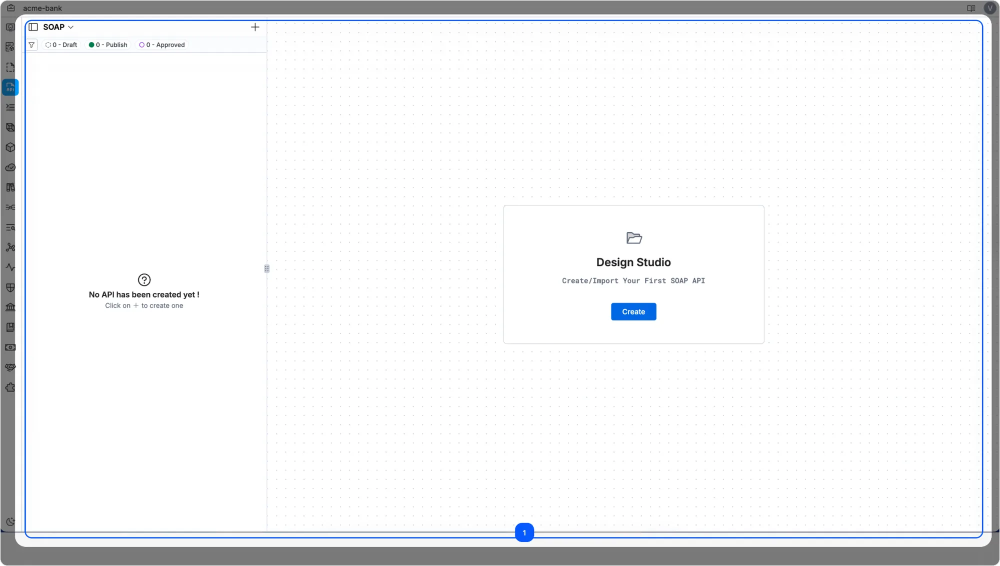

To access the SOAP API interface, follow these steps:

1. In the left navigation panel, select the **API Type** dropdown.
1. Select **SOAP**.
  
1. You are redirected to the SOAP API interface, where you can create, view, and manage your SOAP API definitions.
  