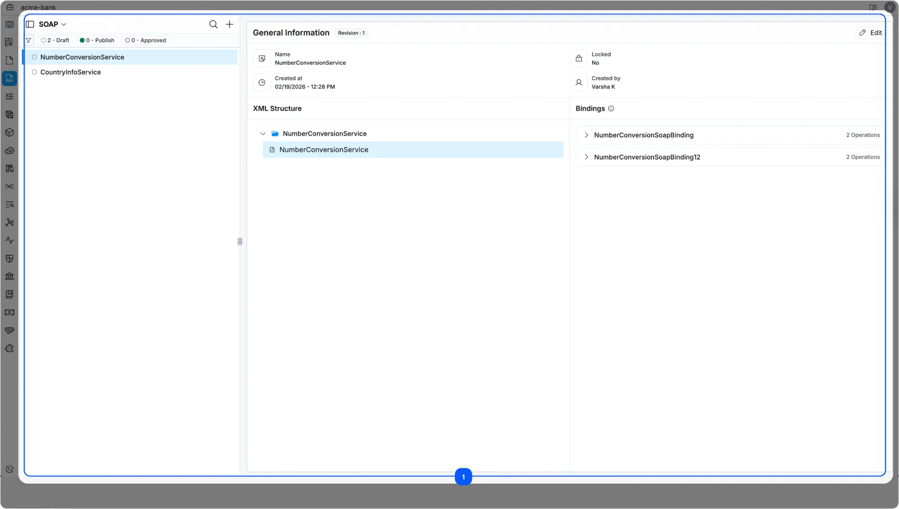

After you create a SOAP API, it appears in the left panel of the main dashboard. 

The SOAP API interface is organized into the following sections:

- **SOAP API List**: Displays all available SOAP API definitions for quick selection and navigation.
- **General Information**: Displays metadata about the selected SOAP API, including name, revision, creation details, and status.
- **XML Structure and Bindings**: Displays the hierarchical structure of the service schema and the operations defined in the WSDL.

### SOAP API list

The **SOAP API List** is the starting point for viewing and managing your SOAP services. Use this panel to locate and open the SOAP API you want to work with.

From the **SOAP API List**, you can:

- Navigate between available SOAP API definitions.
- Search and filter APIs for faster access.
- Create a new SOAP API definition.
- View existing SOAP APIs in a scrollable list.
- Identify the currently selected SOAP API, which is highlighted to indicate the active context.

### General information

The **General Information** panel displays the key details of the selected SOAP API, including:

- API name
- Revision number
- Creation details
- Status

When editing is enabled, you can update the API metadata directly from this panel. Use this section to verify the current version and ownership of the SOAP service before making changes.

### XML structure and bindings

The **XML Structure** and **Bindings** panels display the structure and operations of the selected SOAP service.

**XML Structure**

Use the **XML Structure** panel to understand how requests and responses are organized. This panel displays:

- The hierarchical structure of the service schema.
- Elements, complex types, and message definitions.

**Bindings and operations**

Use the **Bindings** panel to review the capabilities of the SOAP service. This panel displays:

- Operations defined in the SOAP service.
- Available methods, such as service actions and functions.