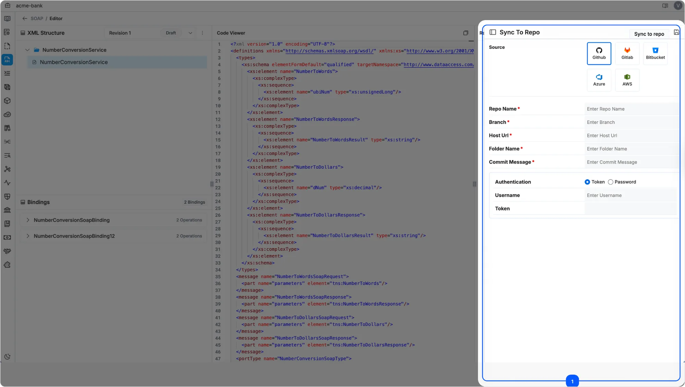
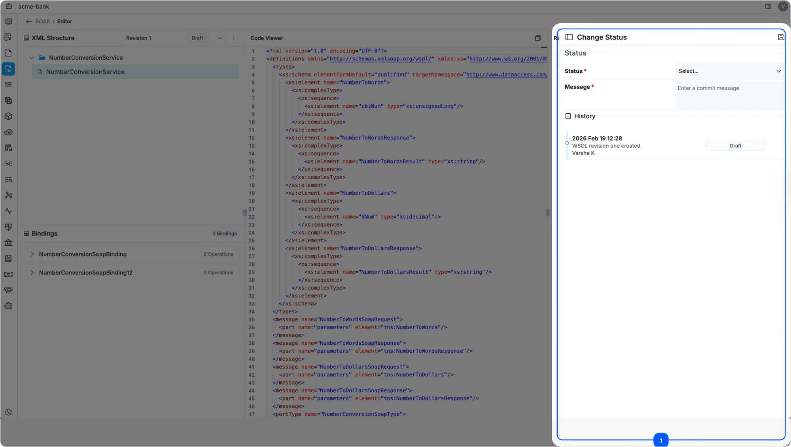
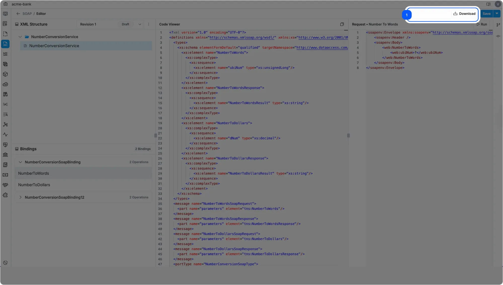

The right panel of the SOAP API editor provides quick access to repository integration, lifecycle status management, and download options.

## Sync to a repository

You can synchronize your SOAP API specification with a source code repository to maintain version control and keep the specification aligned with the underlying implementation.

**Prerequisites**

- Ensure you have access credentials for the target repository.
- Ensure the repository exists in the supported source control system.

To sync a SOAP API to a repository, follow these steps:

1. In the SOAP API editor, select **Sync to Repo**. The **Sync to Repo** panel opens.
  
1. Select the repository source, such as GitHub, GitLab, Bitbucket, Azure, or AWS.
1. Enter the following details:

1. Select **Save**.

>

## Change the status of a SOAP API

To update the lifecycle status of a SOAP API, follow these steps:

1. Select **Change Status**. The **Change Status** panel opens.
  
1. In the **Status** dropdown, select the required status.

1. In **Message**, enter the reason for the status change.
1. Select **Save** to apply the new status.

>

## Download a SOAP API

You can download the SOAP API specification in WSDL format to store, share, or use the definition outside the platform.

To download a SOAP API, follow these steps:

1. In the SOAP API editor, select **Download**.
  

>