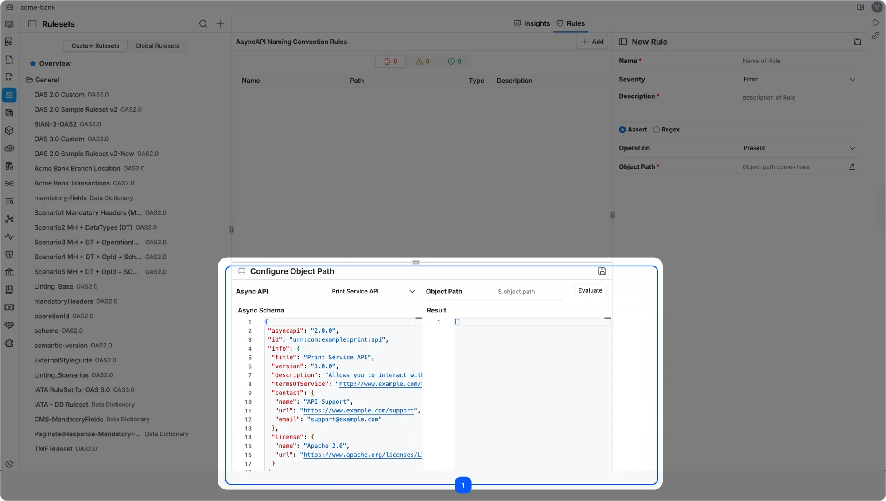
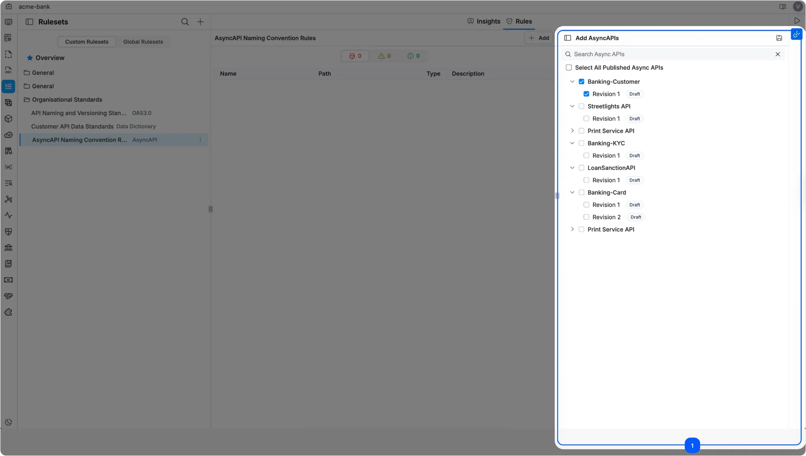
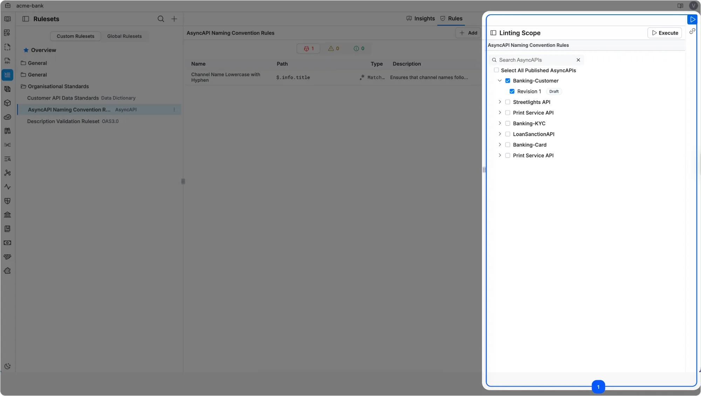

Create an AsyncAPI ruleset to define validation conditions for AsyncAPI specifications. The setup process follows the same pattern as creating an OAS ruleset, with a few AsyncAPI-specific steps for adding rules, configuring object paths, and linking specifications.

**Prerequisites**

- You're familiar with the procedure for creating a new OAS ruleset.

To create an AsyncAPI ruleset, follow these steps:

1. Select **Create Ruleset**.
1. Follow the same steps described in [Creating a new OAS ruleset](https://docs.apiwiz.io/guides?guideId=6a22b872070047a3a81f4972&pageId=6a3425a9cf1933e4d4c13186&groupId=API+Linting).
1. In **Ruleset Type**, select **AsyncAPI**.

The system creates a new AsyncAPI ruleset. You can now add rules to the ruleset.

## Add rules to an AsyncAPI ruleset

After you create an AsyncAPI ruleset, add rules to define the validation conditions for your AsyncAPI specifications.

**Prerequisites**

- You've created an AsyncAPI ruleset.

To add a rule, follow these steps:

1. Go to the **Rules** section.
1. Select **Add Rule**.
1. Configure the rule based on your validation requirements:

The system adds the rule to the AsyncAPI ruleset.

## Configure an object path in an AsyncAPI ruleset

When you create or edit a rule, define the object path to specify where the rule applies within the AsyncAPI schema. Use **Path Assistance** to browse the AsyncAPI specification and verify the selected path, which helps ensure the path matches the schema structure.

**Prerequisites**

- You're creating or editing a rule in an AsyncAPI ruleset.

To configure an object path using Path Assistance, follow these steps:

1. Next to the **Object Path** field, select the **Path Assistance** \(↗\) icon. The **Configure Object Path** panel opens at the bottom of the screen.
  
1. From the dropdown list, select the required AsyncAPI. The AsyncAPI schema appears for reference.
1. In the **Object Path** field, enter the required JSON path.
1. Select **Evaluate** to verify that the path returns the expected result in the **Result** pane.
1. Save the configuration to apply it to the rule.

The system applies the verified object path to the rule.

## Link an AsyncAPI to a ruleset

For an AsyncAPI ruleset, you can associate one or more AsyncAPI specifications with the ruleset to define which APIs the system validates during linting. When you link an AsyncAPI specification, the system automatically applies the ruleset and generates a linting report whenever the specification is created or modified.

**Prerequisites**

- You've created a rule in an AsyncAPI ruleset.

To link an AsyncAPI specification to a ruleset, follow these steps:

1. In the right panel, select the **Association** \(link\) icon. The **Add AsyncAPIs** window opens on the right side of the screen.
  
1. Browse the list of available AsyncAPI specifications in your workspace.
1. Expand an AsyncAPI to view its revisions.
1. Select the checkboxes for the AsyncAPI specifications or revisions you want to associate with the ruleset. To associate all published AsyncAPIs, select **Select All Published Async APIs**.
1. In the top-right corner of the panel, select the **Save** icon.

A success message appears in the bottom-right corner of the screen, confirming the association. Going forward, whenever the selected AsyncAPI specification is edited, the system automatically generates a linting report, based on the selected ruleset and the associated AsyncAPI specifications.

## Run linting on a linked AsyncAPI

After you link an AsyncAPI specification to a ruleset, run linting to evaluate the specification against the ruleset's rules.

**Prerequisites**

- You've linked an AsyncAPI specification to the ruleset.

To run linting, follow these steps:

1. Go to the **Rules** tab of the selected ruleset.
1. Select **Linting Scope**.
1. Choose the **AsyncAPI** and its revision.
1. Select **Execute**.
  

The system evaluates the linked AsyncAPI specifications against all rules in the ruleset.

## View insights after running linting

After linting completes, review the results in the **Insights** tab to analyze violations and validation trends over time.

**Prerequisites**

- You've run linting on a linked AsyncAPI specification.

To view insights, follow these steps:

1. Select the **Insights** tab.
1. Review the results, including:
  - Errors
  - Warnings
  - Informational messages

The **Insights** view displays the validation results for the linting run.

Follow the same steps described in [View insights after executing linting](https://#).

## Resolve AsyncAPI linting issues

If a linting run reports errors, warnings, or info messages, correct the underlying AsyncAPI specification and re-run linting to confirm the fix.

**Prerequisites**

- You've run linting on an AsyncAPI specification and the results show one or more issues.

To resolve linting issues, follow these steps:

1. Go to **Design Studio** \> **AsyncAPI**.
1. Open the affected AsyncAPI specification and correct the reported issues.
1. Go to **API Linting** \> **Rules**.
1. Select **Execute Linting** to re-run validation.
1. Open **Insights** to verify the updated results.

The **Insights** view reflects the updated validation results.

Follow the same steps described in [Resolving linting issues in OAS](https://#).