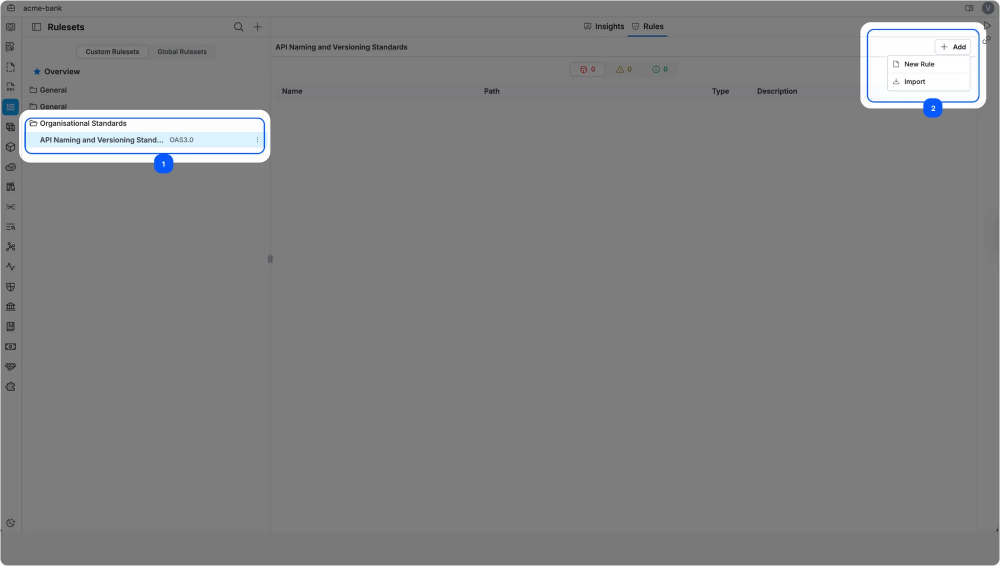
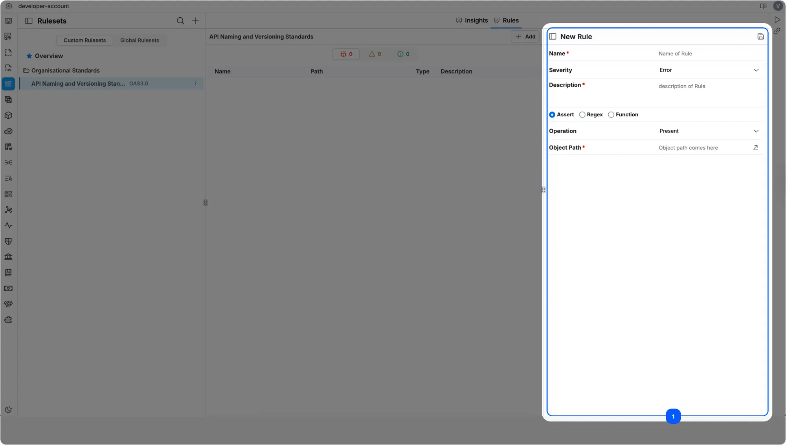
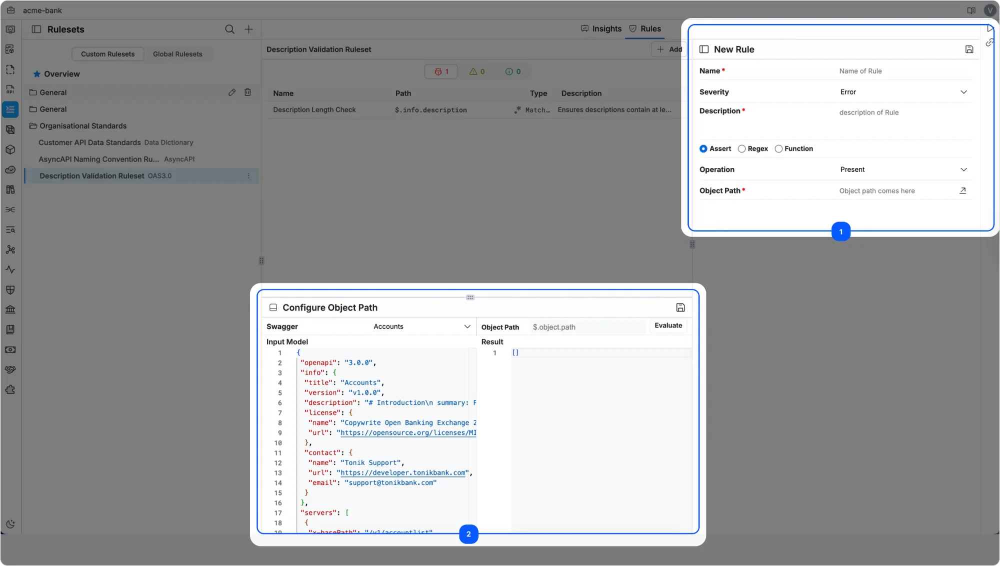
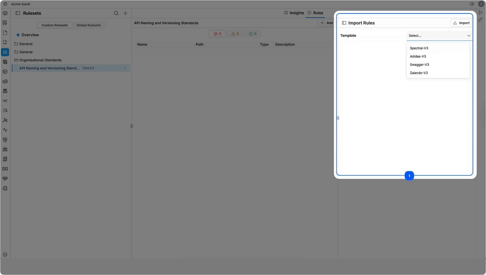

To create an OAS ruleset, follow the same steps described in *Creating a new ruleset*. When selecting the ruleset type, select **OAS 3.0**.

# Rules

The **Rules** tab displays all individual rules defined under the selected ruleset. Each rule represents a specific validation condition applied during linting to ensure API specifications comply with organizational or industry standards.

## Create a rule for an OAS ruleset

You can define custom linting rules within a ruleset to enforce specific API design standards.

**Prerequisites**

- Ensure the ruleset exists before adding rules to it.
- Ensure you have access to the **API Linting** module.

To create a rule for an OAS ruleset, follow these steps:

1. In the **API Linting** module, select the required ruleset from the left panel.
1. Select the **Rules** tab.
1. Select **\+ Add**.
  
1. A dropdown menu appears with the following options:
  - **New Rule**
  - **Import**

## **Creating a rule using New Rule**

Use **New Rule** when you want to create a new rule for the ruleset from scratch. This option allows you to define custom linting rules tailored to your organization's API design standards and governance policies.

To create a new rule, follow these steps:

1. In the left panel, select the ruleset you created to add rules.
1. Select the **Rules** tab.
1. Select **\+ Add** and select **New Rule**.
1. The **New Rule** configuration form opens on the right side of the screen.
  
1. Configure the following fields:

1. Configure the rule type fields based on your selection. See the rule types section below.
1. Select **Save** \(disk icon\).

The rule is created and added to the **Rules** panel under the selected ruleset. The rule is now available for linting and is applied according to the ruleset configuration.

### Severity levels

### Rule types

APIwiz supports three rule types:

**Assert**

Checks object path values and validates a specific condition at a defined object path.

**Regex**

Applies a regular expression pattern to a specific object path to ensure values follow a defined format.

**Function**

Validates predefined API schema or server configurations using built-in logic functions.

### Selecting a function type and function

When you select **Function** as the rule type, select a **Function Type** and then select the appropriate function. Each function type groups related validations for specific API standards.

**Description**

Validates the presence, quality, and duplication of descriptions in the API specification.

- oasDescriptions: Ensures required descriptions exist.
- oasParamDescriptions: Ensures parameters include descriptions.
- oasDescriptionDuplication: Detects duplicate descriptions.
- oasSchemaDescriptions: Ensures schema fields contain descriptions.

**Validation**

Validates general API configuration and structure.

- noEvalDescription: Ensures placeholder or evaluation descriptions are not used.
- oasAPIServers: Ensures server definitions are properly configured.

**Schema**

Validates schema definitions, references, and structural correctness.

- orphanedReferences: Detects unused schema references.
- oasOpSecurityDefined: Ensures operations include security definitions.
- duplicateEnum: Detects duplicate enum values.
- refSiblings: Validates correct usage of $ref with sibling properties.
- typedEnum: Ensures enum values match declared types.

**Example**

Validates that examples are defined and correctly structured.

- oasExample: Ensures examples are present and valid.

**Paths**

Validates API path structure and naming conventions.

- pathsKebabCase: Ensures paths follow kebab-case format.
- noVerbsInPath: Ensures HTTP verbs are not used in path names.
- ambiguousPaths: Detects ambiguous or conflicting paths.
- oasPathParam: Ensures path parameters are properly defined.

**Operation**

Validates request and response definitions for API operations.

- oasOpErrorResponse: Ensures error responses are defined.
- oasOpId: Ensures operation IDs are defined and unique.
- oasOpParams: Ensures required parameters are defined.
- oasOpSuccessResponse: Ensures successful responses are defined.

**Tags**

Validates tagging standards and consistency.

- oasOperationTags: Ensures operations include tags.
- oasOpSingleTag: Ensures each operation uses a single tag where required.
- oasTagDefined: Ensures all used tags are defined globally.

### Defining the object path

The object path, also known as a JSON path, specifies the exact element in the API specification that the rule validates. It defines where in the specification the linting rule is applied.

Use the $ symbol to initialize the path. The following are example path expressions:

- $.info.summary
- $.info.title
- $.path.\*

#### Use Path Assistance to define and verify the object path

To configure the object path using Path Assistance, follow these steps:

1. In the **New Rule** form, select **Path Assistance** \(↗ icon\) next to the **Object Path** field. The **Configure Object Path** panel opens at the bottom of the screen.
  
1. View the API specification or Swagger input in the panel.
1. Enter or refine the JSON path in the field provided.
1. Select **Evaluate** to verify that the path returns the expected result.

The object path is validated and confirmed. Using Path Assistance ensures the object path is accurate and reduces errors when defining validation rules.

#### JSON path syntax guidelines

The object path uses JSON path syntax to identify elements within the API specification. Use the following guidelines when defining an object path:

- Use $ to represent the root of the specification.
- Use . to navigate to a child element. For example, $.info refers to the info object at the root level.
- Use .\* to target all elements within a node. For example, $.paths.\* targets all paths defined in the specification.
- Use .*. to target all child elements within all parent elements. For example, $.paths.*.\* targets all HTTP operations across all paths, such as GET, POST, PUT, and DELETE.

The following table provides common object path examples:

### Creating rules by importing

You can add rules to a ruleset by importing from prebuilt templates. This option is available only for OAS 3.0 rulesets. APIwiz provides the following prebuilt templates based on common API standards and best practices:

- Swagger-V3
- Adidas-V3
- Zalando-V3
- Spectral-V3

Each template contains a curated collection of linting rules designed for specific API styles or organizational standards. After importing a template, you can customize the rules to meet your project-specific requirements.

To import linting rules from a template, follow these steps:

1. In the left panel, select the ruleset in which you want to add rules.
1. Select the **Rules** tab.
1. Select **\+ Add** and select **Import**. The **Import Rules** panel opens.
  
1. In the **Template** dropdown, select a predefined template.
1. Review the list of rules displayed, including the rule names, descriptions, and paths.
1. Clear the checkbox next to any rule that does not apply to your API.
1. Select **Import**.

The selected rules are added to the ruleset and appear in the **Rules** table. Imported rules behave the same as manually created rules.