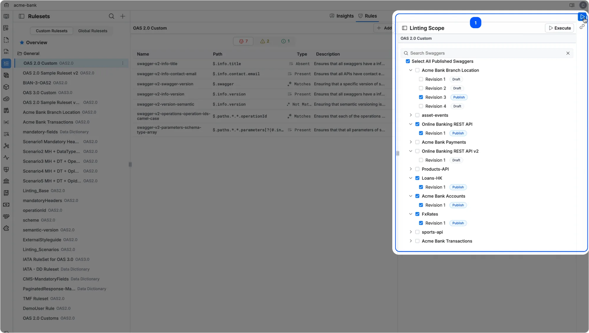

After you link an OAS to a ruleset, you can execute linting on the attached OAS. Linting evaluates the selected API specifications \(Swaggers\) against the chosen ruleset.

After you configure the linting scope, APIwiz automatically revalidates the APIs whenever changes are made to the corresponding OAS in Design Studio.

To execute linting, follow these steps:

1. On the right side of the **Rules** panel, select the **Scope** \(⊳\) button. The **Linting Scope** panel opens.
  
1. Browse the list of available Swaggers in your workspace.
1. Select a Swagger to expand it and view its revisions.
1. Select the checkboxes for the Swaggers or specific revisions you want to include in the linting scope.

1. Select **Execute** \(⊳\) in the top-right corner of the panel.

The system starts the linting process for the selected scope. A confirmation message appears at the bottom-right of the screen.