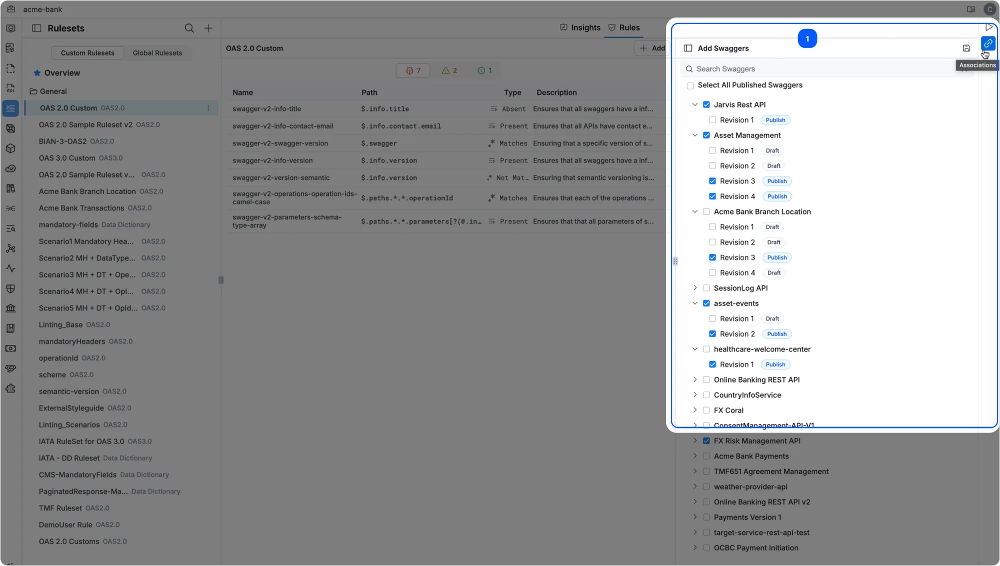

If the ruleset type is OAS 3.0, you can associate one or more OpenAPI Specifications \(OAS\) with the ruleset after creating a rule. This defines which API specifications are validated during linting.

Linking an OAS ensures that whenever the selected API specification is created or modified, the configured ruleset is automatically applied and a linting report is generated.

To link an OAS to a ruleset, follow these steps:

1. On the right-hand panel, select the **Swagger** \(Association\) icon. The **Add Swaggers** panel opens on the right side of the screen.
  
1. Browse the list of available Swaggers in your workspace.
1. Select a Swagger to expand it and view its revisions.
1. Select the checkboxes for the Swaggers or specific revisions you want to associate with the ruleset.
1. To associate all published APIs, enable **Select All Published Swaggers**.
1. Select the **Save** icon in the top-right corner of the panel.

A success message appears at the bottom-right of the screen confirming the association.

After you save the association, the following occurs:

- Whenever the selected OAS is edited in Design Studio, the system automatically generates a linting report.
- The report is generated based on the selected ruleset and the associated OAS specifications.