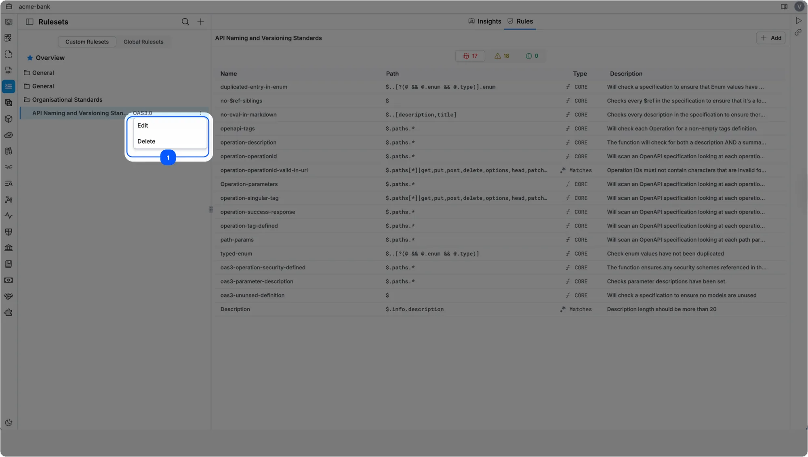
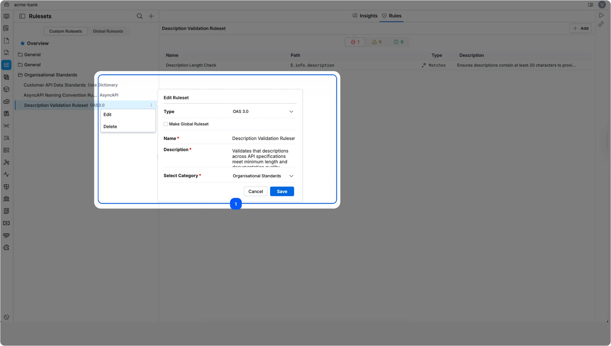

Each ruleset can be managed from the **Rulesets** panel on the left side of the screen. You can edit a ruleset's configuration or delete a ruleset that's no longer needed.

To manage a ruleset, follow these steps:

1. Go to the **Rulesets** panel on the left side of the screen.
1. In the list, locate the ruleset you want to manage.
1. Select the **More options** \(⋮\) menu next to the ruleset name.
  
1. Select an action:

## Edit a ruleset

Edit an existing ruleset to update its configuration, classification, or descriptive details.

To edit a ruleset, follow these steps:

1. In the **Rulesets** panel, locate the ruleset you want to edit.
1. Select the **More options** \(⋮\) menu next to the ruleset name.
1. Select **Edit**. The **Edit Ruleset** dialog box opens in the center of the screen.
  
1. Update any of the following fields as needed:

1. Select **Save**.

The updated ruleset appears in the **Custom Rulesets** or **Global Rulesets** tab, based on your configuration.

### Impact of changing the ruleset type

Changing a ruleset's type isn't recommended. Rules are built around the structure of a specific specification type, so changing the type can cause existing rules to no longer align with the new structure.

Rules and object paths are based on a specific specification structure. For example, OpenAPI rules reference paths such as $.paths or $.components, while AsyncAPI and Data Dictionary specifications use different structures and paths.

If you change a ruleset's type, existing rules remain in the ruleset, but:

- Some object paths might no longer be valid.
- Some rules might not run correctly, because the schema structure differs between specification types.

The change doesn't interrupt your overall workflow, but it can affect validation accuracy.

## Delete a ruleset

Use **Delete** to remove a ruleset from the workspace permanently.

To delete a ruleset, follow these steps:

1. Select the **More options** \(⋮\) menu next to the ruleset name.
1. Select **Delete**. A confirmation dialog opens.
1. Select **OK** to permanently delete the ruleset.

The ruleset is permanently removed. If the ruleset was associated with any API specifications, the system automatically removes that association. The API specifications themselves aren't affected; only the validation configuration is removed.