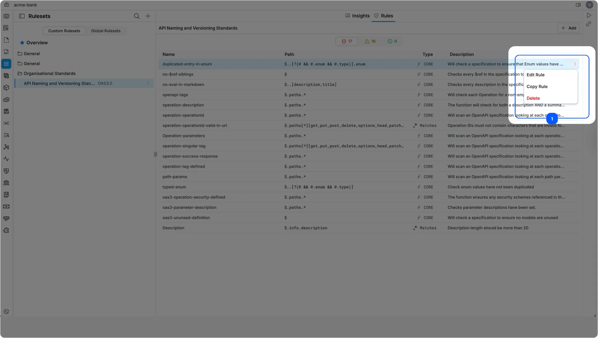
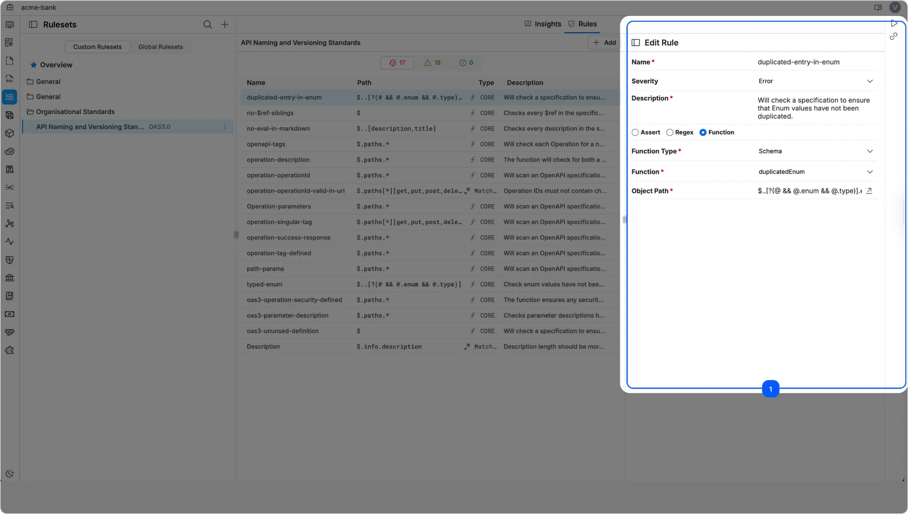
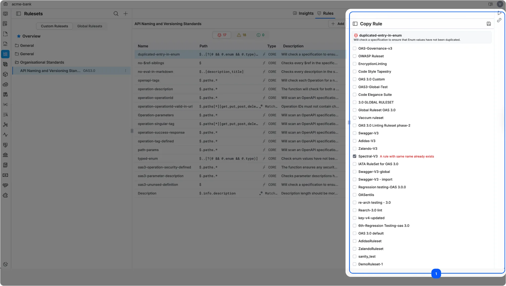
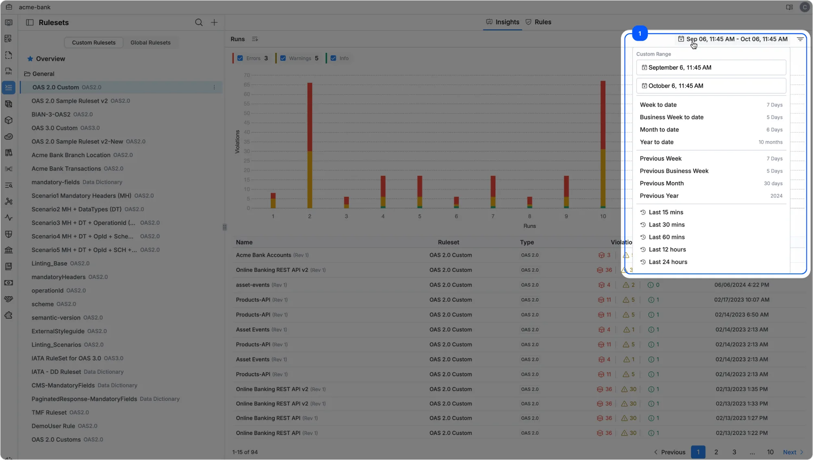

Each rule in a ruleset can be managed from the **Rules** table. You can edit a rule's configuration, copy a rule to reuse its validation logic, or delete a rule that's no longer needed.

### Access rule actions

1. Go to the **Rules** tab for the ruleset you want to manage.
1. In the table, locate the rule you want to manage.
1. Select the **More options** \(⋮\) menu next to the rule.
  
1. Select an action: **Edit Rule**, **Copy Rule**, or **Delete**.

## Edit a rule

Use **Edit Rule** to modify the configuration of an existing rule. Use this option to refine validation logic, adjust the severity level, or update the object path without creating a new rule.

To edit the details of a rule, follow these steps:

1. In the **Rules** table, locate the rule you want to modify.
1. Select the **More options** \(⋮\) menu next to the rule.
1. Select **Edit Rule**. The **Rule Details** panel opens on the right side of the screen.
  
1. Update any of the following fields as needed:

1. Select **Save**.

The system updates the rule. The new configuration applies starting with the next linting run.

## Copy a rule

Use **Copy Rule** to duplicate an existing rule and add it to one or more rulesets. This lets you reuse validation logic instead of recreating a rule from scratch. Use this option to:

- Create similar rules with minor changes.
- Reuse existing validation logic in another ruleset.
- Standardize rules across multiple API governance policies.

To copy a rule, follow these steps:

1. In the **Rules** table, locate the rule you want to duplicate.
1. Select the **More options** \(⋮\) menu next to the rule.
1. Select **Copy Rule**. The **Copy Rule** panel opens on the right side of the screen.
  
1. Select the checkbox for each ruleset you want to copy the rule to.
1. Select the **Save** icon.

The system creates a new rule with the same configuration in each selected ruleset. You can edit the copied rule to change its behavior, object path, or severity.

## Delete a rule

Use **Delete** to permanently remove a rule from a ruleset. After you delete a rule, it no longer runs during linting.

To delete a rule, follow these steps:

1. In the **Rules** table, locate the rule you want to delete.
1. Select the **More options** \(⋮\) menu next to the rule.
1. Select **Delete**. A confirmation dialog opens.
1. Select **OK** to confirm, or **Cancel** to keep the rule.

If you select **OK**, the system permanently removes the rule from the ruleset. The rule no longer runs during linting.

## Filter runs

Use the **Filter Runs** option to filter linting runs by execution status. Use this to quickly find runs that are in progress, completed, or failed.

To filter runs by status, follow these steps:

1. Next to the date filter in the **Runs** panel, select the **Filter Runs** icon.
  
1. A dropdown menu opens with the following options:

1. Select an option.

The chart and Run table refresh to display results based on the selected filter.

## Filter by errors, warnings, and info

The **Errors**, **Warnings**, and **Info** checkboxes above the graph show the number and type of issues found during a linting run, and let you refine the results by issue type. Use these filters to focus on critical issues first.

To filter results by issue type, follow these steps:

1. Select or clear the checkboxes for **Errors**, **Warnings**, and **Info**. For example, to view only errors, clear the **Warnings** and **Info** checkboxes.
  

The bar graph and issue list update to reflect the selected filters.

## Filter by date and time range

Use the date and time range filter to set the time period for linting results displayed in the **Insights** panel. Use this to analyze validation results within a specific timeframe, focus on recent activity, or support trend analysis and reporting.

To filter results by date and time range, follow these steps:

1. In the top-right corner of the **Runs** section, select the **Filters** icon. The **Custom Range** menu opens.
  
1. Select a predefined time range, or specify a custom date and time range. Predefined options include:
  - Week to date
  - Business week to date
  - Month to date
  - Year to date
  - Previous week / Previous month / Previous year
  - Last 15 minutes / 30 minutes / 60 minutes / 12 hours / 24 hours

The bar chart and Run table update to display results within the selected timeframe.