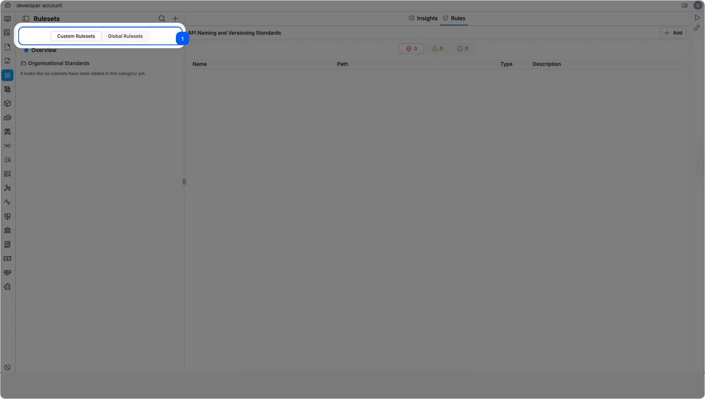

The API Linting module in APIwiz categorizes rulesets into two types: **Global Rulesets** and **Custom Rulesets**. These types determine how broadly linting rules are applied and when they run.

When the platform is provisioned, it may include standard rulesets that implement common best practices and validation checks. Organizations can also create custom rulesets to meet their specific governance and design requirements.

## Custom rulesets

A custom ruleset is a collection of rules applied only to the API specifications you explicitly link to it. Use custom rulesets to enforce rules for specific specifications, such as OAS, Data Dictionary, or AsyncAPI, without affecting all specifications in the workspace.

Organizations typically create custom rulesets to address:

- Internal design standards
- Governance and compliance policies
- Project-specific validation requirements

**Behavior of custom rulesets:**

- Applied only to the API specifications explicitly linked to the ruleset.
- Must be manually associated with specific APIs or artifacts.
- Runs automatically only when a linked specification is modified.

To view custom rulesets, select the **Custom Rulesets** tab in the left panel. Use the search bar next to **\+** to find a specific ruleset.

#### Global rulesets

A global ruleset is a collection of rules automatically applied to all API specifications of a specific type within the workspace. Administrators typically configure global rulesets to enforce organization-wide API design standards.

**Behavior of global rulesets:**

- Applied automatically to all relevant API specifications, such as all OAS APIs.
- Runs automatically when a new specification is created or an existing specification is modified.
- Ensures consistent validation without requiring manual execution.

To view global rulesets, select the **Global Rulesets** tab in the left panel. Use the search bar next to **\+** to find a specific ruleset.

To create a global ruleset, select the **Global Ruleset** checkbox when creating a ruleset. The ruleset appears under the **Global Rulesets** tab instead of the **Custom Rulesets** tab.

#### Choosing between global and custom rulesets