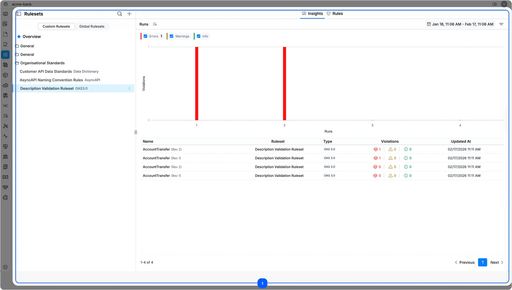
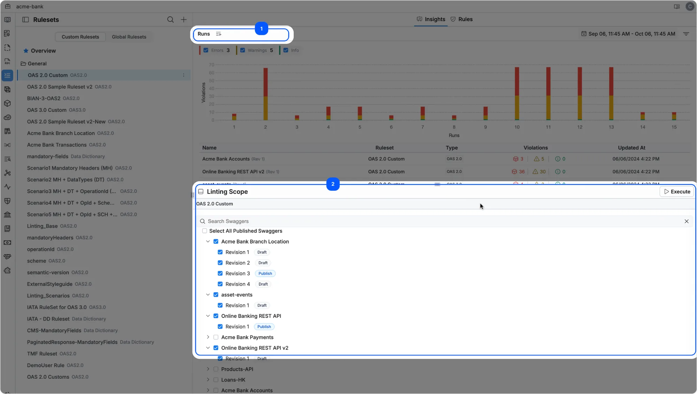

After you execute linting, switch to the **Insights** view of the ruleset to review the results.

### View linting results

To view linting results, follow these steps:

1. In the left navigation panel, select the required ruleset.
1. At the top of the screen, select the **Insights** tab.
  

The **Insights** view provides detailed visibility into linting activities performed using custom or global rulesets. Use this view to do the following:

- Analyze APIs.
- Monitor violations over time.
- Review rule-level details.

### Bar graph of runs

The **Runs** section provides a summary of each linting execution. Each bar in the chart represents a linting run and shows the number and type of violations identified.

The graph displays the following:

Violations are color-coded as follows:

This section helps you monitor the quality and consistency of API specifications across multiple runs and quickly identify trends, recurring issues, and validation results over time.

### Run table

The **Run Table** provides a consolidated view of linting runs, applied rulesets, and associated violations. The table displays the following information:

Violations are displayed using the same color-coded indicators described above: red for errors, yellow for warnings, and green for info.

This table helps you quickly review linting results and identify APIs that require attention.

### Linting scope

Next to the **Runs** label, the **Linting Scope** icon lets you execute a linting run.

To execute a linting run from the Insights view, follow these steps:

1. Select the **Linting Scope** icon. A dialog box opens, showing all published Swaggers associated with the selected ruleset.
  
1. Select a Swagger to expand it and view its available revisions.
1. Select the checkboxes for the required Swaggers or revisions.

1. In the top-right corner of the dialog box, select **Execute**.

A confirmation message appears at the bottom of the screen. After the run completes, the results appear in the **Insights** tab.