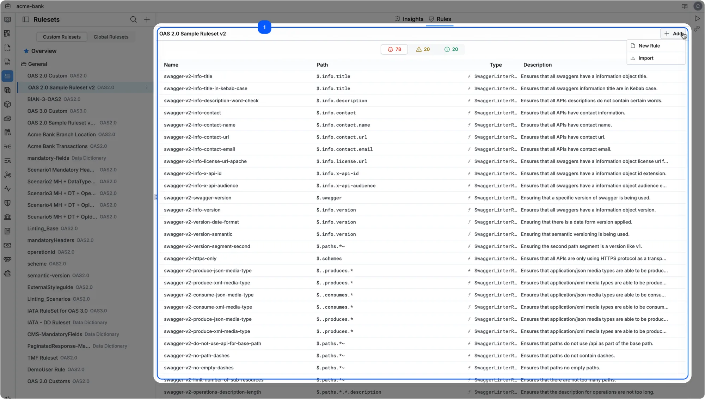
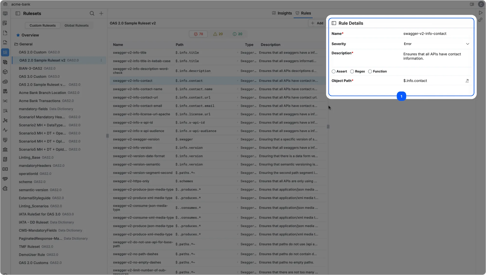

To view the rules configured for a ruleset, follow these steps:

1. In the left panel, select the ruleset you want to view.
1. Select the **Rules** tab.

The **Rules** table displays all rules associated with the selected ruleset. The name of the selected ruleset appears below the tab.

## Rules table

The **Rules** table displays the following details for each rule:

At the top of the **Rules** table, a severity summary displays the number of rules in each category:

- **Errors** \(red\): Indicates violations or failed validations.
- **Warnings** \(yellow\): Highlights potential issues that may require attention.
- **Info** \(green\): Provides informational checks or recommendations.

By default, the **Errors** view is selected. Select **Warnings** or **Info** to view rules in those severity categories.

### View rule details

To view the configuration of a specific rule, follow these steps:

1. In the **Rules** table, select the rule you want to view. The **Rule Details** panel opens on the right side of the screen.
  
1. Review the rule configuration, including its settings and applied paths.

The **Rule Details** panel displays the full configuration of the selected rule, allowing you to review or modify its settings, subject to your permissions.