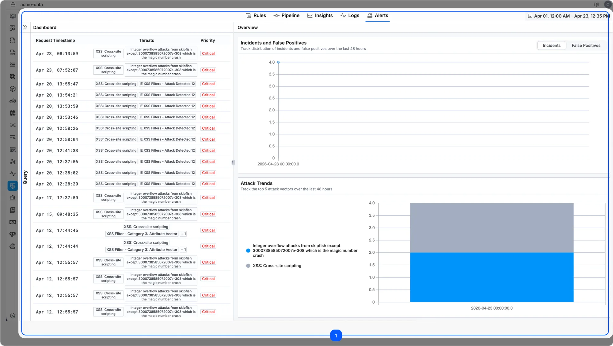
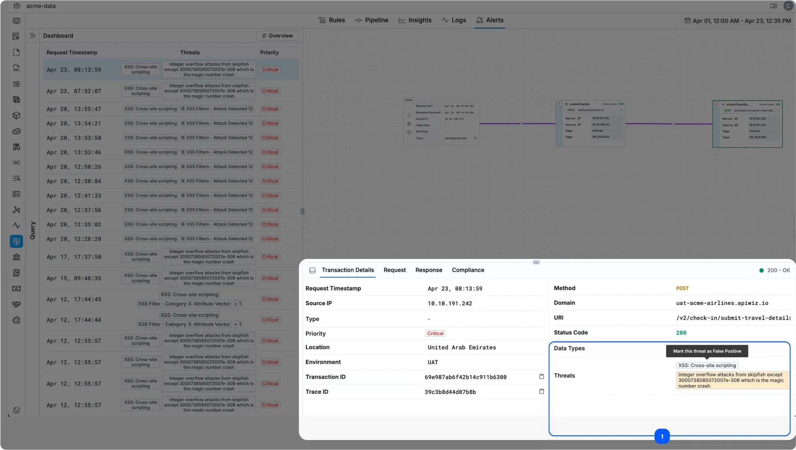

The **Alerts** tab allows you to monitor detected security events, review incident severity, analyze trends, and investigate suspicious transactions. It combines real-time alert data with visual analytics and detailed transaction traces to help security teams respond quickly and maintain visibility across API traffic.

**Prerequisites**

### Alerts layout

The **Alerts** tab contains three main sections.

#### Query table

The **Query table** lists detected alerts in chronological order. Use this table to review recent incidents and prioritize investigation.

**Priority levels**

#### Overview dashboard

The **Overview** section provides visual summaries of recent alert activity.

**Incidents and false positives**

This chart compares confirmed incidents with alerts marked as false positives. Use the toggle to switch between **Incidents** and **False Positives** views. Use this chart to assess alert quality and identify rule tuning opportunities.

**Attack trends**

This chart highlights the most common attack types detected during the selected time range.

Examples include:

- Cross-site scripting \(XSS\)
- Integer overflow
- SQL injection
- Protocol violations

Use this chart to identify recurring threats and adjust security protections accordingly.

### Investigate an alert

To investigate an alert, select any row in the **Query table**.

The alert details panel displays the following:

- Trace visualization
- Transaction details
- Request data
- Response data
- Compliance results

#### Trace visualization

The trace view shows how the request moved through connected services. Use this view to identify where an issue occurred in the request lifecycle.

The trace can include:

- Client source
- Internal services
- Request path
- Response status codes
- Processing sequence

#### Transaction Details tab

The **Transaction Details** tab provides a summary of the selected alert.

#### Request tab

Use the **Request** tab to inspect incoming request data and validate suspicious inputs.

This tab can include:

- Headers
- Query parameters
- Payload
- Method
- Path

#### Response tab

Use the **Response** tab to review how the system handled the request. Use this tab to confirm whether the request was blocked, allowed, or modified.

This tab can include:

- Status code
- Response headers
- Response payload

#### Compliance tab

Use the **Compliance** tab to verify whether the transaction met configured policies. Use this tab to identify governance gaps and policy violations.

This view can help identify:

- Missing required headers
- Policy violations
- Data handling issues
- Regulatory validation failures

### Mark a false positive

If an alert was triggered incorrectly, mark it as a false positive to reduce alert noise and improve rule accuracy.

To mark a false positive, do the following:

1. Select the alert from the **Query table**.
1. In the **Threats** section, select the threat label.
1. Select **Mark this threat as False Positive**.
  

The event is reflected in the **False Positives** chart in the **Overview** dashboard.

### Best practices