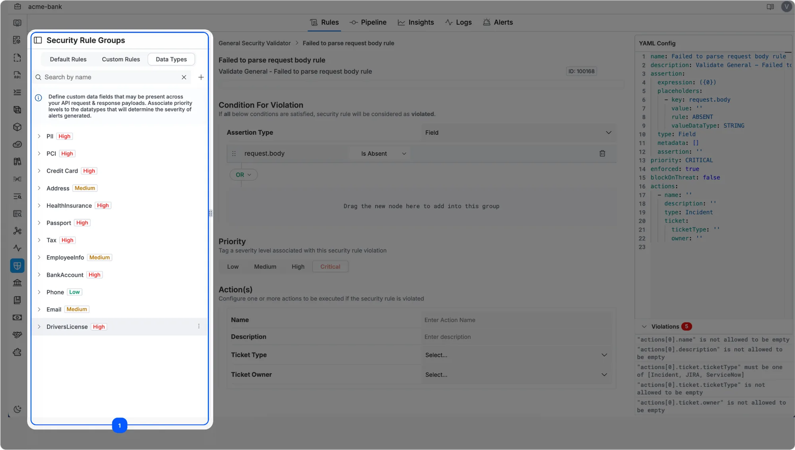
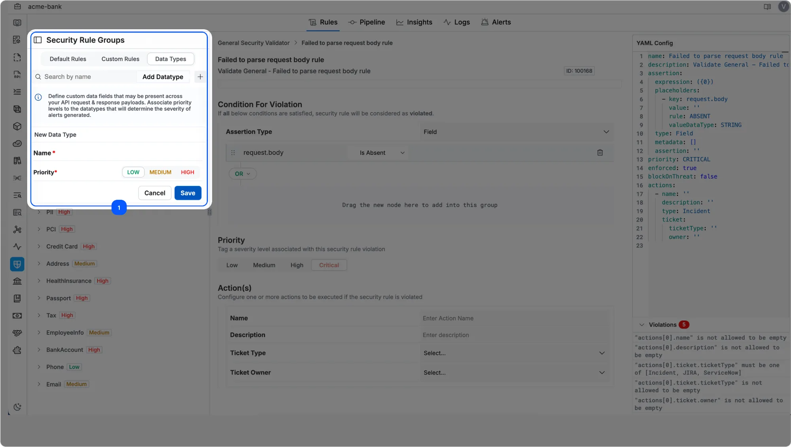
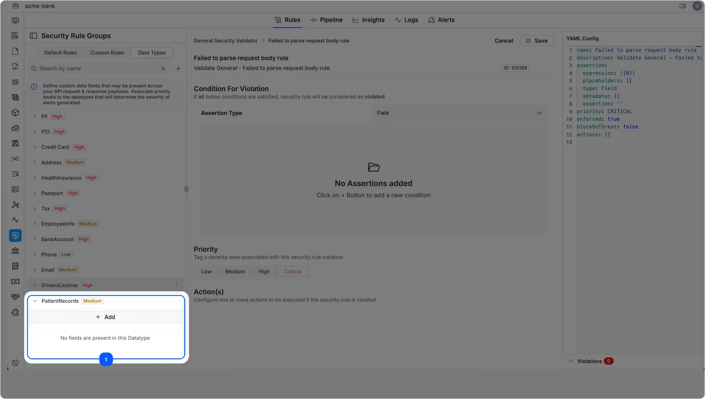

The **Data Types** tab allows you to define and manage sensitive data types that the platform detects within API traffic. Use data types to identify, classify, and label sensitive information found in request and response payloads. This helps you monitor regulated, personal, or confidential data across API transactions.

### How it works

The platform includes approximately 2,000 predefined fields grouped into data type categories. As traffic passes through the system, the platform scans request headers, response headers, and payloads for these fields.

**Examples of predefined fields:**

- First Name
- Last Name
- Email Address
- Passport Number
- Credit Card Number
- Phone Number

When a match is found, the platform automatically applies a data type label to the traffic.

**Examples of data type labels:**

- PII – Personally Identifiable Information
- PCI – Payment Card Information
- Passport
- DriverLicense
- EmployeeInfo

### Benefits of traffic labeling

Data type labels help security teams to:

- Detect exposure of sensitive data
- Search logs quickly
- Apply monitoring policies
- Prioritize investigations
- Support compliance auditing

### Manage custom data types

You can create, edit, or delete custom data types based on your organization's requirements.

### Create a data type

To create a new custom data type, do the following:

1. In **Security Rule Groups**, select the **Data Types** tab.
  
1. Select **\+ Add Datatype**. The **New Data Type** window opens.
  
1. Enter the following details:

1. Select **Save**.

The data type is created and becomes available for traffic labeling, monitoring, and alert prioritization.

### Add fields to a data type

After creating a data type, add the fields that the platform scans for in API traffic.

To add a field to a data type, do the following:

1. In **Security Rule Groups**, select the **Data Types** tab.
1. Select the data type from the list.
1. Select **\+ Add**.
  
1. Enter the field name to detect in traffic.
1. Select **Save**.

The field is added to the selected data type and becomes available for traffic labeling.

### Example

A healthcare organization creates a custom data type named **PatientRecords** with the following fields:

- patientId
- diagnosisCode
- insuranceNumber

When these fields appear in API traffic, the platform automatically tags the related log entries as **PatientRecords** for security review.

The platform continuously scans traffic, detects sensitive fields, and applies data type labels to improve visibility, monitoring, and compliance tracking.