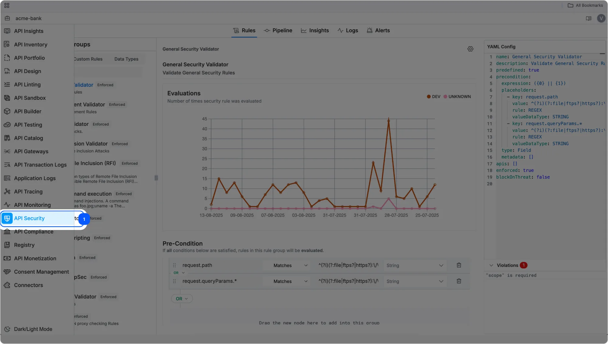

Use this procedure to access the API Security module in the APIwiz platform. The API Security module gives you visibility into security threats, policy violations, and sensitive data exposure across your API traffic.

### Prerequisites

Ensure that [API traffic observability](https://drive.google.com/drive/folders/1qPbC1wMFYiqby1uHnVLju48emcgHqwsj?usp=sharing) is enabled for the target APIs or microservices.

### Access the API Security module

To open the API Security module, follow these steps:

1. Sign in to the APIwiz platform with your credentials.
1. On the left side of the screen, point to the vertical navigation bar to view the names of the available modules.
1. Select the **API Security**.
  

The API Security module opens.