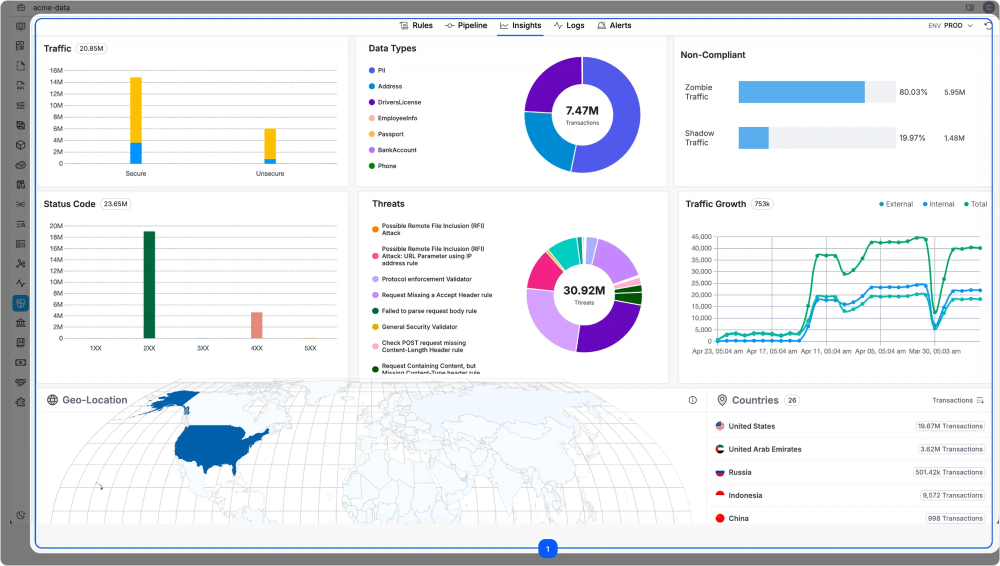

The **Insights** tab is an analytics dashboard that provides a real-time summary of your API ecosystem. It combines traffic metrics, security posture, compliance indicators, geographic activity, and threat trends into a single visual workspace.

Use the **Insights** tab to quickly identify trends, detect anomalies, and respond proactively to operational or security issues.

### What you can monitor

- API traffic patterns
- Security performance
- Compliance status
- Threat activity
- Operational health
- Geographic traffic distribution

### Traffic

The **Traffic** panel displays the distribution of API traffic across secure and unsecure connections for the selected time period.

>

### Data types

The **Data Types** panel displays the sensitive data types detected across API transactions.

Use this panel to identify what types of sensitive data are most commonly processed. Review APIs that handle sensitive data and verify that encryption, masking, and access controls are in place.

### Non-compliant traffic

The **Non-Compliant** panel shows traffic that does not comply with governance or security standards.

Use this panel to identify gaps in API lifecycle governance.

**Recommended actions:**

- Remove deprecated APIs from active environments.
- Discover and register shadow APIs.
- Apply monitoring and security controls to unmanaged endpoints.

### Status codes

The **Status Code** panel displays API responses grouped by HTTP status ranges.

>

### Threats

The **Threats** panel summarizes detected threats by category.

Use this panel to identify recurring attack patterns targeting your APIs. Strengthen security policies, validate inputs, and investigate repeated threat categories.

### Traffic growth

The **Traffic Growth** panel tracks API traffic trends over time.

Use this panel to identify spikes, drops, or long-term growth trends. Investigate unexpected changes and correlate them with deployments, incidents, or campaigns.

### Geo-location

The **Geo-Location** panel displays the geographic origin of API traffic.

**Common use cases:**

- Detect suspicious traffic from unexpected regions.
- Optimize CDN or gateway routing based on traffic origin.
- Support regional compliance monitoring.

### Benefits