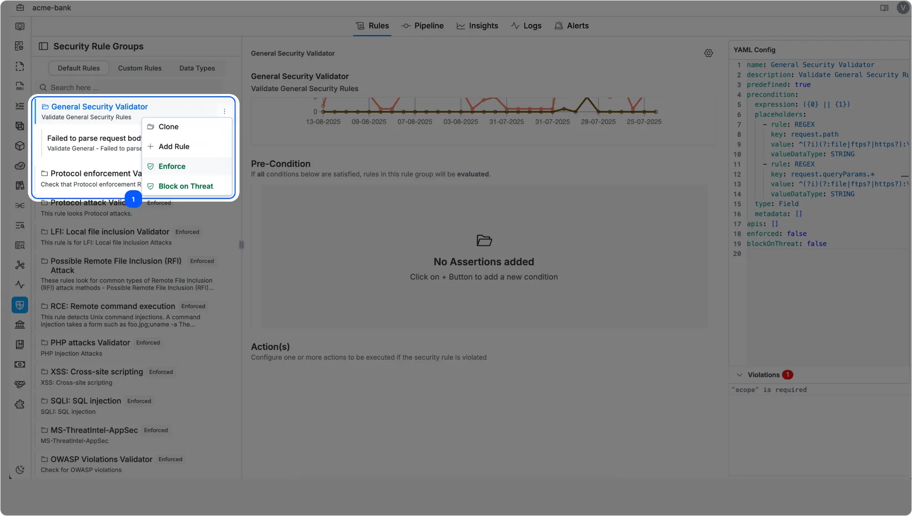

Use the **More Options** \(⋮\) menu in the **Security Rule Groups** panel to manage rule groups. The menu provides options to clone, enforce, block, disarm, or edit a rule group.

### Rule group states

### Clone a rule group

Cloning creates a duplicate copy of an existing rule group. Use this to test or modify configurations without affecting the original rule group.

To clone a rule group, do the following:

1. In **Security Rule Groups**, locate the required rule group.
1. Select the **More Options** \(⋮\) menu.
1. Select **Clone**.

A duplicate copy of the selected rule group is created and added to the list.

### Change the state of a rule group

To change the state of a rule group, do the following:

1. In **Security Rule Groups**, locate the required rule group.
1. Select the **More Options** \(⋮\) menu.
1. Select one of the following:

The selected state is applied to the rule group or the individual rule, depending on your selection.

### Edit a rule group

Use this procedure to modify the configuration of an existing rule group.

To edit a rule group, do the following:

1. In **Security Rule Groups**, locate the required rule group.
1. Select the **More Options** \(⋮\) menu.
1. Select **Disarm**.
1. Make the required changes.
1. Select **Save**.
1. Select the **More Options** \(⋮\) menu again.
1. Select **Enforce** or **Block on Threat** to re-enable the rule group.

The rule group is updated and re-enabled with the selected state.

### Example

An administrator wants to test a default SQL Injection rule group before enabling active blocking:

1. Clone the default rule group.
1. Modify thresholds or conditions in the cloned version.
1. Set the cloned rule group to **Enforce** to monitor traffic passively.
1. After validation, switch to **Block on Threat** to actively block attacks.