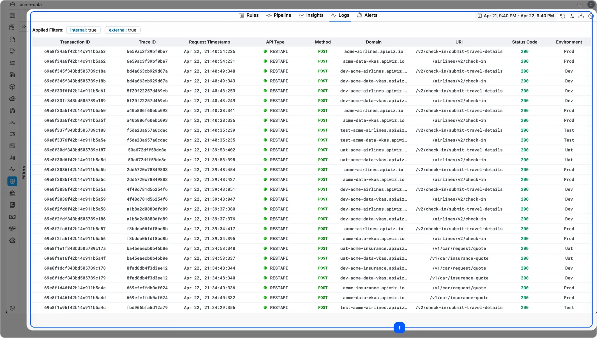
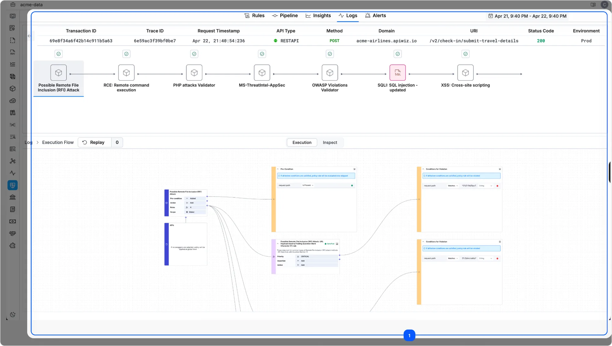

After enforcing a rule group in passive or active mode, select the **Logs** tab to inspect API traffic and security events. The **Logs** tab provides a real-time view of API transactions and serves as the central monitoring console for reviewing evaluated traffic, inspecting request activity, and analyzing security events.

### What you can do

Use the **Logs** tab to:

- Track API usage and traffic trends
- Identify failed or suspicious requests
- Investigate rule violations or threats
- Troubleshoot routing or performance issues
- Validate policy enforcement across environments

### View transaction logs

Each row in the **Logs** table represents a single API transaction. Once observability is configured, the dashboard displays processed traffic records.

Log entries may include:

- Request and response details
- PII or sensitive data detections
- Injection attack attempts
- Threat classifications
- Policy violations
- Environment and endpoint activity

#### Available data fields

### Inspect a log entry

Select any log record from the **Logs** tab to open the **Log Details** view. Use this view to trace request execution, inspect triggered rules, analyze payloads, and understand how the platform processed the selected transaction.

#### Log Details layout

The **Log Details** view contains two main sections:

#### Transaction summary

The top section displays key metadata to help you understand the request context before reviewing detailed logs.

#### Rule evaluation indicators

Below the transaction summary, the platform displays the evaluated rule groups in sequence. Each rule group shows its evaluation result:

Use these indicators to quickly identify where the request failed or triggered security logic.

#### Replay a transaction

Use **Replay** to simulate the selected transaction again using the same request conditions.

Use Replay to:

- Validate updated rule behavior
- Confirm policy changes
- Test false positive corrections
- Reproduce issues safely

### Execution Flow tab

Use the **Execution Flow** tab to review how the request moved through validations and rule checks. This view helps explain why the request passed, failed, or triggered alerts.

### Inspect tab

Use the **Inspect** tab for detailed request and response analysis.

This tab contains three sub-tabs.

#### Request

The **Request** tab displays the following details:

Additional tabs within the Request view include:

- **Headers**
- **Query Params**
- **Form Param**

The **Payload** panel displays the raw request body. If encryption is enabled, select **Decrypt** to view readable content based on your permissions.

#### Response

Use the **Response** tab to review the API response returned by the server. This tab includes:

- Response headers
- Response payload
- HTTP status indicator

Use this information to confirm expected system behavior or troubleshoot failures.

#### Compliance

Use the **Compliance** tab to verify whether the transaction met internal and regulatory policy requirements.

The platform evaluates the following components:

Use this view to identify governance gaps and policy violations.

### Benefits